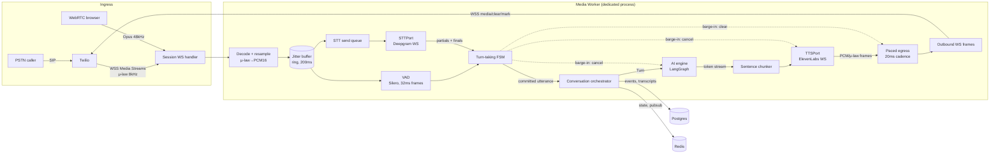
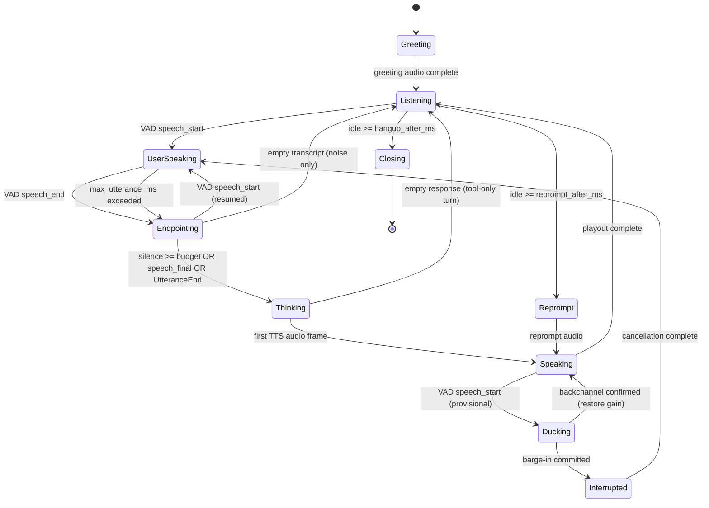
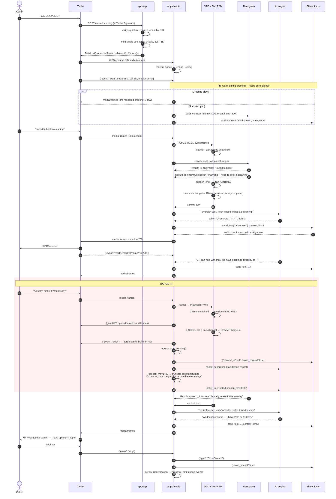
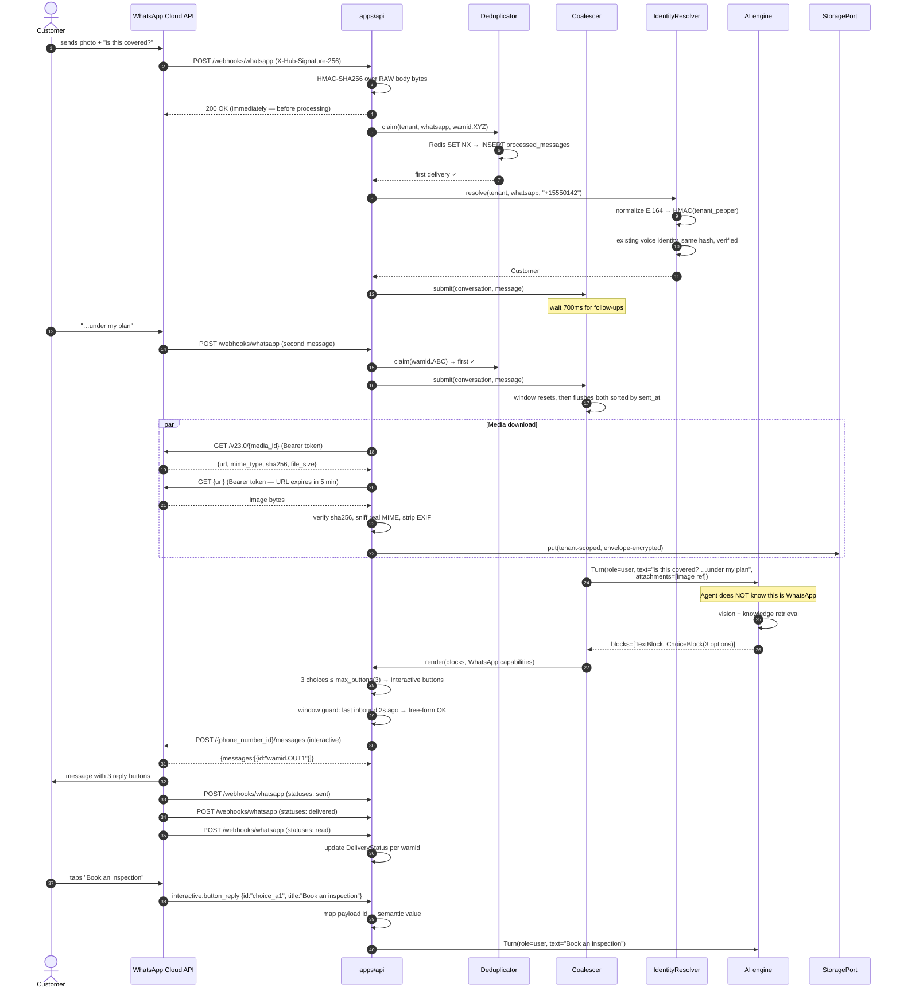
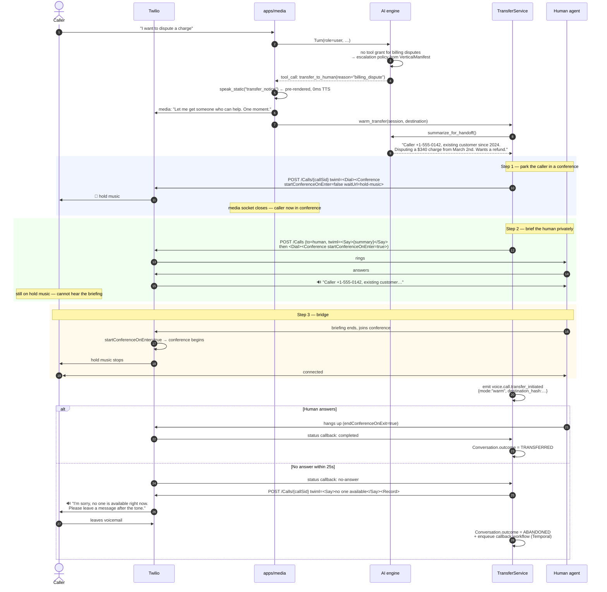

# 04 — Voice & Channels

> **Conformance:** This document implements `00-CORE-CONTRACT.md` §5 (ports),
> §7 (channel-agnostic Conversation model), §8 (security), §9 (repo layout).
> Where this document and the Core Contract disagree, the Core Contract wins.
>
> **Scope:** everything between a human and the AI engine. Audio in, audio out,
> messages in, messages out. This document owns `packages/voice/`,
> `packages/channels/`, and the STT/TTS/realtime adapters in `packages/providers/`.
> It does **not** own agent reasoning, prompt assembly, or the booking engine.
>
> **Status:** Phase 1 design. Provider wire details verified against vendor docs;
> items that vendor docs do not explicitly guarantee are flagged `[UNVERIFIED]`
> inline and must be re-checked before the code depending on them ships.

---

## Table of Contents

**Part A — Voice pipeline**
1. [Architecture & task topology](#1-architecture--task-topology)
2. [Two modes, one interface](#2-two-modes-one-interface)
   - [2.4 Where the agent graph runs in Mode B](#24-where-the-agent-graph-runs-in-mode-b) — answers `03-AI-ENGINE.md` §14 Q3
3. [Turn-taking](#3-turn-taking)
4. [Provider adapters](#4-provider-adapters)
5. [Telephony (Twilio Media Streams)](#5-telephony--twilio-media-streams)
6. [Failure modes](#6-failure-modes)
7. [Latency budget](#7-latency-budget)

**Part B — Chat channels**
8. [The ChannelPort interface](#8-the-channelport-interface)
9. [Reference adapters: web chat & WhatsApp](#9-reference-adapters)
10. [Coverage design for remaining channels](#10-coverage-design-for-remaining-channels)
11. [Cross-channel identity resolution](#11-cross-channel-identity-resolution)
12. [Session lifecycle, idempotency, ordering, rate limits](#12-session-lifecycle-idempotency-ordering-rate-limits)
13. [Sequence diagrams](#13-sequence-diagrams)

---

# PART A — VOICE PIPELINE

## 1. Architecture & task topology

### 1.1 The problem this shape solves

A phone call is a **soft-realtime, bidirectional, unbounded stream with a hard
latency budget and no ability to buffer**. That single sentence dictates most of
the design:

- **No buffering** — if we fall 400ms behind on outbound audio, the caller hears
  a gap. There is no "loading" affordance on a phone call. Every stage must be
  streaming; any stage that waits for a complete input before producing output
  spends its entire processing time inside the latency budget.
- **Unbounded** — calls last 30 seconds or 30 minutes. Anything that accumulates
  per-call (transcript buffers, audio history, task handles) needs an explicit
  bound or the process dies on long calls.
- **Bidirectional and concurrent** — the caller can speak while we speak. This
  is not an edge case; it is the normal case (see §3, barge-in). Inbound and
  outbound audio paths must be independent tasks, never a request/response loop.
- **Soft-realtime** — a missed deadline degrades quality, it does not corrupt
  state. This is why we can use Python/asyncio at all. It is also why we must
  measure jitter, not just mean latency (§7).

### 1.2 Full realtime path



Stage by stage, with the *why*:

| # | Stage | Input → Output | Why it exists |
|---|---|---|---|
| 1 | **Ingress** | SIP/WebRTC → WS frames | Terminates the carrier protocol. Twilio owns PSTN complexity (SIP, DTMF relay, codec negotiation) so we do not. |
| 2 | **Decode + resample** | μ-law 8k → PCM16 8k → PCM16 16k | VAD models want linear PCM at a fixed rate. μ-law is logarithmic; feeding it to a VAD produces garbage energy estimates. |
| 3 | **Jitter buffer** | bursty frames → even 20ms cadence | Networks deliver 5 frames at once then nothing for 100ms. VAD timing assumptions break without smoothing. See §6.2. |
| 4 | **VAD** | PCM frames → speech/silence probability | Local, sub-ms, free. Drives barge-in *immediately* rather than waiting for STT round-trip. This is the single biggest perceived-latency win. |
| 5 | **STT** | PCM frames → partial + final transcripts | Streaming, so text exists before the caller stops talking. |
| 6 | **Turn-taking FSM** | VAD + STT events → turn boundaries | The judgment layer: when has the caller *finished*, vs merely paused. §3. |
| 7 | **AI engine** | `Turn` → token stream | Channel-agnostic per Core Contract §7. Receives text, emits text. Knows nothing about audio. |
| 8 | **Sentence chunker** | tokens → speakable spans | TTS quality collapses on sub-sentence fragments (wrong prosody, clipped words). Chunk on clause boundaries, not token counts. |
| 9 | **TTS** | text spans → audio frames | Streaming, first-byte-optimized. |
| 10 | **Paced egress** | audio frames → 20ms wire frames | Never dump a 10-second buffer at Twilio. If we do, barge-in cannot cancel what is already committed downstream. |

### 1.3 Where each stage runs, and why

**Two process classes.** This is a load-bearing decision.

| Stage | Process | Justification |
|---|---|---|
| Twilio webhook (`POST /voice/incoming`) | **API** (`apps/api`) | Sub-100ms TwiML response, stateless, horizontally trivial. Must not share a process with media loops that could delay it. |
| Media WebSocket + entire audio pipeline | **Media worker** (`apps/media`) | See below. |
| Booking/durable side-effects | **Temporal worker** (`apps/worker`) | Core Contract §3. Media worker never blocks on durable execution; it fires an intent and continues. |

**Why a dedicated media worker rather than running audio in `apps/api`:**

1. **Head-of-line blocking.** A media session runs a tight loop with 20ms
   deadlines. Sharing an event loop with ordinary HTTP handlers means a single
   slow JSON serialization or a synchronous DB driver call injects jitter into
   every concurrent call. Isolation converts a shared-fate risk into a
   capacity-planning problem.
2. **Different scaling signal.** API scales on RPS; media scales on *concurrent
   calls*, which is a fundamentally different and much lower number per pod.
   Mixing them means over-provisioning one to satisfy the other.
3. **Different failure and deploy semantics.** Rolling a media pod kills live
   calls. Media pods need long termination grace (drain to zero calls, up to
   `terminationGracePeriodSeconds: 3600`) and `maxUnavailable: 0`. Applying
   those to the API tier would make deploys glacial.
4. **Different resource profile.** Media is CPU-bound in bursts (resampling,
   VAD inference) with high FD counts (3+ sockets per call) and near-zero
   request concurrency. It wants different CPU limits and different GOMAXPROCS-
   equivalent tuning.
5. **Blast radius.** An OOM in media kills calls in progress; an OOM in API kills
   a request that a client will retry. These should not be the same OOM.

The API process and the media worker are connected by **Redis**: the webhook
writes a short-lived session descriptor (tenant, call metadata, resolved config)
keyed by a nonce, and hands Twilio a `wss://` URL containing that nonce. The
media worker redeems the nonce on connect. This keeps tenant resolution and
secret loading in the API tier where the auth context already exists, and keeps
the media worker from needing a tenant-lookup round trip on the hot path.

> **Contract note.** Core Contract §9 lists `apps/api`, `apps/worker`, `apps/web`.
> `apps/media` is a **new sibling app**, not a new package. It depends on
> `packages/voice/` and `packages/providers/` and obeys the same dependency rule:
> it imports `core`, never the reverse. This is an addition to the app tier, not
> a change to any frozen rule; if the frozen layout is read strictly as an
> exhaustive list, run `apps/media` as a separate *deployment* of `apps/worker`
> with a `--media` entrypoint. The process-isolation argument above is what
> matters; the directory name is not.

#### Scaling metric (contract with `05-PLATFORM-SECURITY-OPS.md`)

`05` scales the voice tier on `receptionai_voice_active_sessions` rather than
CPU, which is correct — CPU on a media pod is bursty and idles between
utterances, so a CPU-based HPA both over-provisions during speech and scales in
while calls are live. **Confirmed: `apps/media` exports that metric**, and it is
declared here so two documents do not depend on an unowned name.

```python
# apps/media/metrics.py
from prometheus_client import Gauge, Histogram

VOICE_ACTIVE_SESSIONS = Gauge(
    "receptionai_voice_active_sessions",
    "Live media sessions on this pod. The HPA scaling signal for the voice tier.",
    labelnames=("tenant_id", "mode"),      # mode: composed | realtime
    multiprocess_mode="livesum",
)

VOICE_SESSION_CAPACITY = Gauge(
    "receptionai_voice_session_capacity",
    "Max concurrent sessions this pod accepts. Lets the HPA compute utilization "
    "as a ratio rather than hardcoding pod capacity in the autoscaler.",
)

VOICE_SESSION_DURATION = Histogram(
    "receptionai_voice_session_duration_seconds",
    "Call duration. Drives drain-time estimates for maxUnavailable:0 rollouts.",
    buckets=(5, 15, 30, 60, 120, 300, 600, 1800),
)
```

The gauge is incremented/decremented by `CallSession`'s context manager, so it
cannot drift on an exception path:

```python
class CallSession:
    async def __aenter__(self) -> "CallSession":
        VOICE_ACTIVE_SESSIONS.labels(self.tenant_id, self.mode).inc()
        self._started = time.monotonic()
        return self

    async def __aexit__(self, *exc: object) -> None:
        VOICE_ACTIVE_SESSIONS.labels(self.tenant_id, self.mode).dec()
        VOICE_SESSION_DURATION.observe(time.monotonic() - self._started)
```

Two properties `05` can rely on: the gauge is **tenant-labelled** (so per-tenant
concurrency caps in §12.4 are enforceable from the same signal), and
`VOICE_SESSION_CAPACITY` is exported alongside it so the autoscaler expresses a
target as *utilization* rather than an absolute session count that would go stale
whenever pod resources change. Because pods are `multiprocess_mode="livesum"`,
the value survives a worker restart within the pod without double-counting.

### 1.4 Async task topology

Per call, exactly **six** long-lived tasks in a single `TaskGroup`, plus
short-lived response tasks. Naming them is not cosmetic — task names show up in
tracebacks and in `asyncio` debug dumps, and a call that leaks tasks is a call
that leaks sockets.

```
CallSession (async context manager, one per call)
│
├── T1  ingress_reader     WS.recv() → decode → jitter buffer → fan-out
├── T2  vad_loop           ring → VAD → TurnFSM events
├── T3  stt_reader         STTPort.results() → TurnFSM events
├── T4  stt_writer         ring → STTPort.send_audio()   (separate: isolates
│                          provider backpressure from VAD timing)
├── T5  egress_pacer       playout queue → 20ms frames → WS.send()
└── T6  supervisor         health, keepalives, idle timers, metrics
     │
     └── (transient) response_task  — spawned per assistant turn,
                                      cancelled wholesale on barge-in
```

**Why `stt_writer` is separate from `ingress_reader`:** if the STT provider's
socket applies backpressure (its send buffer is full), a combined task would
stall the read of inbound audio, which stalls VAD, which breaks barge-in
detection at exactly the moment the caller is talking over us. Splitting them
means STT backpressure degrades transcription only, and VAD keeps working. The
STT queue is bounded and **drops oldest on overflow** (§1.5).

**Why the response task is transient:** barge-in must kill LLM generation and
TTS synthesis together, atomically, without racing. One task owning both means
one `.cancel()` and one `await` on it. Structured concurrency is the mechanism:

```python
# packages/voice/session/response.py
class ResponseTask:
    """One assistant turn: LLM generation → chunking → TTS → playout.

    Owns every resource for that turn so barge-in is a single cancel().
    """

    def __init__(self, session: "CallSession") -> None:
        self._session = session
        self._task: asyncio.Task[None] | None = None
        self._generation_id: str | None = None

    async def start(self, turn: Turn, generation_id: str) -> None:
        await self.cancel()  # never two responses at once
        self._generation_id = generation_id
        self._task = asyncio.create_task(
            self._run(turn, generation_id),
            name=f"response:{self._session.call_id}:{generation_id}",
        )

    async def cancel(self) -> None:
        task, self._task = self._task, None
        if task is None or task.done():
            return
        task.cancel()
        # Await it. A cancelled-but-unawaited TTS task can still have a
        # half-open provider socket and can still push frames into playout.
        with contextlib.suppress(asyncio.CancelledError):
            await task

    async def _run(self, turn: Turn, generation_id: str) -> None:
        async with asyncio.TaskGroup() as tg:
            token_q: asyncio.Queue[str | None] = asyncio.Queue(maxsize=64)
            tg.create_task(self._generate(turn, token_q), name="llm")
            tg.create_task(self._synthesize(token_q, generation_id), name="tts")
```

`asyncio.TaskGroup` (3.11+, and we are on 3.12 per Core Contract §1) guarantees
that cancelling `_run` cancels both children and waits for them. The alternative
— bare `create_task` plus manual bookkeeping — is where barge-in bugs live:
audio from a "cancelled" turn arriving 300ms later and playing over the next one.

### 1.5 Backpressure

Every queue in the pipeline is bounded and has an explicit overflow policy.
Unbounded queues in a realtime pipeline do not prevent failure; they convert a
fast, visible failure into unbounded latency growth and eventual OOM.

| Queue | Bound | Overflow policy | Why |
|---|---|---|---|
| Inbound jitter ring | 200 ms (10 frames @20ms) | **Overwrite oldest** | Stale audio is worthless. Playing catch-up on old frames adds latency permanently. |
| STT send queue | 40 frames (800 ms) | **Drop oldest**, count metric | Losing 20ms of audio degrades one word. Blocking degrades the whole call. |
| LLM token queue | 64 tokens | **Block producer** | The LLM is the cheapest thing to slow down; it has no realtime deadline of its own. |
| TTS→playout queue | 3 s of audio | **Block producer** | Bounds how much synthesized audio is un-cancellable. Directly caps barge-in latency. |
| Egress wire queue | 4 frames (80 ms) | **Block producer** | Frames past this point are committed to the carrier. Keep it tiny. |

**The TTS→playout bound is the important one.** It is the knob that trades
robustness against barge-in responsiveness. Buffer 3 seconds and a network
hiccup never causes a gap — but when the caller interrupts, up to 3 seconds of
audio is already downstream, and we must issue a Twilio `clear` to purge it
(§5.5). Buffer 200ms and barge-in is instant, but any jitter is audible. **3
seconds locally + `clear` on barge-in** gets both, because `clear` makes the
buffer retroactively cancellable. Without a carrier-side purge primitive this
number would have to drop to ~300ms.

```python
# packages/voice/audio/ring.py
class JitterRing:
    """Fixed-capacity ring for inbound PCM frames.

    Overwrites the oldest frame when full: in realtime audio, the newest frame
    is always more valuable than the oldest. Never blocks the network reader.
    """

    __slots__ = ("_buf", "_cap", "_head", "_len", "_wakeup", "_dropped")

    def __init__(self, capacity_frames: int = 10) -> None:
        self._buf: list[bytes | None] = [None] * capacity_frames
        self._cap = capacity_frames
        self._head = 0
        self._len = 0
        self._wakeup = asyncio.Event()
        self._dropped = 0

    def push(self, frame: bytes) -> None:
        idx = (self._head + self._len) % self._cap
        if self._len == self._cap:
            self._head = (self._head + 1) % self._cap
            self._dropped += 1
        else:
            self._len += 1
        self._buf[idx] = frame
        self._wakeup.set()

    async def pop(self) -> bytes:
        while self._len == 0:
            self._wakeup.clear()
            await self._wakeup.wait()
        frame = self._buf[self._head]
        self._buf[self._head] = None
        self._head = (self._head + 1) % self._cap
        self._len -= 1
        assert frame is not None
        return frame

    @property
    def dropped_frames(self) -> int:
        return self._dropped
```

### 1.6 Audio parameters (concrete)

These are the values the rest of the document assumes.

| Parameter | Telephony (Twilio) | WebRTC | Rationale |
|---|---|---|---|
| Wire codec | μ-law (G.711u) | Opus | Fixed by carrier / browser. |
| Wire sample rate | 8000 Hz | 48000 Hz | Fixed. |
| Frame duration | 20 ms | 20 ms | Twilio's cadence; Opus default. 20ms = 160 μ-law bytes @8k. |
| Internal PCM | s16le mono | s16le mono | One internal format everywhere. |
| VAD input rate | 16000 Hz | 16000 Hz | Silero VAD is trained at 8k/16k; 16k is more accurate. Upsample 8k→16k. |
| VAD frame | 32 ms (512 samples @16k) | 32 ms | Silero's native window. Non-native sizes force internal buffering and add jitter. |
| STT input | μ-law 8000 passthrough | PCM16 16000 | Do **not** transcode for telephony STT — send μ-law straight through; Deepgram accepts `encoding=mulaw&sample_rate=8000`. Transcoding adds latency and loses nothing the model wants. |
| TTS output | `ulaw_8000` | `pcm_24000` | Ask the TTS provider for the wire format directly. Server-side resampling is free to us and avoids a CPU hop per frame. |
| Playout chunk | 20 ms / 160 bytes | 20 ms | Matches carrier expectation exactly. |

**Why VAD runs on upsampled 16k while STT gets raw 8k μ-law:** these have
different consumers. VAD is *our* model and we control its input contract —
accuracy matters more than the cost of a cheap upsample on a 20ms frame. STT is
the *provider's* model, tuned for telephony audio in its native band; upsampling
before sending invents no information and merely burns time. Optimize each for
its own consumer rather than forcing one canonical format.

---

## 2. Two modes, one interface

### 2.1 The two modes

**Mode A — Composed pipeline.** Separate STT, LLM, and TTS providers, wired by
our turn-taking FSM. We own every intermediate representation: audio frames,
partial transcripts, committed text, token stream, synthesized audio.

**Mode B — Realtime speech-to-speech.** A single provider session (OpenAI
Realtime, LiveKit Agents) takes audio in and emits audio out. Turn detection,
interruption handling, and prosody live inside the provider.

A tenant switches with one config value. That is the requirement. What follows
is the honest version of what that costs.

### 2.2 The abstraction that actually holds

The naive move is to define one fat interface both modes implement. That fails,
because the modes disagree about *what the unit of work is*: Mode A's unit is a
text turn, Mode B's is a continuous audio session. Forcing Mode B to expose
partial transcripts as if it were an STT provider produces a leaky, lying API.

Instead the seam is placed one level up. Both modes implement **`VoiceEngine`**,
which consumes inbound audio frames and produces outbound audio frames plus a
stream of **observability/control events**. The session shell (ingress, egress,
recording, transfer, metrics) is identical for both; only the engine differs.

```python
# packages/voice/engine/base.py
from __future__ import annotations
import abc
from collections.abc import AsyncIterator
from dataclasses import dataclass
from typing import Literal


@dataclass(frozen=True, slots=True)
class AudioFrame:
    """One frame of mono PCM16 or μ-law, plus its wall-clock position."""
    payload: bytes
    sample_rate: int
    encoding: Literal["pcm16", "mulaw"]
    seq: int
    monotonic_ms: int


@dataclass(frozen=True, slots=True)
class EngineEvent:
    """Everything the shell needs to know without owning the pipeline."""
    kind: Literal[
        "user_speech_started",     # barge-in trigger
        "user_speech_stopped",
        "user_transcript_partial",
        "user_transcript_final",
        "assistant_text_delta",
        "assistant_audio_started",
        "assistant_turn_complete",
        "assistant_interrupted",
        "tool_call_started",
        "tool_call_finished",
        "error",
    ]
    text: str | None = None
    turn_id: str | None = None
    latency_ms: int | None = None
    detail: dict[str, object] | None = None


class VoiceEngine(abc.ABC):
    """The seam between the media shell and the AI.

    Implementations: ComposedVoiceEngine (STT+LLM+TTS),
    RealtimeVoiceEngine (RealtimeVoicePort).
    """

    @abc.abstractmethod
    async def start(self) -> None:
        """Open provider connections. Must be idempotent."""

    @abc.abstractmethod
    async def push_audio(self, frame: AudioFrame) -> None:
        """Feed one inbound frame. Must never block on network I/O."""

    @abc.abstractmethod
    def audio_out(self) -> AsyncIterator[AudioFrame]:
        """Outbound audio. Yields until the engine is closed."""

    @abc.abstractmethod
    def events(self) -> AsyncIterator[EngineEvent]:
        """Control/observability stream. Drives metrics, transcripts, UI."""

    @abc.abstractmethod
    async def interrupt(self) -> None:
        """Barge-in: stop speaking now, discard pending output, keep context."""

    @abc.abstractmethod
    async def inject_text(self, text: str, *, speak: bool = True) -> None:
        """Say something not produced by the model (greetings, hold messages,
        transfer announcements)."""

    @abc.abstractmethod
    async def aclose(self) -> None:
        """Release all provider resources. Must be safe to call twice."""
```

Selection is per-tenant configuration, resolved once at session start:

```python
# packages/voice/engine/factory.py
async def build_engine(cfg: TenantVoiceConfig, ctx: CallContext) -> VoiceEngine:
    """Both branches return the same interface; the shell never branches again."""
    if cfg.mode is VoiceMode.REALTIME:
        rt = registry.realtime(cfg.realtime_provider)      # RealtimeVoicePort
        return RealtimeVoiceEngine(port=rt, cfg=cfg, ctx=ctx)

    return ComposedVoiceEngine(
        stt=registry.stt(cfg.stt_provider),                # STTPort
        tts=registry.tts(cfg.tts_provider),                # TTSPort
        llm=registry.llm(cfg.llm_provider),                # LLMPort
        turn_policy=TurnPolicy.from_config(cfg.turn_taking),
        cfg=cfg,
        ctx=ctx,
    )
```

`ComposedVoiceEngine` is where §3's FSM and §4's adapters live.
`RealtimeVoiceEngine` is a thin translator between `RealtimeVoicePort` events
and `EngineEvent`.

**Why this seam and not lower:** the shell's jobs — pacing egress, DTMF,
recording, transfer, hangup, metrics — are genuinely mode-independent. The
things that differ — who decides a turn ended, whether text ever exists — are
entirely inside the engine. Cutting here means Mode B does not have to fake an
STT interface, and Mode A does not have to pretend it is a single session.

### 2.3 What actually differs behaviorally

This is the part that config-switch marketing hides. These differences are
observable to callers and to tenants, and some cannot be papered over.

| Dimension | Composed (A) | Realtime S2S (B) |
|---|---|---|
| **Median latency** (end-of-speech → first audio) | ~1.7–2.2 s | ~0.5–0.9 s |
| **Prosody** | Flat-ish. TTS reads text; it did not hear the caller. | Genuinely responsive — matches caller energy, laughs, hesitates. |
| **Interruption feel** | Good with our FSM, but we cancel and restart | Native, provider-side; more natural mid-word recovery |
| **Transcript fidelity** | Exact. The text *is* what was sent to the LLM. | Approximate. Transcripts are a **side-channel** of an audio-native model; what the model "heard" may differ from the transcript text. |
| **Tool calling** | Fully under our control; deterministic argument validation | Provider-mediated *dispatch*, but execution still round-trips through us, so the manifest grant check holds identically (§2.4.2) |
| **Agent topology** | Full manifest graph: supervisor + specialists, in-band handoffs | Supervisor runs **out-of-band** during caller speech; specialists become instruction/tool swaps on one session, not separate graph nodes. Deep multi-hop handoff mid-turn is not available (§2.4) |
| **Prompt injection surface** | We can sanitize text between STT and LLM | We cannot inspect intermediate representations |
| **Cost model** | Per-minute STT + per-token LLM + per-char TTS | Per-minute audio in/out; typically higher, less predictable |
| **Provider swap** | Any of three independently | All-or-nothing |
| **Voice cloning / brand voice** | Full TTS catalog (ElevenLabs, Cartesia, PlayHT) | Provider's fixed voice list only |
| **Failover mid-call** | Per-stage; STT can fail over invisibly (§6.1) | Session-level only; failover is audible |
| **Determinism / replay** | Text turns replayable in tests | Audio-in/audio-out is not reproducibly testable |
| **Compliance** | Audio need never leave our TTS/STT vendors; text redactable pre-LLM | Raw caller audio goes to the model vendor; redaction before the model is impossible |

**The compliance row is a hard blocker for some tenants, not a preference.** A
medical tenant under HIPAA that has a BAA with one vendor and not another cannot
switch modes freely. `TenantVoiceConfig` therefore carries a
`compliance_locked_mode` flag that the admin UI cannot override without a
signed-BAA record present.

**The transcript row is the subtle one.** Mode B transcripts are generated by a
separate transcription pass, not by the audio model's own perception. They will
occasionally disagree with what the model actually responded to. Any feature
built on transcripts — QA review, analytics, "what did the bot say" audits,
compliance evidence — is therefore *less* reliable in Mode B. We surface this by
tagging `Transcript.fidelity` as `exact | approximate` so downstream consumers
can decide.

#### Implementation status (as built)

The table above describes both modes. **Only Mode A is implemented.** What
exists today, and what does not:

| Piece | Status | Where |
|---|---|---|
| `VoiceEngine` interface | Declared, **no implementation yet** | `packages/voice/engine/base.py` |
| `TenantVoiceConfig`, mode switch, compliance lock | Implemented | `packages/voice/engine/config.py` |
| `transcript_fidelity` (`exact`/`approximate`) | Implemented, derived from the mode | `packages/voice/engine/config.py` |
| Turn policy (VAD, soft-speech start, mute) | Implemented | `packages/voice/turn.py` |
| Composed pipeline (Deepgram STT → agent → Deepgram TTS) | **Implemented and used** | `packages/providers/voice/pipecat_composed.py` |
| Realtime speech-to-speech engine | Not built | — |
| `OutOfBandSupervisor` (§2.4) | Not built | — |

The composed path runs Pipecat's own pipeline loop rather than implementing
`VoiceEngine`. That is deliberate: Pipecat already owns frame transport, egress
pacing and barge-in, so adapting it to `push_audio`/`audio_out` today would add
a queue hop and a failure mode without removing anything. The interface's value
right now is the **dependency boundary** — no code outside
`packages/providers/voice/` imports Pipecat or Deepgram, enforced by
`tests/architecture/test_voice_engine_seam.py` — and it becomes load-bearing
when a second engine needs the shell to speak one shape to both.

**The latency figures in the table above are design targets from §7, not
measurements of this build, and the gap is currently large.** End-of-speech to
first audio, sampled from a local browser call against DeepSeek (n=4, so
indicative only): **2.2s best case, 7-8s on turns that call a booking tool.**
The §2.3 target is 1.7-2.2s median.

Two known causes, both fixable and neither yet fixed:

1. **The agent bridge does not stream.** The reply is collapsed to a whole
   utterance before TTS begins, so first audio waits on the *last* token
   rather than the first. This was a deliberate trade — multi-job TTS split
   replies in half mid-sentence (see the docstring in
   `packages/providers/voice/agent_bridge.py`) — but the right fix is stage 8
   of §1.2, a sentence chunker that streams tokens into TTS at clause
   boundaries. That is not built.
2. **Tool-calling turns pay full graph latency inline.** A booking turn runs
   supervisor routing, `check_availability`, and `book_appointment` before a
   single word is spoken, with no filler audio covering it.

Recorded here rather than in a commit message because a target table with no
adjacent measurement is how a design document quietly becomes fiction.

### 2.4 Where the agent graph runs in Mode B

> **Cross-document note.** This answers a gap that fell between this document and
> `03-AI-ENGINE.md`: that document compiles a manifest into a LangGraph
> supervisor routing to specialist agents, and its §14 Q3 doubts the graph can be
> expressed over `RealtimeVoicePort` at all. This document previously treated the
> AI engine as an opaque box, which is correct scoping for Mode A but leaves
> Mode B unowned. The answer below is from the voice side: what the latency
> budget and the provider protocol permit. `03` remains the owner of graph
> compilation; `02-PLUGIN-CONNECTOR-SDK.md` §5.7 owns the manifest schema.

The composite claim across the package — *tenants switch modes with one config
value* AND *agent topology is manifest-defined* — is reconcilable, but only
because the supervisor can be moved off the critical path. Here is the
arithmetic.

#### 2.4.1 The supervisor hop: in-band vs out-of-band

**In-band** means the obvious design: caller finishes speaking, provider commits
the turn, we pause, ask a routing model which specialist should answer,
`session.update` the instructions and tool set, then let the provider generate.
The supervisor sits between end-of-speech and first audio.

| Component | Median | p95 | Note |
|---|---|---|---|
| Routing model TTFT | 220 ms | 520 ms | Small/fast model, short prompt |
| Routing decode (~15 tokens) | 60 ms | 140 ms | Structured routing output only |
| `session.update` round trip | 45 ms | 110 ms | Provider must apply before generating |
| **In-band supervisor total** | **+325 ms** | **+770 ms** | |

Applied to §7.3's budget:

| | Mode B baseline | + in-band supervisor | Mode A |
|---|---|---|---|
| Median | 810 ms | **1135 ms** | 1755 ms |
| p95 | 1730 ms | **2500 ms** | 3680 ms |

**The in-band supervisor does not kill Mode B's advantage — but it costs a third
of it.** Mode B still beats Mode A (1135 ms vs 1755 ms median), retaining ~66% of
the median advantage and ~61% at p95. So option (b) is viable, contrary to what
one might assume. It is simply not the best option, because the hop is avoidable
almost entirely.

**Out-of-band** exploits a fact the in-band design ignores: **the supervisor does
not need the final transcript.** It needs to know roughly what the caller is
asking in order to pick a specialist, and that signal is available from the
provider's live transcription (`user_transcript` events, already on
`RealtimeEvent` in §4.3) *while the caller is still speaking*. Routing on a
partial transcript is exactly the speculative-work pattern §7.4(6) already uses
for retrieval prefetch.

| | Median | p95 |
|---|---|---|
| Supervisor decision | 0 ms (hidden) | 0 ms (hidden) |
| Late `session.update` serialization | 0 ms | 45 ms |
| **Out-of-band total** | **+0 ms** | **+45 ms** |

| | Mode B baseline | + out-of-band supervisor | Mode A |
|---|---|---|---|
| Median | 810 ms | **810 ms** | 1755 ms |
| p95 | 1730 ms | **1775 ms** | 3680 ms |

**~100% of the median advantage and ~98% of the p95 advantage survive.**

The hiding window is generous. A typical caller utterance runs 1.5–4 s, and the
provider adds ~300 ms of its own turn detection on top. The supervisor needs
325 ms median / 770 ms p95. Note it does **not** fit inside the 300 ms turn-
detection window alone — it must start during speech, not at speech end. That is
the whole design constraint, and it is why routing on partials rather than finals
is load-bearing rather than an optimization.

```python
# packages/voice/engine/realtime_supervisor.py
class OutOfBandSupervisor:
    """Routes to a manifest specialist during the caller's speech turn.

    Runs speculatively on partial transcripts so the routing decision and the
    session.update land BEFORE the provider commits the turn. On the critical
    path this costs nothing at the median (§2.4.1).

    Re-routing mid-turn is deliberately not supported: session.update while the
    provider is generating produces undefined behaviour on instruction swap, and
    a specialist change mid-utterance would be audible as a personality shift.
    """

    #  Only re-decide when the partial has grown enough to plausibly change the
    #  answer. Routing on every partial burns tokens for no benefit.
    _MIN_CHARS_TO_ROUTE = 25
    _REROUTE_GROWTH_CHARS = 40

    def __init__(self, graph: "CompiledManifestGraph", session: RealtimeSession,
                 cfg: TenantVoiceConfig) -> None:
        self._graph = graph
        self._session = session
        self._cfg = cfg
        self._active_agent: str | None = None
        self._routed_on_len = 0
        self._inflight: asyncio.Task[None] | None = None
        self._turn_committed = False

    async def on_user_transcript_partial(self, text: str) -> None:
        """Speculative routing. Cancelled and superseded as the partial grows."""
        if self._turn_committed:
            return
        n = len(text)
        if n < self._MIN_CHARS_TO_ROUTE:
            return
        if n - self._routed_on_len < self._REROUTE_GROWTH_CHARS and self._active_agent:
            return
        self._routed_on_len = n

        if self._inflight is not None and not self._inflight.done():
            self._inflight.cancel()
        self._inflight = asyncio.create_task(
            self._route_and_apply(text), name="supervisor_route"
        )

    async def _route_and_apply(self, partial: str) -> None:
        with contextlib.suppress(asyncio.CancelledError):
            decision = await self._graph.route(partial)      # small model, ~280ms
            if decision.agent_id == self._active_agent:
                return
            # Applying while the provider is mid-generation is unsafe; if the
            # turn already committed, defer to the next turn boundary rather
            # than swapping under a live response.
            if self._turn_committed:
                self._pending_agent = decision.agent_id
                return
            await self._apply_agent(decision.agent_id)

    async def _apply_agent(self, agent_id: str) -> None:
        """Swap instructions + tool grants for the selected specialist.

        Tool list comes from the manifest grant set for THIS agent — the
        provider is never offered a tool the manifest did not grant (§2.4.2).
        """
        spec = self._graph.agent(agent_id)
        await self._session.update_session(
            instructions=spec.instructions,
            tools=spec.granted_tool_specs,
        )
        self._active_agent = agent_id
        metrics.counter("realtime_agent_switch_total", agent=agent_id)
```

**What Mode B gives up.** Not the supervisor — that survives intact. What is lost
is **mid-turn multi-hop handoff**: in Mode A a supervisor can route to a
specialist, have it produce partial output, observe a tool result, and hand to a
second specialist all within one caller turn, because every hop is a text
transaction we mediate. In Mode B the session is generating audio continuously;
swapping instructions under a live response is unsafe and audibly wrong. So Mode
B collapses each turn to **one specialist per turn**, chosen before generation
starts. Multi-agent topology becomes multi-agent *across* turns rather than
within them.

For a receptionist this is a mild constraint, because reception-desk turns are
naturally single-intent ("book me a cleaning", "what are your hours"). It would
be a severe constraint for a workflow where one utterance legitimately requires
two specialists to collaborate before answering.

#### 2.4.2 Tool grants under provider-mediated calling

**The manifest grant check remains the sole authorization surface in Mode B, and
it still runs before execution.** This is not a compromise — the security
property is preserved exactly. The reason is structural:

The provider decides **when** to call a tool and with **what arguments**. It does
not execute anything. Every realtime provider's function-calling protocol emits a
tool-call event to the client and then *waits* for the client to send a result
back (`send_tool_result` on `RealtimeSession`, §4.3). Execution round-trips
through us unconditionally, because the provider has no network path to a
tenant's calendar or CRM — those live behind `ConnectorPort` on our side.

So the enforcement point is unchanged from Mode A:

```python
async def on_realtime_tool_call(self, call: ToolCall) -> None:
    """Provider asked for a tool. We decide whether it happens.

    Core Contract §8: 'no tool is reachable purely because a model asked for
    it.' That holds identically here — the model asking is an event, not an
    execution.
    """
    grant = self._manifest.grant_for(agent_id=self._supervisor.active_agent,
                                     tool_name=call.name)
    if grant is None:
        # Never silently drop: the model must learn the call failed, or it
        # will assume success and tell the caller the booking is confirmed.
        await self._session.send_tool_result(
            call.call_id,
            json.dumps({"error": "tool_not_granted"}),
        )
        await self._audit("tool.grant.denied", {"tool": call.name,
                                                "agent": self._supervisor.active_agent})
        return

    args = grant.validate_args(call.arguments)   # JSON Schema, manifest-defined
    result = await self._connectors.execute(grant, args, tenant_id=self._tenant_id)
    await self._audit("tool.executed", {"tool": call.name, "grant": grant.id})
    await self._session.send_tool_result(call.call_id, json.dumps(result))
```

Two Mode-B-specific hardening notes:

1. **Never upload the full tool catalog to the provider.** `_apply_agent` sends
   only `spec.granted_tool_specs` for the currently selected agent. This makes
   the grant check defence-in-depth rather than sole defence — the provider
   cannot request what it was never shown. The runtime check still runs, because
   a stale `session.update` could leave a previously-granted tool visible.
2. **Argument variance is a validation problem, not an authorization hole.**
   §2.3 notes Mode B has more variance in *when* the model calls and how it fills
   arguments. That variance is absorbed by `grant.validate_args()` against the
   manifest's JSON Schema, which rejects malformed calls identically in both
   modes. Higher variance means more rejected calls, not weaker enforcement.

#### 2.4.3 Decision

**Recommendation: (b) out-of-band supervisor — with (a) as the validated
fallback for manifests that cannot express themselves that way.**

Stated as a decision:

1. **Mode B runs the manifest supervisor out-of-band**, speculatively on partial
   transcripts, applying the routing decision via `session.update` before the
   provider commits the turn. Measured cost: **+0 ms median, +45 ms p95** —
   Mode B retains its full latency advantage over Mode A.
2. **One specialist per turn.** Mid-turn multi-hop handoff is not supported in
   Mode B. Manifests whose voice-reachable agents require within-turn
   collaboration are not realtime-compatible.
3. **Tool grants are enforced unchanged**, because execution always round-trips
   through us (§2.4.2).
4. **No manifest schema change.** `02-PLUGIN-CONNECTOR-SDK.md` §5.7 is correct
   that `agent.channels` already carries the needed information: a manifest can
   declare a multi-agent graph for chat and a consolidated agent for voice
   without any new field.

Option (a) — single-agent manifests only — is **not** the recommendation, because
the measurement shows the supervisor is nearly free when moved off the critical
path. Restricting Mode B to single-agent manifests would give up manifest
expressiveness to buy latency we do not actually have to spend. Option (a)
survives only as the automatic outcome for a manifest that fails the
compatibility check below: such a tenant gets a consolidated voice agent, which
is exactly (a), reached by validation rather than by policy.

#### 2.4.4 Realtime compatibility should be derived, not declared

**Agreed with `02`'s author, without reservation.** Realtime compatibility must
be **derived** from `agent.channels` at manifest-validation time, never declared
as a manifest field.

The argument is the one that decides most schema questions: a declared flag is a
second source of truth that can disagree with the first. A manifest could claim
`realtime_compatible: true` while declaring three voice-reachable agents that
require within-turn handoff — and nothing would catch it until a caller hit the
path in production, where the failure is a confused agent mid-call. Derivation
cannot go stale, because there is nothing to keep in sync.

This is a **validator check, not a schema change**:

```python
# packages/verticals/validation/realtime.py
def derive_realtime_compatibility(manifest: VerticalManifest) -> RealtimeCompat:
    """Derived, never declared. Runs at manifest validation time.

    Voice-reachable agents are those whose `channels` includes a voice channel
    (or omits `channels` entirely, which means all channels).
    """
    voice_agents = [
        a for a in manifest.agents
        if not a.channels or ChannelKind.VOICE in a.channels
    ]

    if len(voice_agents) <= 1:
        return RealtimeCompat(compatible=True, voice_agents=voice_agents)

    # Multiple voice agents are fine IF the supervisor can pick one per turn.
    # They are NOT fine if any declares a within-turn handoff to another.
    within_turn = [
        a.id for a in voice_agents
        if a.handoff_policy is HandoffPolicy.WITHIN_TURN
    ]
    if within_turn:
        return RealtimeCompat(
            compatible=False,
            reason=(
                "agents %s declare within-turn handoff, which Mode B cannot "
                "express: the realtime session generates audio continuously and "
                "cannot swap specialists mid-response (§2.4.1)" % ", ".join(within_turn)
            ),
            voice_agents=voice_agents,
        )
    return RealtimeCompat(compatible=True, voice_agents=voice_agents)
```

Enforcement is at **two** points, and the split matters:

- **Manifest validation (publish time)** — derive and store the result. A
  manifest that is realtime-incompatible is still perfectly valid; it simply
  cannot be paired with `mode=realtime`.
- **Config validation (mode-switch time)** — selecting `mode=realtime` for a
  tenant whose manifest derives `compatible=False` fails immediately, in the
  admin UI, with the derived reason. The tenant learns at the moment of the
  change rather than on the first call.

```python
@model_validator(mode="after")
def _enforce_realtime_compatibility(self) -> "TenantVoiceConfig":
    """Extends §2.6's validator. Fails the mode switch, not the call."""
    if self.mode is VoiceMode.REALTIME and self._manifest_compat is not None:
        if not self._manifest_compat.compatible:
            raise ValueError(
                f"manifest is not realtime-compatible: {self._manifest_compat.reason}"
            )
    return self
```

This keeps the package's composite claim honest: mode switching stays a
**config change**, and where it cannot, the tenant is told at validation time
with a specific reason — not by discovering a degraded call in production.

### 2.5 Tradeoff summary — when to pick which

- **Default: Mode A.** Cheaper, swappable, auditable, testable, brand voice.
  The latency gap is real but §7's optimizations close most of the perceptual
  distance, and callers tolerate ~1.9s when the turn-taking is right.
- **Mode B when conversational feel is the product** — high-touch concierge,
  luxury hospitality, anything where being interrupted gracefully mid-sentence
  matters more than cost or exact transcripts.
- **Never mix within a call.** Switching engines mid-call means re-establishing
  context in a different modality; the seam in `VoiceEngine` deliberately does
  not support it. Switch between calls only.
- **Mode A when the manifest needs within-turn agent collaboration.** Mode B
  resolves one specialist per turn (§2.4.1), so a vertical whose voice-reachable
  agents must hand off *mid-utterance* is not realtime-compatible. The validator
  derives this rather than trusting a declaration (§2.4.4), so the constraint
  surfaces at manifest publish time — not on the first call.

### 2.6 Config

```python
# packages/core/voice/config.py  (core: no I/O, no vendor imports)
class VoiceMode(StrEnum):
    COMPOSED = "composed"
    REALTIME = "realtime"


class TenantVoiceConfig(BaseModel):
    model_config = ConfigDict(frozen=True, extra="forbid")

    mode: VoiceMode = VoiceMode.COMPOSED

    # Composed mode
    stt_provider: str = "deepgram"
    tts_provider: str = "elevenlabs"
    llm_provider: str = "openai"
    voice_id: str | None = None

    # Realtime mode
    realtime_provider: str = "openai_realtime"
    realtime_voice: str = "marin"

    # Shared
    turn_taking: TurnTakingConfig = Field(default_factory=TurnTakingConfig)
    locale: str = "en-US"
    compliance_locked_mode: VoiceMode | None = None

    @model_validator(mode="after")
    def _enforce_compliance_lock(self) -> "TenantVoiceConfig":
        locked = self.compliance_locked_mode
        if locked is not None and self.mode is not locked:
            raise ValueError(
                f"tenant is compliance-locked to {locked}; cannot select {self.mode}"
            )
        return self
```

---

## 3. Turn-taking

This section is why voice agents feel broken or human. Everything else is
plumbing; this is judgment.

### 3.1 The core problem: silence is ambiguous

When the caller stops making sound, exactly one of these is true:

1. They finished their thought and expect a reply.
2. They are thinking mid-sentence ("I need an appointment for… uh… next Tuesday").
3. They are reading something ("my member number is… 4… 7… 2…").
4. They paused for breath between clauses.
5. They are waiting for us to acknowledge (backchannel expectation).

A fixed silence threshold cannot distinguish these, because **the same acoustic
signal means different things depending on the linguistic content preceding it.**
This is the whole ballgame.

**Why fixed thresholds fail, concretely:**

- **Threshold too low (e.g. 300ms):** we interrupt case 2 and case 3 constantly.
  A caller reading a 10-digit phone number gets interrupted four times. This is
  the single most common complaint about voice agents, and it makes the agent
  feel aggressive and stupid.
- **Threshold too high (e.g. 1500ms):** every exchange gains 1.2 s of dead air.
  The agent feels slow and unsure. Callers start repeating themselves, which
  produces double-input and confuses the model.
- **No single value works,** because the distribution is bimodal and
  content-dependent: turn-final pauses cluster around 200–500ms, while
  mid-utterance hesitation pauses routinely reach 1200ms+. There is no threshold
  separating those distributions. Any fixed value is wrong in one direction ~20%
  of the time.

The fix is to make the threshold a **function of linguistic state**, not a
constant. That is semantic endpointing (§3.4).

### 3.2 VAD tuning

We use **Silero VAD** (ONNX, CPU, ~1ms per 32ms frame) rather than WebRTC VAD.
WebRTC VAD is a pure energy/GMM detector from 2011: it fires on line noise,
hold music, HVAC hum, and car road noise. Silero is a small neural model trained
to detect *speech*, and on telephony audio the difference in false-positive rate
is roughly an order of magnitude. False VAD positives are expensive because they
trigger spurious barge-ins that cut the agent off mid-sentence — the failure
mode callers hate most.

```python
# packages/voice/turn/vad.py
@dataclass(frozen=True, slots=True)
class VADConfig:
    # --- Core thresholds ---
    speech_threshold: float = 0.5
    """Silero P(speech) above which a frame counts as speech.
    0.5 is the model's calibrated midpoint. Raise to 0.6–0.7 on noisy
    lines (mobile, speakerphone, call centres) — it costs ~30ms of
    detection lag but eliminates most noise-triggered barge-ins."""

    silence_threshold: float = 0.35
    """Hysteresis: once speaking, stay in speech until P drops below this.
    A single band would chatter at the boundary, producing dozens of
    spurious start/stop pairs per utterance."""

    # --- Debounce ---
    speech_start_ms: int = 96
    """Consecutive speech time before declaring speech onset (3 frames @32ms).
    Filters coughs, keyboard clicks, line pops. Below ~64ms, transient
    noise gets through; above ~150ms, barge-in feels laggy."""

    speech_end_ms: int = 200
    """Consecutive silence before declaring speech offset. NOT the
    endpointing threshold — this only means 'sound stopped'. Deciding the
    *turn* ended is §3.3's job."""

    # --- Barge-in specific ---
    barge_in_ms: int = 128
    """Speech time required to interrupt the agent (4 frames). Deliberately
    higher than speech_start_ms: interrupting ourselves is disruptive, so we
    want more evidence. Below ~100ms, backchannels ('mm-hmm') falsely
    interrupt; above ~250ms, real interruptions feel ignored."""

    # --- Frame geometry ---
    sample_rate: int = 16_000
    frame_samples: int = 512      # 32ms — Silero's native window
```

**Why hysteresis (`0.5` up, `0.35` down):** speech probability oscillates
frame-to-frame during natural speech, especially across unvoiced consonants
(/s/, /f/, /θ/) where energy genuinely drops. A single threshold produces
start/stop chatter mid-word. The dual band is a Schmitt trigger.

```python
class SileroVAD:
    """Streaming VAD with hysteresis and debounce.

    Stateful across frames; one instance per call, never shared — the
    underlying model carries recurrent state per stream.
    """

    def __init__(self, model: "SileroModel", cfg: VADConfig) -> None:
        self._model = model
        self._cfg = cfg
        self._speaking = False
        self._run_ms = 0          # ms in the current above/below run
        self._frame_ms = int(1000 * cfg.frame_samples / cfg.sample_rate)

    def reset(self) -> None:
        self._model.reset_states()
        self._speaking = False
        self._run_ms = 0

    def process(self, pcm16: bytes) -> VADEvent | None:
        """One 32ms frame in; a transition event out, or None."""
        p = self._model.probability(pcm16)      # ~1ms CPU
        cfg = self._cfg

        if not self._speaking:
            if p >= cfg.speech_threshold:
                self._run_ms += self._frame_ms
                if self._run_ms >= cfg.speech_start_ms:
                    self._speaking = True
                    self._run_ms = 0
                    return VADEvent(kind="speech_start", probability=p)
            else:
                self._run_ms = 0
        else:
            if p < cfg.silence_threshold:
                self._run_ms += self._frame_ms
                if self._run_ms >= cfg.speech_end_ms:
                    self._speaking = False
                    self._run_ms = 0
                    return VADEvent(kind="speech_end", probability=p)
            else:
                self._run_ms = 0
        return None
```

### 3.3 Endpointing: the layered decision

Endpointing decides *the caller's turn is over, generate a response now*. We
combine four signals, cheapest and fastest first:

| Layer | Signal | Latency | Role |
|---|---|---|---|
| L1 | VAD silence | ~0 ms | Necessary precondition. Never sufficient. |
| L2 | Provider endpoint (`speech_final`) | ~100–300 ms | Acoustic + model-internal. Good default. |
| L3 | Provider `UtteranceEnd` (word-gap heuristic) | ~1000 ms | Noise-robust fallback when acoustic endpointing misses. |
| L4 | **Semantic completeness** | ~10–30 ms (local) | Adjusts the wait. The layer that actually fixes §3.1. |

The rule: **L1 gates, L2/L3 propose, L4 decides how long to wait.**

```python
@dataclass(frozen=True, slots=True)
class EndpointConfig:
    min_silence_ms: int = 320
    """Floor. Applied when semantics say the utterance is clearly complete
    ('I'd like to book an appointment.'). Below ~250ms we clip callers who
    breathe mid-sentence; 320ms is the shortest that tests clean."""

    max_silence_ms: int = 1_400
    """Ceiling. Applied when semantics say clearly incomplete ('my number
    is four seven'). Above ~1.5s the caller assumes the line dropped and
    says 'hello?'."""

    default_silence_ms: int = 640
    """Used when the semantic classifier is unavailable or unsure.
    Empirically the least-bad single value for reception-desk dialogue."""

    number_sequence_ms: int = 1_600
    """Special case: caller is reciting digits (phone, member ID, DOB).
    Digit recitation has the longest inter-token pauses of any speech act.
    Detected by §3.4's digit-run heuristic."""

    max_utterance_ms: int = 30_000
    """Hard cap. Force a turn boundary regardless — protects against a stuck
    VAD or an open mic in a noisy room producing an unbounded 'utterance'."""
```

### 3.4 Semantic endpointing

The classifier answers one question: **given the text so far, is this a complete
conversational turn?** It then maps that to a wait time.

Three tiers, chosen by cost:

1. **Digit/spelling-run heuristic (free, ~0 ms).** If the tail of the transcript
   is a run of digits, letters, or number-words, extend to
   `number_sequence_ms`. This single rule removes the most infuriating failure
   mode (interrupting someone reading a phone number) at zero cost and zero
   latency. It ships first and matters most.

2. **Lexical/syntactic heuristics (free, ~0 ms).** Trailing conjunctions,
   prepositions, articles, and filler ("and", "but", "for", "the", "um", "so",
   "because") indicate an incomplete clause → extend. Terminal punctuation from
   the STT's `smart_format`, or a complete question form, indicates completion →
   shorten.

3. **Small classifier (~10–30 ms, local).** A distilled turn-completion model
   scoring P(complete). Runs on the media worker's CPU. We use it to interpolate
   between floor and ceiling rather than as a binary gate, because a binary gate
   inherits exactly the brittleness of a fixed threshold.

```python
# packages/voice/turn/semantic.py
_INCOMPLETE_TAIL = frozenset({
    "and", "but", "or", "so", "because", "if", "when", "while", "the", "a",
    "an", "my", "your", "for", "to", "at", "in", "on", "with", "is", "was",
    "um", "uh", "er", "like", "that", "which", "of", "from", "about",
})
_NUMBER_WORDS = frozenset({
    "zero", "oh", "one", "two", "three", "four", "five", "six", "seven",
    "eight", "nine", "double", "triple", "dash", "hyphen", "plus",
})


class SemanticEndpointer:
    """Maps transcript text → how long to wait before committing the turn."""

    def __init__(self, cfg: EndpointConfig, model: "TurnCompletionModel | None") -> None:
        self._cfg = cfg
        self._model = model

    def silence_budget_ms(self, text: str) -> tuple[int, str]:
        """Returns (wait_ms, reason). Reason is emitted as a span attribute so
        endpointing decisions are debuggable from traces."""
        cfg = self._cfg
        stripped = text.strip()
        if not stripped:
            return cfg.default_silence_ms, "empty"

        tokens = stripped.lower().replace("-", " ").split()
        tail = tokens[-4:]

        # Tier 1 — digit / spelling run. Highest priority: overrides everything.
        digitish = sum(
            1 for t in tail
            if t.isdigit() or t in _NUMBER_WORDS or (len(t) == 1 and t.isalpha())
        )
        if digitish >= 2:
            return cfg.number_sequence_ms, "digit_run"

        # Tier 2 — syntactic incompleteness.
        if tokens[-1] in _INCOMPLETE_TAIL:
            return cfg.max_silence_ms, "incomplete_tail"

        # Tier 3 — learned completion probability, interpolated.
        if self._model is not None:
            p_complete = self._model.probability(stripped)   # 10–30ms
            span = cfg.max_silence_ms - cfg.min_silence_ms
            wait = int(cfg.max_silence_ms - p_complete * span)
            return wait, f"model:{p_complete:.2f}"

        # Terminal punctuation from smart_format is a decent free proxy.
        if stripped.endswith((".", "?", "!")):
            return cfg.min_silence_ms, "terminal_punct"

        return cfg.default_silence_ms, "default"
```

**Why interpolate rather than threshold:** a binary "complete/incomplete" gate
with a 0.5 cutoff makes a hard, wrong decision at p=0.49 and p=0.51.
Interpolating means near-certain completions get 320ms, near-certain
continuations get 1400ms, and genuine ambiguity lands in the middle where the
cost of being wrong is lowest in both directions.

### 3.5 Barge-in and TTS cancellation

Barge-in is the caller speaking while the agent speaks. Handling it well
requires cancelling **three things in the right order**, because they are at
different distances downstream.

The ordering rule: **purge the furthest-downstream buffer first.** Audio already
at the carrier will keep playing for its full duration regardless of what we do
locally, so it must go first. Doing it in the wrong order produces the classic
bug where the agent "keeps talking for a second" after being interrupted.

```python
# packages/voice/turn/bargein.py
async def handle_barge_in(session: "CallSession", reason: str) -> None:
    """Stop speaking immediately. Order is load-bearing — see §3.5.

    Target: caller-perceived silence within ~150ms of speech onset.
    """
    t0 = time.monotonic()

    # 1. Carrier buffer FIRST — up to ~3s of committed audio lives here.
    #    Everything else is useless while this keeps playing.
    await session.egress.clear_carrier_buffer()

    # 2. Local playout queue — drop what has not gone to the wire.
    session.egress.drop_pending()

    # 3. Response task (LLM + TTS together, one structured cancel).
    await session.response.cancel()

    # 4. Tell the engine what the caller actually heard, so conversation
    #    history reflects reality rather than what we intended to say.
    spoken_ms = session.egress.audio_played_ms()
    await session.engine.notify_interrupted(spoken_ms=spoken_ms)

    session.metrics.observe("barge_in_latency_ms", (time.monotonic() - t0) * 1000)
    session.log.info("barge_in", reason=reason, spoken_ms=spoken_ms)
```

**Step 4 is the one everyone forgets and it causes real bugs.** If the agent had
generated "Your appointment is confirmed for Tuesday at three, and I've sent a
text confirmation" but the caller interrupted after "Tuesday at three", the
conversation history must record only what was *heard*. Otherwise the model
believes it already mentioned the text confirmation, and the caller never hears
about it. Both engines support this: Mode A truncates the assistant turn to the
spoken prefix using TTS alignment timings; Mode B uses
`conversation.item.truncate` with `audio_end_ms`.

Mapping spoken milliseconds back to a text prefix requires **character-level
alignment from the TTS provider** — this is exactly what ElevenLabs'
`normalizedAlignment` (`charStartTimesMs`, `charDurationsMs`, `chars`) is for,
and it is why §4.4 retains alignment data rather than discarding it.

```python
def truncate_to_spoken(text: str, alignment: Alignment, spoken_ms: int) -> str:
    """Trim assistant text to what was actually audible before interruption."""
    if alignment.char_start_times_ms and spoken_ms <= alignment.char_start_times_ms[0]:
        return ""
    cut = len(text)
    for idx, start_ms in enumerate(alignment.char_start_times_ms):
        if start_ms > spoken_ms:
            cut = idx
            break
    # Back off to a word boundary; a half-word in history reads as corruption.
    prefix = text[:cut]
    if cut < len(text) and not text[cut].isspace():
        prefix = prefix.rpartition(" ")[0] or prefix
    return prefix.rstrip()
```

### 3.6 Backchannel suppression

"Mm-hmm", "yeah", "okay", "right", "uh-huh" while the agent is speaking are
**not** interruptions — they are listening signals. Treating them as barge-in
makes the agent stop constantly with an attentive caller, which feels broken.

Detection uses three cheap signals in combination:

1. **Duration.** Backchannels are short: 150–400ms. Real interruptions run
   longer because the caller intends to say something.
2. **Lexical match.** Against a locale-specific set.
3. **Continuation.** A backchannel is followed by silence; an interruption is
   followed by more speech.

```python
_BACKCHANNELS_EN = frozenset({
    "mm", "mhm", "mmhmm", "mm-hmm", "uh-huh", "uhhuh", "yeah", "yep", "yes",
    "ok", "okay", "right", "sure", "gotcha", "i see", "got it", "hmm", "ah",
})

@dataclass(frozen=True, slots=True)
class BackchannelConfig:
    max_duration_ms: int = 400
    """Longer than this is an interruption regardless of words. A caller
    saying 'yeah, but I actually need—' exceeds this on 'yeah but I'."""

    confirm_window_ms: int = 300
    """After a short utterance ends, wait this long. More speech within the
    window ⇒ it was the start of a real interruption after all."""

    suppress_only_while_speaking: bool = True
    """When the agent is NOT speaking, 'yeah' is a real answer (e.g. to
    'Would you like me to book that?') and must never be suppressed."""
```

**The deferred-decision design.** We cannot classify at speech onset, because
"yeah" and "yeah, but actually—" begin identically. So barge-in is *provisional*:

- On VAD `speech_start` while speaking → **duck** (attenuate TTS to ~25% gain),
  do not cancel.
- If the utterance ends within `max_duration_ms`, matches a backchannel, and no
  further speech arrives within `confirm_window_ms` → **restore full gain**, no
  interruption occurred.
- Otherwise → **commit** the barge-in via §3.5.

Ducking rather than pausing is deliberate: it gives the caller immediate
acoustic feedback that they were heard (so they do not repeat themselves) while
remaining fully recoverable. A hard pause followed by resume sounds like a
glitch; a brief dip in volume sounds like listening.

> **Cost:** this adds up to ~400ms of ducked-but-not-cancelled audio on genuine
> interruptions. We accept it because false interruptions are far more damaging
> than 400ms of slightly-quiet speech, and because the caller hears the volume
> dip immediately either way.

### 3.7 Overlapping speech

Both parties talking for more than ~600ms is a **collision**, and it does not
resolve itself — both sides tend to defer simultaneously, then both resume
simultaneously. Humans break collisions with a social rule: whoever started
first has the floor, and the other yields.

We implement exactly that, with the agent always yielding:

| Situation | Action | Why |
|---|---|---|
| Caller starts while agent speaks (>`barge_in_ms`) | Agent yields immediately | The human always has priority. Non-negotiable. |
| Both start within 200ms of each other | Agent yields, waits `min_silence_ms + 200` | Symmetric-start collision; deferring is cheap for us, awkward for them. |
| Caller talks over the agent for >2s continuously | Agent yields, discards its pending turn entirely, re-plans from the caller's new input | The turn we were producing is stale; the caller has moved on. |
| Agent yields ≥3 times in 30s | Enter **listen-only** for 5s, emit `voice.turn.collision_storm` | Signals a systemic problem (echo, hold music, speakerphone feedback). Repeated yielding produces a call where nobody says anything. |

The collision-storm rule exists because of a real failure mode: acoustic echo
on speakerphone means the agent hears *itself*, triggers barge-in on its own
voice, yields, restarts, and loops forever. Echo cancellation upstream should
prevent this, but the storm detector is the backstop that keeps a bad line from
becoming an infinite loop.

### 3.8 The state machine



Nine states. `Ducking` is the one most implementations omit, and its absence is
exactly why so many agents stop dead every time a caller says "mm-hmm".

```python
# packages/voice/turn/fsm.py
class TurnState(StrEnum):
    GREETING = "greeting"
    LISTENING = "listening"
    USER_SPEAKING = "user_speaking"
    ENDPOINTING = "endpointing"
    THINKING = "thinking"
    SPEAKING = "speaking"
    DUCKING = "ducking"
    INTERRUPTED = "interrupted"
    REPROMPT = "reprompt"
    CLOSING = "closing"


class TurnMachine:
    """Single-threaded FSM. All transitions happen on the media worker's event
    loop; no locking, and therefore no lock-ordering bugs.

    Every transition is logged with the triggering event so a call can be
    replayed from structured logs alone.
    """

    def __init__(
        self,
        cfg: TurnTakingConfig,
        endpointer: SemanticEndpointer,
        sink: "TurnSink",
        clock: Callable[[], float] = time.monotonic,
    ) -> None:
        self._cfg = cfg
        self._endpointer = endpointer
        self._sink = sink
        self._clock = clock
        self._state = TurnState.GREETING
        self._partial = ""
        self._silence_task: asyncio.Task[None] | None = None
        self._duck_task: asyncio.Task[None] | None = None
        self._utterance_start: float | None = None
        self._yields: deque[float] = deque(maxlen=8)

    # ---- inbound events -------------------------------------------------

    async def on_vad(self, ev: VADEvent) -> None:
        if ev.kind == "speech_start":
            await self._on_speech_start()
        else:
            await self._on_speech_end()

    async def _on_speech_start(self) -> None:
        self._cancel_silence_timer()

        if self._state in (TurnState.SPEAKING, TurnState.GREETING, TurnState.REPROMPT):
            # Provisional: could be a backchannel. Duck, decide later.
            await self._transition(TurnState.DUCKING, "vad_speech_start")
            await self._sink.duck(gain=self._cfg.duck_gain)
            self._duck_task = asyncio.create_task(
                self._resolve_duck(), name="duck_resolver"
            )
            return

        if self._state in (TurnState.LISTENING, TurnState.ENDPOINTING):
            self._utterance_start = self._clock()
            await self._transition(TurnState.USER_SPEAKING, "vad_speech_start")

    async def _on_speech_end(self) -> None:
        if self._state is not TurnState.USER_SPEAKING:
            return
        await self._transition(TurnState.ENDPOINTING, "vad_speech_end")
        wait_ms, reason = self._endpointer.silence_budget_ms(self._partial)
        self._silence_task = asyncio.create_task(
            self._commit_after(wait_ms, reason), name="endpoint_timer"
        )

    async def _commit_after(self, wait_ms: int, reason: str) -> None:
        """Wait out the semantic budget, then commit. Cancelled if the caller
        resumes speaking — which is the entire point of the timer."""
        try:
            await asyncio.sleep(wait_ms / 1000)
        except asyncio.CancelledError:
            return
        if self._state is TurnState.ENDPOINTING:
            await self._commit_turn(f"silence:{reason}")

    async def on_stt(self, result: STTResult) -> None:
        """Provider transcripts. speech_final short-circuits the timer only when
        semantics agree the utterance is complete — the provider's acoustic
        endpointing does not know the caller is mid-phone-number."""
        if result.is_final:
            self._partial = (self._partial + " " + result.text).strip()
        else:
            self._partial = (self._committed_prefix() + " " + result.text).strip()

        await self._sink.emit_partial(self._partial)

        if result.speech_final and self._state is TurnState.ENDPOINTING:
            wait_ms, reason = self._endpointer.silence_budget_ms(self._partial)
            if wait_ms <= self._cfg.endpoint.default_silence_ms:
                self._cancel_silence_timer()
                await self._commit_turn(f"speech_final:{reason}")

    async def on_utterance_end(self) -> None:
        """Deepgram UtteranceEnd — word-gap heuristic, noise-robust. Our
        backstop when acoustic endpointing never fires (background noise keeps
        the acoustic detector hot)."""
        if self._state in (TurnState.ENDPOINTING, TurnState.USER_SPEAKING) and self._partial:
            self._cancel_silence_timer()
            await self._commit_turn("utterance_end")

    # ---- backchannel resolution ----------------------------------------

    async def _resolve_duck(self) -> None:
        """Decide whether the ducked speech was a backchannel or a real
        interruption. See §3.6."""
        cfg = self._cfg.backchannel
        try:
            await asyncio.sleep(cfg.max_duration_ms / 1000)
        except asyncio.CancelledError:
            return

        tail = self._partial.lower().strip(" .,!?")
        still_talking = self._state is TurnState.DUCKING and self._vad_active

        if not still_talking and tail in _BACKCHANNELS_EN:
            await asyncio.sleep(cfg.confirm_window_ms / 1000)
            if self._state is TurnState.DUCKING and not self._vad_active:
                await self._sink.duck(gain=1.0)          # restore
                await self._transition(TurnState.SPEAKING, "backchannel_suppressed")
                self._partial = ""
                return

        await self._commit_barge_in("barge_in_confirmed")

    async def _commit_barge_in(self, reason: str) -> None:
        now = self._clock()
        self._yields.append(now)
        recent = [t for t in self._yields if now - t <= 30.0]
        if len(recent) >= 3:
            await self._sink.enter_listen_only(seconds=5.0)
            await self._sink.emit_event("voice.turn.collision_storm", {"yields": len(recent)})

        await self._transition(TurnState.INTERRUPTED, reason)
        await self._sink.barge_in(reason)
        self._utterance_start = self._clock()
        await self._transition(TurnState.USER_SPEAKING, "post_interrupt")
```

### 3.9 Tuned parameter summary

Every value in one table, with the reasoning compressed. These are starting
points; each is per-tenant overridable, and §7's telemetry is what justifies
changing any of them.

| Parameter | Value | Why this value |
|---|---|---|
| VAD frame | 32 ms | Silero native window; other sizes add buffering jitter |
| `speech_threshold` | 0.5 | Model-calibrated midpoint |
| `silence_threshold` | 0.35 | Hysteresis band; prevents boundary chatter |
| `speech_start_ms` | 96 ms | Filters clicks/coughs without feeling laggy |
| `speech_end_ms` | 200 ms | Detects "sound stopped", not "turn ended" |
| `barge_in_ms` | 128 ms | Higher bar to interrupt ourselves than to detect speech |
| `min_silence_ms` | 320 ms | Floor for clearly-complete utterances |
| `default_silence_ms` | 640 ms | Least-bad value under uncertainty |
| `max_silence_ms` | 1400 ms | Ceiling before caller says "hello?" |
| `number_sequence_ms` | 1600 ms | Digit recitation has the longest natural pauses |
| `max_utterance_ms` | 30 s | Backstop against stuck VAD / open mic |
| `duck_gain` | 0.25 | Audible acknowledgement, fully recoverable |
| `backchannel.max_duration_ms` | 400 ms | Upper bound of real backchannels |
| `backchannel.confirm_window_ms` | 300 ms | Distinguishes "yeah" from "yeah, but—" |
| `reprompt_after_ms` | 8000 ms | Silent-caller nudge (§6.4) |
| `hangup_after_ms` | 25 s | Two unanswered reprompts then release |
| Collision storm | 3 yields / 30 s | Echo-loop backstop |

---

## 4. Provider adapters

Per Core Contract §5, every adapter is async, cancellable, timeout-bounded,
retry-with-jitter, circuit-broken, emits OTel spans and cost events, and never
logs secrets or raw PII. Per §9, vendor SDKs appear **only** under
`packages/providers/`.

### 4.1 `STTPort`

```python
# packages/core/ports/stt.py   (core: no vendor imports, no I/O)
from __future__ import annotations
import abc
from collections.abc import AsyncIterator
from dataclasses import dataclass, field
from typing import Literal


@dataclass(frozen=True, slots=True)
class Word:
    text: str
    start_ms: int
    end_ms: int
    confidence: float
    speaker: int | None = None


@dataclass(frozen=True, slots=True)
class STTResult:
    """One transcription event.

    is_final     — this text will not be revised (may be part of an utterance)
    speech_final — the provider believes the utterance ended here
    """
    text: str
    is_final: bool
    speech_final: bool
    confidence: float
    words: tuple[Word, ...] = ()
    language: str | None = None
    start_ms: int = 0
    duration_ms: int = 0


@dataclass(frozen=True, slots=True)
class STTEvent:
    kind: Literal["result", "utterance_end", "speech_started", "metadata", "error"]
    result: STTResult | None = None
    detail: dict[str, object] = field(default_factory=dict)


@dataclass(frozen=True, slots=True)
class STTConfig:
    encoding: Literal["mulaw", "linear16", "opus"] = "mulaw"
    sample_rate: int = 8000
    channels: int = 1
    language: str = "en-US"
    interim_results: bool = True
    punctuate: bool = True
    smart_format: bool = True
    endpointing_ms: int = 300
    utterance_end_ms: int = 1000
    vad_events: bool = True
    keyterms: tuple[str, ...] = ()
    """Domain vocabulary — clinic name, doctor names, service names. Pulled
    from the tenant's VerticalManifest.vocabulary. Materially improves
    recognition of exactly the words that matter for booking."""
    redact_pii: bool = False


class STTSession(abc.ABC):
    """One live transcription stream. Not reusable across calls."""

    @abc.abstractmethod
    async def send_audio(self, frame: bytes) -> None: ...

    @abc.abstractmethod
    async def finalize(self) -> None:
        """Ask the provider to flush pending audio into a final result.
        Used before transfer/hangup so the last utterance is not lost."""

    @abc.abstractmethod
    def events(self) -> AsyncIterator[STTEvent]: ...

    @abc.abstractmethod
    async def aclose(self) -> None: ...


class STTPort(abc.ABC):
    @abc.abstractmethod
    async def open(self, cfg: STTConfig, *, trace_ctx: TraceContext) -> STTSession: ...

    @abc.abstractmethod
    async def transcribe_batch(self, audio: bytes, cfg: STTConfig) -> STTResult:
        """Non-realtime path: voicemail, recordings, evaluation fixtures."""
```

### 4.2 `TTSPort`

```python
# packages/core/ports/tts.py
@dataclass(frozen=True, slots=True)
class Alignment:
    """Character-level timing. Required for barge-in truncation (§3.5)."""
    chars: tuple[str, ...]
    char_start_times_ms: tuple[int, ...]
    char_durations_ms: tuple[int, ...]


@dataclass(frozen=True, slots=True)
class TTSChunk:
    audio: bytes
    is_final: bool = False
    alignment: Alignment | None = None
    context_id: str | None = None


@dataclass(frozen=True, slots=True)
class TTSConfig:
    voice_id: str
    model_id: str = "eleven_flash_v2_5"
    output_encoding: Literal["ulaw_8000", "pcm_16000", "pcm_24000", "mp3_44100_128"] = "ulaw_8000"
    stability: float = 0.5
    similarity_boost: float = 0.75
    speed: float = 1.0
    language: str | None = None
    request_alignment: bool = True


class TTSSession(abc.ABC):
    """A streaming synthesis session supporting mid-utterance cancellation."""

    @abc.abstractmethod
    async def send_text(self, text: str, *, flush: bool = False) -> None: ...

    @abc.abstractmethod
    async def end_input(self) -> None:
        """No more text for this utterance; flush and finish."""

    @abc.abstractmethod
    async def cancel(self) -> None:
        """Barge-in. Abandon pending audio for the current utterance and become
        immediately reusable for the next one."""

    @abc.abstractmethod
    def chunks(self) -> AsyncIterator[TTSChunk]: ...

    @abc.abstractmethod
    async def aclose(self) -> None: ...


class TTSPort(abc.ABC):
    @abc.abstractmethod
    async def open(self, cfg: TTSConfig, *, trace_ctx: TraceContext) -> TTSSession: ...

    @abc.abstractmethod
    async def synthesize_batch(self, text: str, cfg: TTSConfig) -> bytes:
        """Pre-render path: greetings, hold messages, IVR prompts (§7.4)."""
```

### 4.3 `RealtimeVoicePort`

```python
# packages/core/ports/realtime.py
@dataclass(frozen=True, slots=True)
class RealtimeConfig:
    model: str = "gpt-realtime-2.1"
    voice: str = "marin"
    input_format: Literal["audio/pcmu", "audio/pcma", "audio/pcm"] = "audio/pcmu"
    output_format: Literal["audio/pcmu", "audio/pcma", "audio/pcm"] = "audio/pcmu"
    input_sample_rate: int | None = None      # only for audio/pcm
    instructions: str = ""
    tools: tuple[ToolSpec, ...] = ()
    turn_detection: "RealtimeTurnDetection | None" = None
    transcription_model: str | None = "gpt-live-transcribe"


@dataclass(frozen=True, slots=True)
class RealtimeTurnDetection:
    type: Literal["server_vad", "semantic_vad"] = "semantic_vad"
    threshold: float = 0.5                    # server_vad only
    prefix_padding_ms: int = 300              # server_vad only
    silence_duration_ms: int = 500            # server_vad only
    eagerness: Literal["low", "medium", "high", "auto"] = "medium"  # semantic_vad only
    create_response: bool = True
    interrupt_response: bool = True


@dataclass(frozen=True, slots=True)
class RealtimeEvent:
    kind: Literal[
        "audio_delta", "audio_done", "transcript_delta", "transcript_done",
        "user_transcript", "speech_started", "speech_stopped",
        "tool_call", "response_done", "error",
    ]
    audio: bytes | None = None
    text: str | None = None
    item_id: str | None = None
    tool_call: ToolCall | None = None
    detail: dict[str, object] = field(default_factory=dict)


class RealtimeSession(abc.ABC):
    @abc.abstractmethod
    async def send_audio(self, frame: bytes) -> None: ...

    @abc.abstractmethod
    async def commit_audio(self) -> None:
        """Manual turn commit. Only when turn_detection is None."""

    @abc.abstractmethod
    async def cancel_response(self) -> None: ...

    @abc.abstractmethod
    async def truncate_item(self, item_id: str, audio_end_ms: int) -> None:
        """Trim an assistant item to what the caller actually heard (§3.5)."""

    @abc.abstractmethod
    async def send_tool_result(self, call_id: str, output: str) -> None: ...

    @abc.abstractmethod
    async def send_text(self, text: str, *, respond: bool = True) -> None: ...

    @abc.abstractmethod
    def events(self) -> AsyncIterator[RealtimeEvent]: ...

    @abc.abstractmethod
    async def aclose(self) -> None: ...


class RealtimeVoicePort(abc.ABC):
    @abc.abstractmethod
    async def connect(self, cfg: RealtimeConfig, *, trace_ctx: TraceContext) -> RealtimeSession: ...
```

### 4.4 Reference adapter — Deepgram streaming STT

Endpoint `wss://api.deepgram.com/v1/listen`, auth header `Authorization: Token <key>`.
Control frames must be **text** frames; audio is **binary**. KeepAlive must be
sent within every 10 s idle window or the server closes with `1011 NET-0001`.

Semantics that drive the FSM (§3.8):
- `is_final` — this segment will not be revised. Several per utterance.
- `speech_final` — acoustic endpointing fired (`endpointing=` ms of silence).
- `UtteranceEnd` — independent word-gap heuristic (`utterance_end_ms=`, min 1000,
  requires `interim_results=true`), carries **no transcript**. Noise-robust
  backstop for when `speech_final` never arrives because background noise keeps
  the acoustic detector hot.

```python
# packages/providers/stt/deepgram.py
from __future__ import annotations

import asyncio
import contextlib
import json
import random
import time
from collections.abc import AsyncIterator
from urllib.parse import urlencode

import websockets
from opentelemetry import trace

from packages.core.ports.stt import (
    STTConfig, STTEvent, STTPort, STTResult, STTSession, Word,
)
from packages.observability import metrics

_TRACER = trace.get_tracer("providers.stt.deepgram")
_WS_URL = "wss://api.deepgram.com/v1/listen"
_KEEPALIVE_INTERVAL_S = 4.0     # server timeout is 10s; 4s survives one loss
_CONNECT_TIMEOUT_S = 5.0
_MAX_RECONNECT_ATTEMPTS = 4


class DeepgramSTTSession(STTSession):
    """Streaming transcription over Deepgram's WebSocket.

    Reconnection preserves the audio stream but NOT provider-side context:
    on reconnect the model restarts cold. We therefore replay the tail of
    recent audio (see _replay_buffer) so a mid-word disconnect does not
    silently swallow the word.
    """

    def __init__(self, api_key: str, cfg: STTConfig, model: str) -> None:
        self._api_key = api_key
        self._cfg = cfg
        self._model = model
        self._ws: websockets.WebSocketClientProtocol | None = None
        self._events: asyncio.Queue[STTEvent | None] = asyncio.Queue(maxsize=256)
        self._tasks: list[asyncio.Task[None]] = []
        self._closed = False
        self._generation = 0
        # ~1s of μ-law @8k = 8000 bytes. Replayed after reconnect so the
        # in-flight word is not lost. Bounded: never grows with call length.
        self._replay: deque[bytes] = deque(maxlen=50)
        self._audio_bytes = 0
        self._started_at = time.monotonic()

    # ---- lifecycle ------------------------------------------------------

    def _query(self) -> str:
        cfg = self._cfg
        params: dict[str, str] = {
            "model": self._model,
            "language": cfg.language,
            "encoding": cfg.encoding,
            "sample_rate": str(cfg.sample_rate),
            "channels": str(cfg.channels),
            "interim_results": "true" if cfg.interim_results else "false",
            "punctuate": "true" if cfg.punctuate else "false",
            "smart_format": "true" if cfg.smart_format else "false",
            "endpointing": str(cfg.endpointing_ms),
            "vad_events": "true" if cfg.vad_events else "false",
        }
        # utterance_end_ms requires interim_results=true (provider constraint).
        if cfg.interim_results and cfg.utterance_end_ms:
            params["utterance_end_ms"] = str(max(1000, min(cfg.utterance_end_ms, 5000)))
        if cfg.redact_pii:
            params["redact"] = "pci,ssn"
        url = f"{_WS_URL}?{urlencode(params)}"
        # keyterm repeats; Nova-3 only. Never urlencode-joined into one value.
        for term in cfg.keyterms:
            url += f"&keyterm={quote(term)}"
        return url

    async def connect(self) -> None:
        await self._connect_with_retry(replay=False)
        self._tasks = [
            asyncio.create_task(self._reader(), name="dg_reader"),
            asyncio.create_task(self._keepalive(), name="dg_keepalive"),
        ]

    async def _connect_with_retry(self, *, replay: bool) -> None:
        """Exponential backoff with full jitter. Full jitter (not 'equal
        jitter') because many concurrent calls reconnect simultaneously when
        the provider blips, and correlated retries make the outage worse."""
        last: Exception | None = None
        for attempt in range(_MAX_RECONNECT_ATTEMPTS):
            try:
                self._ws = await asyncio.wait_for(
                    websockets.connect(
                        self._query(),
                        additional_headers={"Authorization": f"Token {self._api_key}"},
                        max_queue=64,
                        ping_interval=None,   # we send KeepAlive frames ourselves
                        close_timeout=1.0,
                    ),
                    timeout=_CONNECT_TIMEOUT_S,
                )
                self._generation += 1
                if replay and self._replay:
                    for frame in list(self._replay):
                        await self._ws.send(frame)
                metrics.counter("stt_connect_total", provider="deepgram", outcome="ok")
                return
            except Exception as exc:                      # noqa: BLE001
                last = exc
                metrics.counter("stt_connect_total", provider="deepgram", outcome="error")
                backoff = min(0.25 * (2 ** attempt), 2.0)
                await asyncio.sleep(random.uniform(0, backoff))
        raise STTUnavailable("deepgram connect failed") from last

    # ---- send path ------------------------------------------------------

    async def send_audio(self, frame: bytes) -> None:
        """Never raises on transient socket failure — audio loss must degrade
        transcription, not kill the call. The reader task owns reconnection."""
        if self._closed:
            return
        self._replay.append(frame)
        self._audio_bytes += len(frame)
        ws = self._ws
        if ws is None:
            return
        try:
            await ws.send(frame)
        except websockets.ConnectionClosed:
            metrics.counter("stt_send_dropped_total", provider="deepgram")

    async def finalize(self) -> None:
        """Force pending audio into a final result before we stop sending."""
        await self._send_control({"type": "Finalize"})

    async def _send_control(self, msg: dict[str, str]) -> None:
        ws = self._ws
        if ws is None or self._closed:
            return
        with contextlib.suppress(websockets.ConnectionClosed):
            await ws.send(json.dumps(msg))     # text frame, per protocol

    async def _keepalive(self) -> None:
        while not self._closed:
            await asyncio.sleep(_KEEPALIVE_INTERVAL_S)
            await self._send_control({"type": "KeepAlive"})

    # ---- receive path ---------------------------------------------------

    async def _reader(self) -> None:
        """Owns reconnection. Survives provider blips without dropping the call."""
        while not self._closed:
            ws = self._ws
            if ws is None:
                break
            try:
                async for raw in ws:
                    if isinstance(raw, bytes):
                        continue                     # provider sends JSON text only
                    await self._dispatch(json.loads(raw))
            except websockets.ConnectionClosed as exc:
                if self._closed:
                    break
                metrics.counter(
                    "stt_disconnect_total", provider="deepgram", code=str(exc.code)
                )
                try:
                    await self._connect_with_retry(replay=True)
                except STTUnavailable:
                    await self._events.put(
                        STTEvent(kind="error", detail={"fatal": True, "provider": "deepgram"})
                    )
                    break
            except Exception:                        # noqa: BLE001
                await self._events.put(STTEvent(kind="error", detail={"fatal": False}))
        await self._events.put(None)

    async def _dispatch(self, msg: dict) -> None:
        # Defensive: /v1 has no documented JSON error frame, and new message
        # types have been added before. Unknown types must never crash a call.
        kind = msg.get("type")

        if kind == "Results":
            alt = (msg.get("channel", {}).get("alternatives") or [{}])[0]
            text = (alt.get("transcript") or "").strip()
            if not text and not msg.get("speech_final"):
                return                                # empty interim; ignore
            result = STTResult(
                text=text,
                is_final=bool(msg.get("is_final")),
                speech_final=bool(msg.get("speech_final")),
                confidence=float(alt.get("confidence") or 0.0),
                words=tuple(
                    Word(
                        text=w.get("punctuated_word") or w["word"],
                        start_ms=int(float(w["start"]) * 1000),
                        end_ms=int(float(w["end"]) * 1000),
                        confidence=float(w.get("confidence") or 0.0),
                        speaker=w.get("speaker"),
                    )
                    for w in (alt.get("words") or [])
                ),
                start_ms=int(float(msg.get("start") or 0.0) * 1000),
                duration_ms=int(float(msg.get("duration") or 0.0) * 1000),
            )
            await self._put(STTEvent(kind="result", result=result))

        elif kind == "UtteranceEnd":
            await self._put(STTEvent(kind="utterance_end",
                                     detail={"last_word_end": msg.get("last_word_end")}))
        elif kind == "SpeechStarted":
            await self._put(STTEvent(kind="speech_started",
                                     detail={"timestamp": msg.get("timestamp")}))
        elif kind == "Metadata":
            await self._put(STTEvent(kind="metadata", detail={"request_id": msg.get("request_id")}))
        # else: unknown type — ignore by design.

    async def _put(self, ev: STTEvent) -> None:
        """Drop-oldest on overflow: a stalled consumer must not stall the
        provider socket, and old transcripts have no value."""
        try:
            self._events.put_nowait(ev)
        except asyncio.QueueFull:
            with contextlib.suppress(asyncio.QueueEmpty):
                self._events.get_nowait()
            with contextlib.suppress(asyncio.QueueFull):
                self._events.put_nowait(ev)

    async def events(self) -> AsyncIterator[STTEvent]:
        while True:
            ev = await self._events.get()
            if ev is None:
                return
            yield ev

    # ---- teardown -------------------------------------------------------

    async def aclose(self) -> None:
        if self._closed:
            return
        self._closed = True
        await self._send_control({"type": "CloseStream"})
        for task in self._tasks:
            task.cancel()
        for task in self._tasks:
            with contextlib.suppress(asyncio.CancelledError):
                await task
        if self._ws is not None:
            with contextlib.suppress(Exception):
                await self._ws.close()
        # Cost event per Core Contract §5.
        seconds = self._audio_bytes / (self._cfg.sample_rate * (1 if self._cfg.encoding == "mulaw" else 2))
        metrics.emit_usage(
            provider="deepgram", kind="stt_seconds", quantity=seconds, model=self._model
        )


class DeepgramSTTAdapter(STTPort):
    """Per Core Contract §10 naming: <Vendor><Domain>Adapter."""

    def __init__(self, secrets: SecretsPort, breaker: CircuitBreaker) -> None:
        self._secrets = secrets
        self._breaker = breaker

    async def open(self, cfg: STTConfig, *, trace_ctx: TraceContext) -> STTSession:
        with _TRACER.start_as_current_span("stt.open", context=trace_ctx.otel) as span:
            span.set_attribute("stt.provider", "deepgram")
            span.set_attribute("stt.encoding", cfg.encoding)
            span.set_attribute("stt.sample_rate", cfg.sample_rate)
            # nova-3 handles telephony well; nova-3-phonecall does NOT exist.
            model = "nova-3" if cfg.sample_rate >= 8000 else "nova-2"
            key = await self._secrets.get("deepgram.api_key")
            session = DeepgramSTTSession(key, cfg, model)
            await self._breaker.call(session.connect)
            return session
```

**Reconnection semantics worth calling out.** Deepgram does not restore
model-side context on reconnect. The `_replay` deque (bounded at 50 frames ≈ 1 s)
re-sends recent audio so the word being spoken during the disconnect is still
transcribed. It is bounded by frame count, not call duration, so a two-hour call
uses the same memory as a ten-second one. The tradeoff is a possible duplicated
partial immediately after reconnect; the FSM tolerates this because it treats
`is_final` segments as the authority and rebuilds `_partial` from the committed
prefix on each interim.

### 4.5 Reference adapter — ElevenLabs streaming TTS

Endpoints:
- `wss://api.elevenlabs.io/v1/text-to-speech/{voice_id}/stream-input`
- `wss://api.elevenlabs.io/v1/text-to-speech/{voice_id}/multi-stream-input`

Auth: `xi-api-key` header. `output_format=ulaw_8000` for telephony — the
provider resamples server-side, so we never spend CPU on it.

**Barge-in is the critical design point here.** There is **no documented
mid-stream cancel on the single-context endpoint.** We therefore use the
**multi-context** endpoint, where each utterance is a `context_id` that can be
closed with `close_context`. Because vendor docs do **not** explicitly guarantee
that `close_context` discards already-generated-but-undelivered audio
`[UNVERIFIED]`, we never rely on it alone: the authoritative interrupt is the
Twilio `clear` frame (§5.5), which purges the carrier buffer. Provider-side
cancellation is an optimization that saves synthesis cost and bandwidth; the
carrier purge is what the caller actually hears.

```python
# packages/providers/tts/elevenlabs.py
_WS_URL = "wss://api.elevenlabs.io/v1/text-to-speech/{voice_id}/multi-stream-input"
_INACTIVITY_TIMEOUT_S = 60          # provider default 20s, max 180s
_CONNECT_TIMEOUT_S = 4.0


class ElevenLabsTTSSession(TTSSession):
    """Multi-context streaming synthesis.

    One WS connection is reused across many utterances in a call: connection
    setup is ~150-300ms and paying it per utterance would blow the latency
    budget (§7). Each utterance is an isolated context_id, so cancelling one
    never disturbs the connection or the next utterance.
    """

    def __init__(self, api_key: str, cfg: TTSConfig) -> None:
        self._api_key = api_key
        self._cfg = cfg
        self._ws: websockets.WebSocketClientProtocol | None = None
        self._chunks: asyncio.Queue[TTSChunk | None] = asyncio.Queue(maxsize=128)
        self._reader_task: asyncio.Task[None] | None = None
        self._context_id: str | None = None
        self._closed = False
        self._chars_billed = 0
        self._first_byte_at: float | None = None
        self._utterance_started_at: float | None = None

    def _url(self) -> str:
        cfg = self._cfg
        params = {
            "model_id": cfg.model_id,
            "output_format": cfg.output_encoding,
            "inactivity_timeout": str(_INACTIVITY_TIMEOUT_S),
            # Alignment is required for barge-in truncation (§3.5). Without it
            # we cannot map "spoken milliseconds" back to a text prefix.
            "sync_alignment": "true" if cfg.request_alignment else "false",
            # auto_mode defaults on and disables chunk scheduling. We keep it
            # OFF because our sentence chunker (§7.4) already emits clause-sized
            # spans and we want the provider's low-latency schedule applied.
            "auto_mode": "false",
        }
        if cfg.language:
            params["language_code"] = cfg.language
        return _WS_URL.format(voice_id=cfg.voice_id) + "?" + urlencode(params)

    async def connect(self) -> None:
        self._ws = await asyncio.wait_for(
            websockets.connect(
                self._url(),
                additional_headers={"xi-api-key": self._api_key},
                max_queue=64,
                close_timeout=1.0,
            ),
            timeout=_CONNECT_TIMEOUT_S,
        )
        self._reader_task = asyncio.create_task(self._reader(), name="el_reader")

    # ---- utterance lifecycle -------------------------------------------

    async def begin_utterance(self, context_id: str) -> None:
        """Open a context with the initialisation message.

        chunk_length_schedule [50,120,160,250] front-loads the first chunk:
        the provider starts synthesizing after only 50 characters instead of
        the default 120, cutting time-to-first-byte by roughly 100-150ms at a
        small cost in prosody smoothness across the first boundary. For a
        receptionist that is the right trade — the first word's arrival time
        is what callers perceive as responsiveness.
        """
        self._context_id = context_id
        self._utterance_started_at = time.monotonic()
        self._first_byte_at = None
        await self._send({
            "text": " ",
            "context_id": context_id,
            "voice_settings": {
                "stability": self._cfg.stability,
                "similarity_boost": self._cfg.similarity_boost,
                "speed": self._cfg.speed,
                "use_speaker_boost": False,   # adds latency; inaudible on 8kHz telephony
            },
            "generation_config": {"chunk_length_schedule": [50, 120, 160, 250]},
        })

    async def send_text(self, text: str, *, flush: bool = False) -> None:
        if self._context_id is None:
            await self.begin_utterance(uuid7str())
        self._chars_billed += len(text)
        # Trailing space matters: the provider tokenizes on whitespace and a
        # missing trailing space merges words across chunk boundaries.
        payload: dict[str, object] = {
            "text": text if text.endswith(" ") else text + " ",
            "context_id": self._context_id,
        }
        if flush:
            payload["flush"] = True
        await self._send(payload)

    async def end_input(self) -> None:
        if self._context_id is None:
            return
        await self._send({"context_id": self._context_id, "close_context": True})
        self._context_id = None

    async def cancel(self) -> None:
        """Barge-in. Closes the context so the provider stops synthesizing and
        stops billing. NOT authoritative for what the caller hears — the
        Twilio `clear` frame is (§5.5)."""
        ctx, self._context_id = self._context_id, None
        if ctx is None:
            return
        with contextlib.suppress(websockets.ConnectionClosed):
            await self._send({"context_id": ctx, "close_context": True})
        # Drain queued audio for the cancelled context so it can never play
        # over the next utterance.
        drained = 0
        while True:
            try:
                item = self._chunks.get_nowait()
            except asyncio.QueueEmpty:
                break
            if item is None:
                await self._chunks.put(None)
                break
            drained += 1
        metrics.counter("tts_cancel_total", provider="elevenlabs", drained=str(drained))

    async def _send(self, msg: dict[str, object]) -> None:
        ws = self._ws
        if ws is None or self._closed:
            return
        await ws.send(json.dumps(msg))

    # ---- receive path ---------------------------------------------------

    async def _reader(self) -> None:
        ws = self._ws
        assert ws is not None
        try:
            async for raw in ws:
                msg = json.loads(raw)
                ctx = msg.get("contextId")
                # Late audio from a cancelled context: drop on the floor.
                if ctx is not None and self._context_id is not None and ctx != self._context_id:
                    continue

                if audio_b64 := msg.get("audio"):
                    if self._first_byte_at is None and self._utterance_started_at:
                        self._first_byte_at = time.monotonic()
                        metrics.observe(
                            "tts_ttfb_ms",
                            (self._first_byte_at - self._utterance_started_at) * 1000,
                            provider="elevenlabs",
                            model=self._cfg.model_id,
                        )
                    await self._chunks.put(TTSChunk(
                        audio=base64.b64decode(audio_b64),
                        alignment=_parse_alignment(msg.get("normalizedAlignment")),
                        context_id=ctx,
                    ))
                elif msg.get("isFinal"):
                    await self._chunks.put(TTSChunk(audio=b"", is_final=True, context_id=ctx))
        except websockets.ConnectionClosed:
            pass
        finally:
            await self._chunks.put(None)

    async def chunks(self) -> AsyncIterator[TTSChunk]:
        while True:
            item = await self._chunks.get()
            if item is None:
                return
            yield item

    async def aclose(self) -> None:
        if self._closed:
            return
        self._closed = True
        with contextlib.suppress(Exception):
            await self._send({"close_socket": True})
        if self._reader_task:
            self._reader_task.cancel()
            with contextlib.suppress(asyncio.CancelledError):
                await self._reader_task
        if self._ws is not None:
            with contextlib.suppress(Exception):
                await self._ws.close()
        metrics.emit_usage(
            provider="elevenlabs", kind="tts_characters",
            quantity=self._chars_billed, model=self._cfg.model_id,
        )


def _parse_alignment(raw: dict | None) -> Alignment | None:
    if not raw:
        return None
    return Alignment(
        chars=tuple(raw.get("chars", ())),
        char_start_times_ms=tuple(raw.get("charStartTimesMs", ())),
        char_durations_ms=tuple(raw.get("charDurationsMs", ())),
    )
```

**Why one connection per call rather than per utterance:** connection setup runs
150–300 ms. Inside a ~1.9 s budget where TTS TTFB is allocated 150 ms, paying
setup per utterance is not survivable. Multi-context makes reuse safe: contexts
are independent, so a cancelled utterance cannot corrupt the next. The
`inactivity_timeout=60` covers realistic thinking pauses; a caller silent longer
than 60 s hits the reprompt/hangup ladder (§6.4) anyway.

### 4.6 Writing the remaining adapters

These two are the templates. What each remaining provider needs beyond copying
the structure:

| Provider | Port | Notes specific to it |
|---|---|---|
| **Whisper** (self-hosted / API) | `STTPort` | Not natively streaming. Wrap with a 600ms sliding window + overlap dedupe, or use `faster-whisper` with VAD-gated segments. `speech_final` must be synthesized locally by our VAD — the model gives no endpointing signal. Expect +300ms vs Deepgram. |
| **Azure Speech** | `STTPort` | SDK-based rather than raw WS. `RecognizedSpeech` ≈ `is_final`; endpointing via `Speech_SegmentationSilenceTimeoutMs`. Strong custom-vocabulary story via phrase lists. |
| **AssemblyAI** | `STTPort` | Universal-Streaming WS. `turn_is_formatted` and its end-of-turn confidence map cleanly onto our L2/L4 layers; can replace our semantic endpointer where available. |
| **Google STT v2** | `STTPort` | gRPC bidi streaming, not WS. Adapter owns a gRPC channel; `is_final` maps directly; no `speech_final` equivalent — synthesize from `stability` + our VAD. |
| **OpenAI TTS** | `TTSPort` | HTTP chunked, not WS. No mid-stream cancel: cancellation = abort the HTTP response. No alignment data ⇒ barge-in truncation falls back to estimating spoken text by duration × average speaking rate (less accurate; document the degradation). |
| **Cartesia** | `TTSPort` | WS with native `context_id` and explicit cancel. Lowest TTFB in the class (~90ms). Supports `raw` μ-law output. Closest drop-in for ElevenLabs. |
| **PlayHT** | `TTSPort` | WS streaming; μ-law supported. Cancellation by closing the request stream. Verify alignment availability before enabling barge-in truncation. |

Every adapter must ship with the same conformance test suite
(`packages/providers/tests/conformance/`) that asserts: cancellation completes
within 100ms, reconnect preserves stream identity, no audio is emitted after
`cancel()` returns, usage events are emitted exactly once, and no secret appears
in any log record.

---

## 5. Telephony — Twilio Media Streams

### 5.1 Webhook → stream handoff

`<Connect><Stream>` (not `<Start><Stream>`) is the correct verb: it is
**bidirectional** and it **blocks** the call for the socket's lifetime.
`<Start><Stream>` is a unidirectional fork that lets TwiML continue — useful for
passive transcription, useless for a conversational agent because we could not
send audio back.

The webhook does three things and nothing else, because it is on the critical
path of call setup and must answer in <100 ms:

1. Verify the Twilio signature (§5.2).
2. Resolve tenant from the dialed number, mint a short-lived session nonce in
   Redis carrying the resolved config.
3. Return TwiML pointing at the media worker.

```python
# apps/api/routes/voice.py
router = APIRouter(prefix="/api/v1/voice", tags=["voice"])


@router.post("/incoming", response_class=Response)
async def incoming_call(
    request: Request,
    _: None = Depends(verify_twilio_signature),
    svc: VoiceSessionService = Depends(get_voice_session_service),
) -> Response:
    """Twilio hits this on inbound PSTN. Must respond in <100ms.

    No LLM calls, no provider warm-up, no blocking work happens here — all of
    that is the media worker's job once the socket is up.
    """
    form = await request.form()
    call_sid = str(form["CallSid"])
    to_number = str(form["To"])
    from_number = str(form["From"])

    # Tenant is derived from the dialed number, never from a query param
    # (Core Contract §10: tenant never comes from path/query).
    tenant = await svc.resolve_tenant_by_did(to_number)
    if tenant is None:
        return _twiml(
            "<Response><Say>This number is not in service.</Say><Hangup/></Response>"
        )

    # Nonce carries tenant + config to the media worker without a second
    # tenant lookup on the hot path. 60s TTL, single-use.
    nonce = await svc.mint_session_nonce(
        tenant_id=tenant.id,
        call_sid=call_sid,
        caller=from_number,
        dialed=to_number,
        ttl_seconds=60,
    )

    ws_url = f"{settings.media_ws_base}/v1/media/{nonce}"
    twiml = f"""<?xml version="1.0" encoding="UTF-8"?>
<Response>
  <Connect>
    <Stream url="{escape(ws_url)}">
      <Parameter name="callSid" value="{escape(call_sid)}"/>
      <Parameter name="tenantId" value="{escape(str(tenant.id))}"/>
    </Stream>
  </Connect>
</Response>"""
    return _twiml(twiml)
```

**Why a nonce instead of putting `tenant_id` in the URL:** the WS URL is visible
in Twilio logs and to anyone who can see the TwiML. A guessable tenant-scoped
URL is an authorization boundary we do not want to defend. The nonce is
single-use, 60-second TTL, and redeeming it is what authorizes the socket — this
satisfies Core Contract §8's "tenant isolation re-checked in the service layer".
`customParameters` still carries `tenantId` for correlation, but it is
**verified against the nonce**, never trusted on its own.

### 5.2 Signature verification

HMAC-SHA1 over `full_URL + concat(sorted(POST params as key+value))`, base64,
compared to `X-Twilio-Signature` in constant time. For JSON bodies Twilio
appends a `bodySHA256` query param instead.

```python
# apps/api/security/twilio_signature.py
async def verify_twilio_signature(request: Request) -> None:
    """Reject unsigned/forged webhooks.

    Without this, anyone who learns the URL can originate fake calls against a
    tenant, burn their minutes, and inject arbitrary caller IDs into the
    conversation record.
    """
    signature = request.headers.get("X-Twilio-Signature")
    if not signature:
        raise HTTPException(status_code=403, detail="missing signature")

    auth_token = await secrets.get("twilio.auth_token")

    # Reconstruct the URL Twilio signed. Behind a proxy/ingress the app sees
    # http:// and an internal host, so we must use forwarded headers — a
    # mismatch here is the #1 cause of false signature failures.
    url = str(request.url.replace(scheme=_forwarded_scheme(request),
                                  netloc=_forwarded_host(request)))

    form = await request.form()
    payload = url + "".join(
        f"{k}{v}" for k, v in sorted((str(k), str(v)) for k, v in form.multi_items())
    )
    expected = base64.b64encode(
        hmac.new(auth_token.encode(), payload.encode("utf-8"), hashlib.sha1).digest()
    ).decode()

    if not hmac.compare_digest(expected, signature):
        logger.warning("twilio_signature_invalid", path=request.url.path)
        raise HTTPException(status_code=403, detail="invalid signature")
```

We validate the WebSocket handshake separately via the nonce, because Twilio
does **not** sign the Media Streams WS upgrade.

### 5.3 Codec handling and resampling

Twilio's wire format is `audio/x-mulaw`, 8000 Hz, mono, base64 per `media`
message. Typical framing is 20 ms / 160 bytes, but that is conventional rather
than a documented contract `[UNVERIFIED]` — the code must not assume a fixed
inbound chunk size.

```python
# packages/voice/audio/codec.py
import audioop     # stdlib; C-speed. Deprecated in 3.13 — see note below.

MULAW_SAMPLE_RATE = 8_000
VAD_SAMPLE_RATE = 16_000
BYTES_PER_20MS_MULAW = 160


class TelephonyCodec:
    """μ-law ↔ PCM16 conversion plus 8k→16k upsampling for VAD.

    Resampling state (`_up_state`) must persist across frames: ratecv is an
    IIR-style filter and discarding state between frames injects a
    discontinuity at every boundary, which VAD reads as a transient. This is a
    subtle bug that shows up as spurious barge-ins on quiet lines.
    """

    __slots__ = ("_up_state", "_frame_buf")

    def __init__(self) -> None:
        self._up_state: tuple | None = None
        self._frame_buf = bytearray()

    def mulaw_to_pcm16(self, payload: bytes) -> bytes:
        return audioop.ulaw2lin(payload, 2)

    def pcm16_to_mulaw(self, pcm: bytes) -> bytes:
        return audioop.lin2ulaw(pcm, 2)

    def to_vad_rate(self, pcm8k: bytes) -> bytes:
        converted, self._up_state = audioop.ratecv(
            pcm8k, 2, 1, MULAW_SAMPLE_RATE, VAD_SAMPLE_RATE, self._up_state
        )
        return converted

    def reframe(self, pcm: bytes, frame_bytes: int) -> Iterator[bytes]:
        """Twilio's inbound chunking is not guaranteed. Silero needs exactly
        512 samples (1024 bytes @16k). Buffer and emit exact frames."""
        self._frame_buf.extend(pcm)
        while len(self._frame_buf) >= frame_bytes:
            yield bytes(self._frame_buf[:frame_bytes])
            del self._frame_buf[:frame_bytes]
```

> **`audioop` note:** removed from the stdlib in Python 3.13 (PEP 594). We are
> on 3.12 per Core Contract §1, so this works today. Pin `audioop-lts` (or
> `numpy`/`soxr` equivalents) before any 3.13 upgrade. Flagged so the upgrade
> does not silently break every call. `soxr` is the better long-term choice
> anyway: higher-quality resampling at comparable cost.

**Outbound is cheaper:** we request `ulaw_8000` directly from the TTS provider,
so the egress path does zero conversion — just base64 and pacing. This removes a
per-frame CPU cost from the hottest loop in the system.

### 5.4 The media WebSocket handler

```python
# apps/media/ws.py
@app.websocket("/v1/media/{nonce}")
async def media_socket(ws: WebSocket, nonce: str) -> None:
    """One connection = one call. Everything is scoped to this coroutine."""
    session_desc = await redis_sessions.redeem(nonce)      # single-use
    if session_desc is None:
        await ws.close(code=4401, reason="invalid or expired session")
        return

    await ws.accept()
    async with CallSession.create(session_desc) as session:
        try:
            await _pump(ws, session)
        except WebSocketDisconnect:
            session.log.info("caller_disconnected")
        finally:
            await session.finalize()      # persist transcript, emit outcome


async def _pump(ws: WebSocket, session: CallSession) -> None:
    codec = TelephonyCodec()
    async for raw in ws.iter_text():
        msg = json.loads(raw)
        event = msg.get("event")

        if event == "connected":
            continue                                   # protocol handshake only

        if event == "start":
            start = msg["start"]
            # Verify customParameters against the nonce — never trust them alone.
            session.bind_stream(
                stream_sid=start["streamSid"],
                call_sid=start["callSid"],
                media_format=start["mediaFormat"],
                custom=start.get("customParameters", {}),
            )
            await session.begin()                      # greeting, warm providers

        elif event == "media":
            payload = base64.b64decode(msg["media"]["payload"])
            pcm8k = codec.mulaw_to_pcm16(payload)
            # STT gets raw μ-law (its native telephony format, no transcode).
            await session.on_inbound_audio(mulaw=payload, pcm8k=pcm8k, codec=codec)

        elif event == "dtmf":
            await session.on_dtmf(msg["dtmf"]["digit"])

        elif event == "mark":
            # Marks are our playout-completion signal — see §5.5.
            session.egress.on_mark(msg["mark"]["name"])

        elif event == "stop":
            session.log.info("stream_stopped")
            return
```

### 5.5 Egress pacing, marks, and `clear`

Three outbound message types matter:

| Message | Shape | Purpose |
|---|---|---|
| `media` | `{"event":"media","streamSid":…,"media":{"payload":b64}}` | Audio out. Raw μ-law, **no file header**. |
| `mark` | `{"event":"mark","streamSid":…,"mark":{"name":…}}` | Twilio echoes it back when playback reaches that point. Our only reliable "the caller has actually heard this" signal. |
| `clear` | `{"event":"clear","streamSid":…}` | Purges Twilio's buffered outbound audio. **The authoritative barge-in primitive.** |

```python
# packages/voice/egress/pacer.py
FRAME_MS = 20
FRAME_BYTES_MULAW = 160


class PacedEgress:
    """Sends audio at wall-clock rate rather than as fast as it is produced.

    Why pace at all when Twilio buffers anyway? Because unpaced sending moves
    audio out of OUR buffer (cancellable, cheap) into TWILIO's buffer
    (cancellable only via `clear`, and `clear` is all-or-nothing). Keeping
    audio local as long as possible makes barge-in precise and lets us track
    exactly how much the caller has heard via marks.
    """

    def __init__(self, ws: WebSocket, stream_sid: str, session: "CallSession") -> None:
        self._ws = ws
        self._stream_sid = stream_sid
        self._session = session
        self._queue: asyncio.Queue[bytes | None] = asyncio.Queue(maxsize=150)  # 3s
        self._buf = bytearray()
        self._gain = 1.0
        self._played_ms = 0
        self._marks_outstanding: dict[str, int] = {}

    async def enqueue(self, mulaw: bytes) -> None:
        await self._queue.put(mulaw)

    def duck(self, gain: float) -> None:
        """Attenuate without stopping — backchannel handling (§3.6)."""
        self._gain = gain

    def drop_pending(self) -> None:
        """Discard local queue. Does NOT affect audio already at Twilio."""
        while True:
            try:
                self._queue.get_nowait()
            except asyncio.QueueEmpty:
                break
        self._buf.clear()

    async def clear_carrier_buffer(self) -> None:
        """Purge Twilio's buffer. This is what the caller actually hears stop."""
        await self._ws.send_text(json.dumps(
            {"event": "clear", "streamSid": self._stream_sid}
        ))
        self._marks_outstanding.clear()

    def audio_played_ms(self) -> int:
        """Milliseconds the caller has actually heard, from mark acknowledgements.
        Feeds barge-in truncation (§3.5)."""
        return self._played_ms

    def on_mark(self, name: str) -> None:
        if (ms := self._marks_outstanding.pop(name, None)) is not None:
            self._played_ms = ms

    async def run(self) -> None:
        """Emit exactly one 20ms frame per 20ms of wall clock.

        Uses absolute deadlines rather than `sleep(0.02)` per iteration:
        sleep-per-iteration accumulates drift (each sleep overshoots slightly),
        which after 30 seconds becomes an audible slowdown. Absolute deadlines
        are self-correcting.
        """
        next_deadline = time.monotonic()
        cumulative_ms = 0
        while True:
            chunk = await self._queue.get()
            if chunk is None:
                return
            self._buf.extend(chunk)

            while len(self._buf) >= FRAME_BYTES_MULAW:
                frame = bytes(self._buf[:FRAME_BYTES_MULAW])
                del self._buf[:FRAME_BYTES_MULAW]

                if self._gain != 1.0:
                    pcm = audioop.mul(audioop.ulaw2lin(frame, 2), 2, self._gain)
                    frame = audioop.lin2ulaw(pcm, 2)

                next_deadline += FRAME_MS / 1000
                if (delay := next_deadline - time.monotonic()) > 0:
                    await asyncio.sleep(delay)
                else:
                    # We are behind (GC pause, CPU contention). Do not sleep;
                    # reset the clock so we do not spiral into burst-sending.
                    next_deadline = time.monotonic()
                    metrics.counter("egress_pacing_late_total")

                await self._ws.send_text(json.dumps({
                    "event": "media",
                    "streamSid": self._stream_sid,
                    "media": {"payload": base64.b64encode(frame).decode()},
                }))
                cumulative_ms += FRAME_MS

                # Mark every 200ms: fine enough for accurate barge-in
                # truncation, coarse enough not to double our message rate.
                if cumulative_ms % 200 == 0:
                    name = f"m{cumulative_ms}"
                    self._marks_outstanding[name] = cumulative_ms
                    await self._ws.send_text(json.dumps({
                        "event": "mark",
                        "streamSid": self._stream_sid,
                        "mark": {"name": name},
                    }))
```

### 5.6 DTMF

Twilio delivers keypresses as `dtmf` events on the same socket, so we do not
have to detect tones in the audio ourselves.

```python
async def on_dtmf(self, digit: str) -> None:
    """Digits are a control channel, not conversation.

    Handled BEFORE the AI engine because DTMF is unambiguous and often used
    precisely when speech recognition is failing — a caller pressing 0 in
    frustration must not have that intent routed through the model.
    """
    self._dtmf_buffer += digit
    self._dtmf_last_at = time.monotonic()

    if digit == "0" and self._tenant.dtmf_zero_transfers:
        await self.transfer_to_human(reason="dtmf_zero")
        return

    if digit == "#":                       # explicit end-of-entry
        await self._flush_dtmf_entry()
        return

    if self._awaiting_dtmf_entry and len(self._dtmf_buffer) >= self._dtmf_expected_len:
        await self._flush_dtmf_entry()
        return

    # Barge-in applies to DTMF too: pressing a key means stop talking.
    if self.turn.state in (TurnState.SPEAKING, TurnState.GREETING):
        await handle_barge_in(self, reason="dtmf")


async def _flush_dtmf_entry(self) -> None:
    """Deliver collected digits to the engine as a normal user Turn, so the
    agent stays channel-agnostic (Core Contract §7) — it just sees text."""
    digits, self._dtmf_buffer = self._dtmf_buffer.rstrip("#"), ""
    self._awaiting_dtmf_entry = False
    if digits:
        await self.engine.inject_user_text(f"[keypad] {digits}")
```

DTMF entry mode is armed by the agent through a tool (`request_dtmf_entry`) when
it asks for a numeric value — account numbers, dates of birth, extension numbers.
Callers reciting these by voice is exactly the case where STT is least reliable
and where §3.4's digit-run heuristic is fighting hardest, so offering the keypad
is a genuine reliability win, not a fallback.

### 5.7 Transfer to a human

Two kinds, and the difference matters operationally.

**Cold transfer** — hand the call off and disappear. Simple, fast, but the
receiving human gets no context and the caller repeats themselves.

**Warm transfer** — the agent stays on, briefs the human, then drops. Better
experience, more moving parts, and requires a conference.

```python
# packages/voice/transfer.py
class TransferService:
    """Both paths use the REST API to redirect the live call. `<Refer>` is
    SIP-only — it errors on PSTN and Voice-SDK legs — so it is used only when
    the tenant's destination is a SIP URI."""

    async def cold_transfer(self, call_sid: str, destination: str, *, whisper: str) -> None:
        """Redirect the caller's leg to a human. The agent's socket then closes.

        `whisper` plays to the AGENT (the human), not the caller: it announces
        who is calling and why, which is the minimum context that stops the
        human from starting cold.
        """
        twiml = f"""<Response>
  <Dial answerOnBridge="true" callerId="{escape(self._caller_id)}"
        action="{escape(self._status_callback)}" timeout="25">
    <Number url="{escape(self._whisper_url(whisper))}">{escape(destination)}</Number>
  </Dial>
  <Say>I'm sorry, no one is available right now. Please leave a message
       after the tone.</Say>
  <Record maxLength="120" transcribe="false"/>
</Response>"""
        await self._twilio.calls(call_sid).update(twiml=twiml)

    async def warm_transfer(self, session: "CallSession", destination: str) -> None:
        """1. Move the caller into a conference on hold.
           2. Dial the human into the same conference, muted to the caller.
           3. Agent speaks a summary to the human.
           4. Agent unmutes the caller and leaves.

        Why a conference rather than <Dial>: <Dial> creates a two-party bridge
        with no room for the agent to brief the human privately. A conference
        gives us three participants and per-participant mute control, which is
        exactly what "warm" requires.
        """
        room = f"warm-{session.call_id}"

        await self._twilio.calls(session.call_sid).update(twiml=f"""<Response>
  <Dial>
    <Conference startConferenceOnEnter="false" endConferenceOnExit="true"
                waitUrl="{escape(self._hold_music_url)}"
                beep="false">{escape(room)}</Conference>
  </Dial>
</Response>""")

        summary = await session.engine.summarize_for_handoff()   # ≤3 sentences

        human_call = await self._twilio.calls.create(
            to=destination,
            from_=self._caller_id,
            twiml=f"""<Response>
  <Say>{escape(summary)}</Say>
  <Dial>
    <Conference startConferenceOnEnter="true" endConferenceOnExit="true"
                beep="false">{escape(room)}</Conference>
  </Dial>
</Response>""",
            status_callback=self._status_callback,
            timeout=25,
        )

        await session.emit_event("voice.call.transfer_initiated", {
            "mode": "warm", "destination_hash": _hash_pii(destination),
            "human_call_sid": human_call.sid,
        })
```

Note `destination_hash`: the human agent's phone number is PII and Core Contract
§8 forbids logging it in the clear.

**Transfer failure is a first-class path.** If the human does not answer within
25 s, the `action` URL fires and we fall through to voicemail rather than
dropping the caller. This must be tested, because "transfer to a number that
rings out" is common in small businesses — the exact tenants this product
serves.

### 5.8 Recording and consent

Recording is a legal question before it is a technical one. Two-party-consent
jurisdictions require the caller to be told *and* to have a chance to object.

```python
class RecordingPolicy(StrEnum):
    DISABLED = "disabled"
    ALWAYS = "always"                 # one-party-consent jurisdictions only
    ANNOUNCE_AND_RECORD = "announce"  # announce, then record
    OPT_IN = "opt_in"                 # announce, record only on explicit yes


async def begin_recording(session: "CallSession") -> None:
    policy = session.tenant.recording_policy

    if policy is RecordingPolicy.DISABLED:
        return

    if policy is not RecordingPolicy.ALWAYS:
        await session.speak_static("recording_notice")   # pre-rendered (§7.4)

    if policy is RecordingPolicy.OPT_IN:
        consent = await session.ask_yes_no(
            "Is it okay if I record this call for quality purposes?",
            timeout_s=8.0,
        )
        await session.audit(
            "voice.recording.consent_captured",
            {"granted": consent, "policy": policy, "prompt_version": "v2"},
        )
        if not consent:
            return

    # Dual-channel: caller and agent on separate channels. Essential for
    # QA and for training the turn-taking models — you cannot measure
    # overlap or barge-in accuracy from a mixed recording.
    rec = await session.twilio.calls(session.call_sid).recordings.create(
        recording_channels="dual",
        recording_status_callback=session.recording_callback_url,
        trim="do-not-trim",
    )
    await session.audit("voice.recording.started", {"recording_sid": rec.sid})
```

**Storage and retention.** Recordings go to `StoragePort` under a tenant-scoped
prefix, envelope-encrypted per Core Contract §8, with a retention policy from
tenant config (default 90 days) enforced by a scheduled Temporal workflow.
Twilio-side copies are deleted after our transfer completes so there is one
authoritative location and one deletion path — important for GDPR/CCPA erasure
requests, which must be satisfiable without asking a vendor to also delete.

**Recording must pause during payment entry.** If the agent collects a card
number by DTMF, recording pauses (`Recordings.update(status="paused")`) for the
duration. PCI-DSS forbids storing card data in recordings, and "we'll redact it
later" is not a control.

---

## 6. Failure modes

Design principle: **the caller must never experience silence without
explanation.** Silence on a phone call is indistinguishable from a dropped call,
and callers hang up. Every failure below therefore has a defined audible
behaviour — that column is the specification, not a footnote.

### 6.1 Provider failure mid-call

| Failure | Detection | Response | Caller hears |
|---|---|---|---|
| STT socket drops | `ConnectionClosed` in reader | Reconnect with backoff + 1 s audio replay (§4.4) | Nothing — recovery is under one turn |
| STT reconnect exhausted (4 attempts, ~4 s) | `STTUnavailable` | Fail over to secondary STT provider | Nothing, if failover succeeds |
| STT fully unavailable | Both providers down | Degrade to DTMF-only menu | *"I'm having trouble hearing you. Press 1 to book an appointment, or 0 for a person."* |
| TTS socket drops mid-utterance | Reader closes | Reconnect, resynthesize **unspoken remainder** using mark position | Brief ~200 ms gap mid-sentence |
| TTS unavailable | Connect fails | Fall back to secondary TTS; then to pre-rendered phrase bank | Voice changes (noticeable but functional) |
| LLM timeout (>4 s to first token) | Watchdog | Play filler, extend to 8 s, then escalate | *"Let me check that for you…"* then answer or transfer |
| LLM error / content filter | Exception | Apologize and offer transfer | *"I'm sorry, I'm not able to help with that. Let me get someone who can."* |
| Realtime session drops (Mode B) | WS close | Reconnect; replay last 2 turns as text context | ~1–2 s gap, then *"Sorry, could you say that again?"* |

**Mid-call STT failover** is invisible because STT is stateless per utterance:
open the secondary, point the audio fan-out at it, discard the primary. The
in-flight utterance may be lost, which the FSM handles as an empty transcript
(reprompt).

```python
# packages/voice/resilience/failover.py
class FailoverSTT(STTSession):
    """Wraps a primary session; transparently swaps to a secondary provider.

    Audio is mirrored into a bounded replay buffer so the secondary can be
    brought up mid-utterance without losing the words already spoken.
    """

    def __init__(self, primary: STTPort, secondary: STTPort, cfg: STTConfig,
                 ctx: TraceContext) -> None:
        self._providers = [primary, secondary]
        self._idx = 0
        self._cfg = cfg
        self._ctx = ctx
        self._active: STTSession | None = None
        self._replay: deque[bytes] = deque(maxlen=50)
        self._out: asyncio.Queue[STTEvent | None] = asyncio.Queue(maxsize=256)

    async def _promote(self) -> bool:
        """Switch to the next provider. Returns False when exhausted."""
        if self._idx + 1 >= len(self._providers):
            return False
        self._idx += 1
        old, self._active = self._active, None
        if old is not None:
            with contextlib.suppress(Exception):
                await old.aclose()

        self._active = await self._providers[self._idx].open(self._cfg, trace_ctx=self._ctx)
        for frame in list(self._replay):
            await self._active.send_audio(frame)

        metrics.counter("stt_failover_total", to_index=str(self._idx))
        logger.warning("stt_failover", provider_index=self._idx)
        return True

    async def send_audio(self, frame: bytes) -> None:
        self._replay.append(frame)
        if self._active is not None:
            await self._active.send_audio(frame)
```

**Mid-utterance TTS recovery** uses mark positions: we know from
`audio_played_ms()` exactly how much was heard, map it back to a character
offset via alignment (§3.5), and resynthesize only the remainder. Without
alignment we would have to repeat the whole sentence, which sounds like a
stutter.

### 6.2 Network jitter

Jitter is the gap between when frames *should* arrive and when they do.

| Symptom | Threshold | Action |
|---|---|---|
| Inbound frame gap > 60 ms | 3 in 10 s | Grow jitter ring 200→400 ms; log `voice.net.jitter_high` |
| Inbound gap > 500 ms | any | Treat as transient one-way audio (§6.3); suspend endpointing timers |
| Outbound pacing late | >5 %/30 s | Emit `voice.net.egress_congested`; shed non-essential work (disable semantic classifier) |
| Ring overflow (drops) | >1 %/30 s | Alert — a media pod this behind is a capacity problem, not a network one |

**Endpointing timers must be suspended during a detected inbound gap.** If 400 ms
of audio never arrives, VAD sees silence and the FSM concludes the caller
finished speaking — so the agent interrupts a caller who never stopped talking.
Distinguishing "silence" from "no data" is the fix, and it is not optional:

```python
def on_frame_gap(self, gap_ms: int) -> None:
    """A gap is missing data, not silence. Freeze the endpointing clock."""
    if gap_ms > 60:
        self._jitter_events.append(time.monotonic())
    if gap_ms > 500 and self._state is TurnState.ENDPOINTING:
        self._cancel_silence_timer()
        self._state = TurnState.USER_SPEAKING     # assume still talking
        metrics.counter("endpoint_suspended_gap_total")
```

### 6.3 One-way audio

Classic SIP/NAT failure: we hear them, they cannot hear us, or vice versa.
Neither side's stack reports an error, so it must be inferred.

| Direction | Detection | Response |
|---|---|---|
| **We hear nothing** (no inbound media ≥5 s while stream is up) | Frame counter flat | Send a probe tone; if still nothing at 10 s, hang up with `voice.call.one_way_inbound` |
| **They hear nothing** (marks not acknowledged) | ≥3 marks unacked over 2 s of sent audio | Log `voice.call.one_way_outbound`; re-`clear` and resend greeting once; then hang up and trigger callback workflow |

Mark acknowledgement is the only positive signal that audio is reaching the
caller. This is the second reason marks exist (the first is barge-in
truncation), and it is why we mark every 200 ms rather than only at
utterance end.

```python
async def _watchdog(self) -> None:
    """Supervisor task (T6). Detects the silent failures nothing else reports."""
    while not self._closed:
        await asyncio.sleep(1.0)
        now = time.monotonic()

        if self._stream_active and now - self._last_inbound_frame_at > 5.0:
            if now - self._last_inbound_frame_at > 10.0:
                await self._hangup("one_way_inbound")
                return
            await self._probe_inbound()

        if self._egress.unacked_marks() >= 3 and self._egress.sent_since_ack_ms() > 2000:
            if self._one_way_outbound_retried:
                await self._hangup("one_way_outbound")
                return
            self._one_way_outbound_retried = True
            await self._egress.clear_carrier_buffer()
            await self.speak_static("reconnect_greeting")
```

### 6.4 Silent caller

Not a failure — a person who is confused, on hold themselves, or has a muted
handset. The ladder is deliberately gentle and bounded:

| Elapsed silence | Action | Caller hears |
|---|---|---|
| 8 s | First reprompt | *"Are you still there?"* |
| 16 s | Second reprompt, more specific | *"I can help you book an appointment or answer questions about our hours. What can I do for you?"* |
| 25 s | Close politely, leave door open | *"I'll let you go for now — please call back any time. Goodbye."* then hang up |

Reprompts are **pre-rendered** (§7.4), so they cost 0 ms of TTS latency, and
they reset on any VAD speech onset — even speech that produces no transcript,
because a caller mumbling is present and should not be hung up on.

Answering-machine detection matters for the outbound-call case: if AMD reports
`machine_start`, we skip the ladder entirely and either leave a message or hang
up per tenant config. Running the silent-caller ladder against a voicemail
greeting wastes 25 seconds of every outbound call.

### 6.5 The degradation ladder

Ordered by how much capability we give up. Always descend one rung at a time,
and always climb back when health recovers.

```
L0  Full         composed pipeline / realtime, all providers healthy
      │  semantic classifier unavailable or CPU-saturated
L1  Reduced      fixed endpointing at default_silence_ms; everything else normal
      │  primary STT or TTS degraded
L2  Failover     secondary providers; voice may change; latency +200-400ms
      │  LLM slow or erroring
L3  Scripted     tool-free FAQ answers from the pre-rendered phrase bank;
      │          booking still possible via strict slot-filling
      │  STT unusable
L4  DTMF-only    keypad menu; no speech recognition
      │  media pipeline unhealthy
L5  Handoff      transfer to human, or voicemail if none available
      │  everything down
L6  Fallback     carrier-level TwiML: <Say> apology + <Record> voicemail
```

**L6 is the important one and it must not depend on us.** It is configured as
Twilio's `fallback_url` on the phone number, so it fires even when the entire
platform is unreachable. A caller then hears an apology and can leave a message,
rather than a carrier error tone. This is a five-line TwiML endpoint served from
a different availability zone and a different code path — deliberately boring.

```python
@dataclass(frozen=True, slots=True)
class DegradationState:
    level: int = 0
    reasons: frozenset[str] = frozenset()

    def with_failure(self, reason: str, level: int) -> "DegradationState":
        return DegradationState(max(self.level, level), self.reasons | {reason})

    def recovered(self, reason: str) -> "DegradationState":
        remaining = self.reasons - {reason}
        return DegradationState(0 if not remaining else self.level, remaining)
```

Every transition emits `voice.degradation.changed` with the reason set, so an
on-call engineer can see *why* calls degraded, not merely that they did.

---

## 7. Latency budget

### 7.1 What we are measuring

**The metric that matters is end-of-speech → first audible word (EOS→FAW).** Not
first token, not TTFB, not "processing time". The caller's perception starts the
instant they stop talking and ends when they hear a voice.

Human conversational turn gaps average ~200 ms, and gaps beyond ~1 s read as
hesitation or a bad connection. We cannot hit 200 ms with a composed pipeline.
**Target: 1.9 s median, 2.8 s p95** — attainable, and comfortable when
turn-taking is right, because callers forgive latency far more readily than they
forgive being interrupted.

Note the interaction with §3: endpointing wait time is *inside* this budget.
A 640 ms semantic wait consumes a third of it. That is why §3.4's work to keep
the wait short when the utterance is clearly complete is a latency optimization
as much as a quality one.

### 7.2 Per-stage budget — composed pipeline (Mode A)

| # | Stage | Median | p95 | Notes |
|---|---|---|---|---|
| 1 | Caller audio → Twilio → our socket | 80 ms | 160 ms | Carrier + internet. Not controllable; reduce by colocating (§7.4). |
| 2 | Jitter buffer | 20 ms | 40 ms | One frame of smoothing. |
| 3 | VAD speech-end detection | 200 ms | 200 ms | `speech_end_ms`. Deterministic. |
| 4 | **Endpointing wait** | **640 ms** | **1400 ms** | Semantic budget (§3.4). Largest single line. |
| 5 | STT final result after audio | 120 ms | 300 ms | Deepgram streaming; already has the audio. |
| 6 | Turn assembly + context build | 15 ms | 40 ms | Local. Retrieval, if any, is prefetched during speech. |
| 7 | LLM time-to-first-token | 380 ms | 900 ms | Dominant variable cost. |
| 8 | First speakable chunk | 60 ms | 140 ms | Wait for a clause boundary, not the full response. |
| 9 | TTS time-to-first-byte | 150 ms | 320 ms | ElevenLabs Flash with front-loaded chunk schedule. |
| 10 | Egress → Twilio → caller | 90 ms | 180 ms | Mirror of stage 1. |
| | **Total EOS→FAW** | **1755 ms** | **3680 ms** | Median inside target; p95 needs the §7.4 work. |

Stages 3+4 together are 840 ms — **48 % of the median budget is turn-taking
judgment, not computation.** Any latency conversation that ignores endpointing
is optimizing the wrong half of the system.

### 7.3 Per-stage budget — realtime (Mode B)

| # | Stage | Median | p95 |
|---|---|---|---|
| 1 | Caller → our socket | 80 ms | 160 ms |
| 2 | Frame relay to provider | 40 ms | 90 ms |
| 3 | Provider turn detection (`semantic_vad`) | 300 ms | 600 ms |
| 4 | Manifest supervisor routing (**out-of-band**, §2.4.1) | **0 ms** | **45 ms** |
| 5 | Model → first audio token | 260 ms | 620 ms |
| 6 | Provider → us → Twilio → caller | 130 ms | 260 ms |
| | **Total** | **810 ms** | **1775 ms** |

Roughly **2.2× faster at the median**, which is precisely the tradeoff catalogued
in §2.3. The gain comes from eliminating two serialization boundaries
(audio→text and text→audio) and from turn detection running inside the model
rather than as a separate stage.

**Stage 4 is zero at the median by construction, not by luck.** The manifest
supervisor runs speculatively on partial transcripts *while the caller is still
speaking* (§2.4.1), so its ~325 ms of work overlaps the 1.5–4 s utterance rather
than following it. The 45 ms p95 is the tail case where the routing decision
lands just as the turn commits and one `session.update` round trip serializes.

Had the supervisor run in-band instead, stage 4 would be **+325 ms median /
+770 ms p95**, giving 1135 ms / 2500 ms. That still beats Mode A — the in-band
design is viable, not fatal — but it spends a third of the mode's advantage on a
hop that is almost entirely avoidable. This is the measurement behind §2.4.3's
decision.

### 7.4 Named optimizations

**1. Stream everywhere — never wait for a complete unit.**
The single largest structural win. Non-negotiable at every stage: STT emits
partials, LLM streams tokens, TTS accepts incremental text, egress paces frames.
Buffering a complete LLM response before starting TTS would add 800–2000 ms.

**2. Clause-boundary chunking, front-loaded.**
Start TTS at the first clause boundary rather than the first sentence. Saves
~250 ms on multi-sentence responses. Chunk on `,;:—` and sentence terminators
with a 12-character minimum — below that, prosody degrades audibly because the
TTS lacks context to place stress.

```python
# packages/voice/text/chunker.py
_BOUNDARY = re.compile(r"(?<=[.!?])\s+|(?<=[,;:—])\s+")
_MIN_CHUNK_CHARS = 12
_FIRST_CHUNK_CHARS = 8      # even more aggressive for the very first chunk


class ClauseChunker:
    """Emits speakable spans as tokens arrive.

    The first chunk uses a lower threshold: time-to-first-word dominates
    perceived latency, and a slightly awkward first boundary costs less than
    150ms of extra silence.
    """

    def __init__(self) -> None:
        self._buf = ""
        self._emitted_first = False

    def push(self, token: str) -> list[str]:
        self._buf += token
        out: list[str] = []
        threshold = _MIN_CHUNK_CHARS if self._emitted_first else _FIRST_CHUNK_CHARS
        while (m := _BOUNDARY.search(self._buf)) is not None:
            head, rest = self._buf[: m.end()], self._buf[m.end():]
            if len(head.strip()) < threshold:
                break
            out.append(head.strip())
            self._buf = rest
            self._emitted_first = True
            threshold = _MIN_CHUNK_CHARS
        return out

    def flush(self) -> str | None:
        tail, self._buf = self._buf.strip(), ""
        return tail or None
```

**3. Connection pre-warming.**
TTS and STT sockets are opened *during the greeting*, not on first use. The
greeting is pre-rendered audio, so it costs nothing to play while sockets
establish in parallel. Saves 150–300 ms on the first real turn — the turn where
a caller is most likely to judge the system.

Additionally, a small pool of pre-connected STT sockets is kept warm per media
pod (`pool_size = ceil(0.1 × max_concurrent_calls)`), so inbound call spikes do
not serialize on TLS handshakes.

**4. Pre-rendered phrase bank.**
Greetings, hold phrases, reprompts, recording notices, transfer announcements,
and error apologies are synthesized once per (tenant, voice, phrase) and cached
in blob storage as μ-law. Playing them costs **0 ms** of TTS latency instead of
150–320 ms, and it keeps the fallback ladder (§6.5) working when TTS is down.
Invalidated on voice change; regenerated by a Temporal workflow.

**5. Filler audio on slow turns.**
If the LLM has not produced a first token within 600 ms, play a short pre-
rendered filler ("Let me check that…", "One moment…"). This does not reduce
latency — it changes what latency *means* to the caller, converting dead air
into evidence of work. Used sparingly: more than once every few turns reads as a
verbal tic.

**6. Retrieval prefetch during speech.**
Knowledge-base retrieval starts on the **partial** transcript, before the caller
finishes. By commit time, results are usually already in hand. Saves 100–200 ms
on knowledge-grounded turns. Speculative work is discarded if the final
transcript diverges materially from the partial that triggered it.

**7. Speculative TTS on high-confidence responses.**
For turns whose response is nearly deterministic — confirmations ("Great, you're
booked for Tuesday at three"), acknowledgements, yes/no follow-ups — begin TTS
on the predicted prefix before the LLM confirms it. Discard on mismatch. Saves
the entire TTS TTFB (~150 ms) when it hits. **Guardrail:** never speculate on
anything containing tool-call results or PII; a wrong speculative utterance that
reaches the caller is far worse than 150 ms of latency, so speculation is only
armed when the predicted text is drawn from a fixed template set.

**8. Colocation.**
Media workers run in the same cloud region as the Twilio edge and, where
possible, the same region as the STT/TTS providers. Cross-region round trips add
40–80 ms *per hop*, and the pipeline has four provider hops. This is
configuration, not code, and it is worth more than most code-level optimization:
US-East colocation alone removes ~120 ms versus a US-West deployment serving
East-Coast callers.

**9. Skip transcoding on the hot path.**
STT receives raw μ-law; TTS emits `ulaw_8000`. Zero conversions in either
direction on the wire path. Only VAD gets converted audio, and only for a 32 ms
frame at a time.

### 7.5 Measurement

Latency that is not attributed per stage cannot be optimized. Every stage
records a span attribute on the call trace, and we alert on **p95 of EOS→FAW**,
never the mean — the mean hides exactly the tail that makes calls feel broken.

```python
# packages/voice/metrics/latency.py
class TurnLatencyRecorder:
    """One instance per turn. Marks are monotonic; the emitted histogram is
    what §7.2's table is validated against in production."""

    _STAGES = (
        "eos_detected", "stt_final", "turn_committed", "llm_first_token",
        "first_chunk", "tts_first_byte", "first_frame_sent", "first_frame_acked",
    )

    def __init__(self, span: trace.Span, tenant_id: str) -> None:
        self._span = span
        self._tenant_id = tenant_id
        self._marks: dict[str, float] = {}

    def mark(self, stage: str) -> None:
        assert stage in self._STAGES, stage
        self._marks[stage] = time.monotonic()

    def finish(self) -> None:
        eos = self._marks.get("eos_detected")
        faw = self._marks.get("first_frame_acked") or self._marks.get("first_frame_sent")
        if eos is None or faw is None:
            metrics.counter("turn_latency_incomplete_total")
            return

        total_ms = (faw - eos) * 1000
        self._span.set_attribute("voice.latency.eos_to_faw_ms", total_ms)
        metrics.observe("voice_eos_to_faw_ms", total_ms, tenant=self._tenant_id)

        prev = eos
        for stage in self._STAGES[1:]:
            if (t := self._marks.get(stage)) is not None:
                metrics.observe(f"voice_stage_{stage}_ms", (t - prev) * 1000)
                self._span.set_attribute(f"voice.latency.{stage}_ms", (t - prev) * 1000)
                prev = t
```

`first_frame_acked` (from the Twilio mark echo) is preferred over
`first_frame_sent` because it measures when audio actually reached the caller,
not when we handed it to the carrier. The gap between the two is the carrier
leg, and tracking it separately is how we tell "our pipeline got slow" apart
from "the network got slow" — two problems with completely different fixes.

---

# PART B — CHAT CHANNELS

## 8. The `ChannelPort` interface

### 8.1 What this port must guarantee

Core Contract §7 is unambiguous: **agents never know which channel they are on.**
Everything channel-specific must be absorbed here. That imposes two obligations:

1. **Inbound:** any channel event normalizes to a `Turn` with no channel-specific
   fields leaking into agent-visible content.
2. **Outbound:** an agent-authored `Turn` renders to whatever the channel
   supports, degrading gracefully when it does not support something.

The second is where naive designs fail. If an agent must ask "does this channel
support buttons?", the abstraction is already broken. Instead the agent emits
**semantic intent** — "offer these three choices" — and the adapter decides
whether that becomes a WhatsApp interactive list, a Slack Block Kit element, or
plain numbered text over SMS.

Capabilities are therefore consumed by the **renderer**, not the agent. The one
legitimate exception is the *prompt-assembly* layer, which may consult
capabilities to set a length hint — an SMS-bound agent should be told to be
terse. That is a prompt-construction concern, not agent logic, and it stays
outside the agent graph.

### 8.2 Capability declaration

```python
# packages/core/ports/channel.py
class ChannelKind(StrEnum):
    VOICE = "voice"
    WEB = "web"
    WHATSAPP = "whatsapp"
    SMS = "sms"
    TELEGRAM = "telegram"
    SLACK = "slack"
    TEAMS = "teams"
    REST = "rest"
    MCP = "mcp"


@dataclass(frozen=True, slots=True)
class ChannelCapabilities:
    """What a channel can actually do. Consumed by the renderer, never by agents."""

    # Rich content
    rich_cards: bool = False
    quick_replies: bool = False
    max_quick_replies: int = 0
    buttons: bool = False
    max_buttons: int = 0
    lists: bool = False
    markdown: bool = False
    markdown_flavor: Literal["none", "commonmark", "slack_mrkdwn", "telegram_md_v2"] = "none"

    # Media
    inbound_attachments: bool = False
    outbound_attachments: bool = False
    max_attachment_bytes: int = 0
    supported_mime: frozenset[str] = frozenset()

    # Feedback affordances
    typing_indicator: bool = False
    read_receipts: bool = False
    delivery_receipts: bool = False
    reactions: bool = False
    message_edit: bool = False

    # Constraints
    max_message_chars: int = 4096
    supports_streaming: bool = False
    """True only where partial output can be shown as it is generated (web SSE).
    Everywhere else the renderer must buffer the complete response — streaming
    into a WhatsApp message would produce dozens of separate messages."""

    session_window: timedelta | None = None
    """Non-null where the platform restricts unsolicited outbound messages
    (WhatsApp's 24h customer-service window). Outside it, only templates."""

    requires_template_outside_window: bool = False
    ordered_delivery: bool = False
    """Whether the platform guarantees ordering. Almost none do — see §12.3."""
```

### 8.3 The normalized message model

```python
@dataclass(frozen=True, slots=True)
class InboundMessage:
    """A channel event normalized far enough to become a Turn.

    `raw` is retained for audit and replay but is NEVER passed to the agent.
    """
    channel: ChannelKind
    channel_message_id: str
    """Platform-assigned ID. The idempotency key for redelivery (§12.2)."""
    conversation_ref: str
    """Platform-side thread identity: phone number, chat_id, thread_ts."""
    sender_ref: str
    """Platform-side user identity. PII — hashed before logging."""
    text: str | None
    attachments: tuple["InboundAttachment", ...] = ()
    reply_to_message_id: str | None = None
    sent_at: datetime | None = None
    received_at: datetime = field(default_factory=lambda: datetime.now(UTC))
    raw: Mapping[str, object] = field(default_factory=dict)


@dataclass(frozen=True, slots=True)
class InboundAttachment:
    media_ref: str
    mime_type: str
    size_bytes: int | None = None
    filename: str | None = None
    caption: str | None = None
    sha256: str | None = None


class OutboundBlock(BaseModel):
    """Semantic intent. The agent emits these; adapters decide presentation."""
    model_config = ConfigDict(frozen=True)


class TextBlock(OutboundBlock):
    text: str


class ChoiceBlock(OutboundBlock):
    """'Offer these options.' Becomes buttons, a list, or numbered text."""
    prompt: str
    choices: tuple["Choice", ...]
    allow_free_text: bool = True


class MediaBlock(OutboundBlock):
    url: str
    mime_type: str
    caption: str | None = None


class CardBlock(OutboundBlock):
    title: str
    subtitle: str | None = None
    image_url: str | None = None
    fields: tuple[tuple[str, str], ...] = ()
    actions: tuple["Choice", ...] = ()


@dataclass(frozen=True, slots=True)
class OutboundMessage:
    blocks: tuple[OutboundBlock, ...]
    idempotency_key: str
    """UUIDv7 per Core Contract §6. Survives our own retries (§12.2)."""
    reply_to_message_id: str | None = None
```

### 8.4 The port

```python
class ChannelPort(abc.ABC):
    """One adapter per channel. Lives in packages/channels/."""

    kind: ClassVar[ChannelKind]

    @abc.abstractmethod
    def capabilities(self, tenant_cfg: "ChannelConfig") -> ChannelCapabilities:
        """Per-tenant because plan tier and platform approval state change what
        is available (e.g. a WhatsApp number with no approved templates cannot
        message outside the window)."""

    @abc.abstractmethod
    async def verify_inbound(self, request: "RawRequest", secret: str) -> None:
        """Signature verification. MUST raise on failure. Called before parsing
        — an unverified payload is attacker-controlled input."""

    @abc.abstractmethod
    async def parse_inbound(self, request: "RawRequest") -> list[InboundMessage]:
        """One webhook may carry many messages (WhatsApp batches). Returns [] for
        non-message events (status callbacks) — those go to handle_status."""

    @abc.abstractmethod
    async def handle_status(self, request: "RawRequest") -> list["DeliveryStatus"]:
        """Delivery/read receipts, failures."""

    @abc.abstractmethod
    async def send(self, msg: OutboundMessage, ref: "ChannelTarget") -> "SendResult": ...

    @abc.abstractmethod
    async def download_media(self, media_ref: str) -> "MediaPayload": ...

    async def set_typing(self, ref: "ChannelTarget", on: bool) -> None:
        """Default no-op: most channels lack it, and its absence is never fatal."""
        return None

    async def mark_read(self, ref: "ChannelTarget", message_id: str) -> None:
        return None
```

### 8.5 Rendering: one agent output, every channel

```python
# packages/channels/render.py
class BlockRenderer:
    """Degrades semantic blocks onto channel capabilities.

    The degradation ladder for choices:
      buttons (≤max) → list picker → quick replies → numbered plain text
    Numbered text always works, so there is always a terminal fallback and no
    channel can be 'unsupported'.
    """

    def render(self, blocks: Sequence[OutboundBlock], caps: ChannelCapabilities
               ) -> list["RenderedPart"]:
        parts: list[RenderedPart] = []
        for block in blocks:
            match block:
                case TextBlock(text=text):
                    parts.extend(self._text(text, caps))
                case ChoiceBlock():
                    parts.extend(self._choices(block, caps))
                case MediaBlock():
                    parts.extend(self._media(block, caps))
                case CardBlock():
                    parts.extend(self._card(block, caps))
        return parts

    def _choices(self, block: ChoiceBlock, caps: ChannelCapabilities) -> list[RenderedPart]:
        n = len(block.choices)
        if caps.buttons and n <= caps.max_buttons:
            return [ButtonsPart(block.prompt, block.choices)]
        if caps.lists and n <= 10:
            return [ListPart(block.prompt, block.choices)]
        if caps.quick_replies and n <= caps.max_quick_replies:
            return [QuickReplyPart(block.prompt, block.choices)]
        # Terminal fallback: numbered text. Works on SMS, voice, anything.
        numbered = "\n".join(f"{i}. {c.label}" for i, c in enumerate(block.choices, 1))
        return self._text(f"{block.prompt}\n{numbered}", caps)

    def _text(self, text: str, caps: ChannelCapabilities) -> list[RenderedPart]:
        if not caps.markdown:
            text = strip_markdown(text)
        elif caps.markdown_flavor != "commonmark":
            text = convert_markdown(text, caps.markdown_flavor)
        if len(text) <= caps.max_message_chars:
            return [TextPart(text)]
        # Split on paragraph, then sentence, then hard-wrap. Never mid-word:
        # a split URL or phone number is worse than an extra message.
        return [TextPart(p) for p in smart_split(text, caps.max_message_chars)]
```

**Choice replies must round-trip.** When a caller taps a button, the platform
returns an opaque payload ID, not the label. The adapter maps it back to the
original choice value before building the `Turn`, so the agent sees the same
semantic value regardless of whether the user tapped a button or typed "2".
Unmapped payloads (stale buttons from an old message) are surfaced as plain text
rather than dropped, because dropping them leaves the user with a button that
silently does nothing.

---

## 9. Reference adapters

### 9.1 Web chat (SSE + WebSocket)

Web chat is the only channel that supports true token streaming, so it is the
one place `supports_streaming=True`. Per Core Contract §1, **SSE is the default
transport** for streaming (it survives proxies better); WebSocket is used only
when the client needs to send while receiving.

```python
# packages/channels/web/adapter.py
class WebChatAdapter(ChannelPort):
    kind: ClassVar[ChannelKind] = ChannelKind.WEB

    def capabilities(self, tenant_cfg: ChannelConfig) -> ChannelCapabilities:
        return ChannelCapabilities(
            rich_cards=True, quick_replies=True, max_quick_replies=8,
            buttons=True, max_buttons=8, lists=True,
            markdown=True, markdown_flavor="commonmark",
            inbound_attachments=True, outbound_attachments=True,
            max_attachment_bytes=25 * 1024 * 1024,
            supported_mime=frozenset({
                "image/png", "image/jpeg", "image/webp", "application/pdf",
            }),
            typing_indicator=True, read_receipts=True, delivery_receipts=True,
            max_message_chars=8000, supports_streaming=True,
            ordered_delivery=True,   # single WS/SSE connection preserves order
        )

    async def verify_inbound(self, request: RawRequest, secret: str) -> None:
        """POST requests carry the widget token in an Authorization header.

        This is safe for POSTs because `fetch()` CAN set arbitrary headers. It
        is NOT available on the SSE/WS stream — see §9.1.1, which is the reason
        the stream uses a separate mechanism rather than reusing this one.
        """
        claims = await self._jwt.verify(
            request.headers.get("Authorization", "").removeprefix("Bearer "),
            audience="widget",
        )
        if claims["tenant_id"] != str(request.tenant_id):
            raise ChannelAuthError("token/tenant mismatch")
        request.bind_conversation(claims["conversation_id"])
```

#### 9.1.1 Authenticating the stream (browser constraint)

> **Defect fixed.** An earlier draft authenticated the SSE stream by reading an
> `Authorization` header. **No browser API can set that header on a stream.**
> `EventSource` accepts only `(url, {withCredentials})`; `WebSocket` accepts only
> `(url, protocols)`. Neither has a header argument, and neither is reachable
> through `fetch()`'s header machinery. The design below is what actually works.

The constraint is worth stating precisely, because it drives the whole design:

| Transport | Constructor | Can send `Authorization`? | Can send cookies? |
|---|---|---|---|
| `fetch()` (POST) | `fetch(url, {headers})` | **Yes** | Yes, `credentials: "include"` |
| `EventSource` | `new EventSource(url, {withCredentials})` | **No** | Yes, `withCredentials: true` |
| `WebSocket` | `new WebSocket(url, protocols)` | **No** | Yes (same-site rules apply) |

So a stream can be authenticated by **cookie** or by **something in the URL**, and
nothing else. The naive workaround — putting the session token in the query
string — is the one thing we must not do: query strings land in nginx/ALB access
logs, APM traces, and the `Referer` header of any outbound link, which turns a
long-lived credential into a logged one.

**Decision, split by deployment context:**

| Context | Mechanism | Why |
|---|---|---|
| **First-party** (our dashboard, `app.receptionai.com`) | `HttpOnly` cookie + `withCredentials` | Same-site; cookie is invisible to JS, so XSS cannot exfiltrate it |
| **Third-party embed** (widget on `dentist.com`) | **Single-use stream ticket in the URL** | Third-party cookies are blocked by default in current browsers — a cookie-only design silently fails for the primary widget use case |

The second row is why option (1) alone is not sufficient. The widget's entire
purpose is embedding on a tenant's own domain, which makes our cookie
third-party. Safari's ITP has blocked those since 2020, Firefox blocks them by
default, and Chrome's Privacy Sandbox restricts them. A widget authenticated
only by cookie would work in development (same origin) and fail in production
(cross origin) — the worst possible failure timing.

**The stream ticket.** Minted by an authenticated POST (which *can* send a
header), then passed in the URL. It is acceptable there only because it is
constrained to near-uselessness if leaked:

```python
# apps/api/security/stream_ticket.py
@dataclass(frozen=True, slots=True)
class StreamTicket:
    """A single-use, seconds-lived, single-conversation credential.

    Deliberately NOT the session token. If this leaks into an access log it
    grants: one conversation, for ≤20 seconds, once. The session token would
    grant everything that principal can do, for its full lifetime.
    """
    ticket_id: str          # UUIDv7, the Redis key
    conversation_id: UUID
    tenant_id: UUID
    expires_at: datetime


_TICKET_TTL = timedelta(seconds=20)
"""Long enough to cover a slow mobile handshake and one EventSource auto-retry;
short enough that a ticket in a log is expired before anyone reads the log."""


async def mint_stream_ticket(ctx: TenantContext, conversation_id: UUID) -> str:
    """Called from an authenticated POST — Authorization header available here."""
    await authorize_conversation(ctx, conversation_id)
    ticket_id = uuid7str()
    await redis.set(
        f"stream_ticket:{ticket_id}",
        json.dumps({
            "tenant_id": str(ctx.tenant_id),
            "conversation_id": str(conversation_id),
            "principal": ctx.principal_id,
        }),
        ex=int(_TICKET_TTL.total_seconds()),
        nx=True,
    )
    return ticket_id


async def redeem_stream_ticket(ticket_id: str) -> TenantContext:
    """Single-use: GETDEL is atomic, so a replayed ticket finds nothing.

    This is what makes URL placement tolerable. A ticket recovered from a log
    or a Referer header has already been consumed by the legitimate client.
    """
    raw = await redis.getdel(f"stream_ticket:{ticket_id}")
    if raw is None:
        raise ChannelAuthError("invalid or already-used stream ticket")
    data = json.loads(raw)
    return TenantContext(
        tenant_id=UUID(data["tenant_id"]),
        principal_id=data["principal"],
        conversation_id=UUID(data["conversation_id"]),
    )
```

**Single-use has one consequence that must be designed for, not discovered:**
`EventSource` auto-reconnects, and its reconnect reuses the original URL — whose
ticket is now spent. So the client must re-mint before reconnecting. The widget
therefore treats a `401` on the stream as "get a new ticket", not as "auth
failed":

```javascript
// Widget reconnect loop. The 401-on-reconnect behaviour is by design:
// tickets are single-use, so every reconnect needs a fresh one.
async function connectStream(conversationId, onEvent) {
  let backoff = 500;
  for (;;) {
    const { ticket } = await fetch(`/api/v1/conversations/${conversationId}/stream-ticket`,
      { method: "POST", headers: { Authorization: `Bearer ${sessionToken}` } }
    ).then(r => r.json());

    const closed = await new Promise((resolve) => {
      const es = new EventSource(
        `/api/v1/conversations/${conversationId}/stream?ticket=${ticket}`,
        { withCredentials: true }   // first-party: cookie path also works
      );
      es.onmessage = (e) => { backoff = 500; onEvent(e); };
      es.onerror = () => { es.close(); resolve(true); };
    });
    if (!closed) return;
    await new Promise(r => setTimeout(r, backoff));
    backoff = Math.min(backoff * 2, 10_000);
  }
}
```

**CSRF consequence of the cookie path.** A cookie is sent automatically by the
browser, so a cookie-authenticated endpoint is CSRF-reachable by default. Three
mitigations, and we apply all three:

1. `SameSite=Lax` — blocks the cross-site cases that matter. Note this is
   precisely what makes the cookie unusable for third-party embeds, which is why
   tickets exist; the two mechanisms are complements, not alternatives.
2. **Origin checking on every cookie-authenticated request.** The stream is a
   `GET`, so `SameSite=Lax` alone would still permit top-level navigation; we
   verify `Origin`/`Referer` against the tenant's allow-list regardless.
3. **The stream is read-only.** No state-changing endpoint is cookie-
   authenticated. Every mutation is a POST bearing an `Authorization` header,
   which CSRF cannot forge because the attacker's page cannot read the token.

**Cross-origin story for embeds.** The widget loads from our origin inside an
iframe, so the tenant's page never touches our tokens. CORS on the API is
per-tenant allow-listed against the origins registered in tenant config, not
`*`:

```python
# apps/api/middleware/widget_cors.py
async def widget_cors(request: Request, call_next):
    """Per-tenant origin allow-list. `*` is not usable here anyway: it is
    incompatible with credentialed requests, and it would let any site open
    a stream against a tenant it does not own."""
    origin = request.headers.get("Origin")
    if origin is not None:
        tenant = await resolve_tenant_from_widget_key(request)
        if tenant is None or origin not in tenant.allowed_widget_origins:
            return PlainTextResponse("origin not allowed", status_code=403)
    response = await call_next(request)
    if origin:
        response.headers["Access-Control-Allow-Origin"] = origin
        response.headers["Access-Control-Allow-Credentials"] = "true"
        response.headers["Vary"] = "Origin"
    return response
```

**Consistency with `05` and `06`.** `05`'s access token is memory-only with a
10-minute lifetime and no server-side path, which is exactly why `06` chose
client-side React Query over RSC fetching. That model is preserved here: the
session token stays in memory and is used only on `fetch()` POSTs (where headers
work). The stream ticket is minted from that in-memory token and is a *distinct*,
narrower credential — so nothing in this design requires the session token to
become readable by the server, reach a cookie, or appear in a URL.

#### 9.1.2 The corrected streaming endpoint

Note it never calls the agent directly — it subscribes to a Redis stream the
orchestrator publishes to, so a reconnecting browser can resume from a cursor
rather than losing the response.

```python
# apps/api/routes/chat.py
@router.post("/conversations/{conversation_id}/stream-ticket")
async def create_stream_ticket(
    conversation_id: UUID,
    ctx: TenantContext = Depends(require_widget_token),   # Authorization header OK on POST
) -> dict[str, str]:
    """Mint a single-use ticket for the SSE stream (§9.1.1).

    Separate endpoint because this is the only place the browser can present a
    bearer token for a stream it is about to open.
    """
    return {"ticket": await mint_stream_ticket(ctx, conversation_id)}


@router.get("/conversations/{conversation_id}/stream")
async def stream_conversation(
    request: Request,
    conversation_id: UUID,
    ticket: str | None = Query(None),
    last_event_id: str | None = Header(None, alias="Last-Event-ID"),
    cookie_ctx: TenantContext | None = Depends(optional_cookie_session),
) -> EventSourceResponse:
    """SSE stream of assistant tokens and lifecycle events.

    Auth accepts EITHER a single-use ticket (third-party embeds) OR an
    HttpOnly cookie session (first-party dashboard). It deliberately does NOT
    read an Authorization header: no browser can set one on EventSource, so
    accepting it here would be dead code that implies a working path (§9.1.1).

    Resumable: `Last-Event-ID` lets a browser that lost connectivity replay
    from where it stopped instead of showing a truncated answer. Without this,
    every transient network blip looks like the bot failed mid-sentence.
    """
    if ticket is not None:
        ctx = await redeem_stream_ticket(ticket)          # single-use, atomic GETDEL
        if ctx.conversation_id != conversation_id:
            raise HTTPException(403, "ticket scoped to a different conversation")
    elif cookie_ctx is not None:
        ctx = cookie_ctx
        _require_allowed_origin(request)                  # CSRF: see §9.1.1
    else:
        raise HTTPException(401, "stream ticket or session cookie required")

    await authorize_conversation(ctx, conversation_id)

    async def publisher() -> AsyncIterator[dict]:
        cursor = last_event_id or "0"
        stream_key = f"conv:{ctx.tenant_id}:{conversation_id}"
        idle_since = time.monotonic()
        try:
            while True:
                entries = await redis.xread({stream_key: cursor}, block=15_000, count=64)
                if not entries:
                    # Comment frame keeps proxies from reaping an idle connection.
                    yield {"event": "ping", "data": ""}
                    if time.monotonic() - idle_since > 900:
                        return
                    continue
                idle_since = time.monotonic()
                for _key, records in entries:
                    for record_id, fields in records:
                        cursor = record_id
                        yield {
                            "id": record_id,
                            "event": fields[b"type"].decode(),
                            "data": fields[b"data"].decode(),
                        }
        except asyncio.CancelledError:
            raise

    return EventSourceResponse(publisher(), ping=15)
```

**Why Redis Streams rather than pub/sub:** pub/sub drops messages to
disconnected subscribers. A user switching tabs on mobile would silently lose
part of an answer. Streams give us a cursor and replay, which is what makes
`Last-Event-ID` work. Entries are trimmed (`MAXLEN ~ 1000`) and expire with the
conversation.

### 9.2 WhatsApp Business (Meta Cloud API)

The hardest chat channel, because of the 24-hour window, template approval,
two-step media download, and at-least-once webhooks.

```python
# packages/channels/whatsapp/adapter.py
_GRAPH = "https://graph.facebook.com"
_API_VERSION = "v23.0"    # pin explicitly; verify against the changelog on upgrade


class WhatsAppAdapter(ChannelPort):
    kind: ClassVar[ChannelKind] = ChannelKind.WHATSAPP

    def capabilities(self, tenant_cfg: ChannelConfig) -> ChannelCapabilities:
        return ChannelCapabilities(
            rich_cards=False,
            quick_replies=True, max_quick_replies=3,   # reply buttons: hard max 3
            buttons=True, max_buttons=3,
            lists=True,                                 # list picker: up to 10 rows
            markdown=True, markdown_flavor="none",      # WA uses *bold*/_italic_ only
            inbound_attachments=True, outbound_attachments=True,
            max_attachment_bytes=16 * 1024 * 1024,      # 100MB for documents
            supported_mime=frozenset({
                "image/jpeg", "image/png", "audio/ogg", "audio/mpeg", "audio/mp4",
                "video/mp4", "application/pdf",
            }),
            typing_indicator=True,
            read_receipts=True, delivery_receipts=True,
            max_message_chars=4096,
            supports_streaming=False,     # buffer the full response, send once
            session_window=timedelta(hours=24),
            requires_template_outside_window=True,
            ordered_delivery=False,
        )

    # ---- inbound ------------------------------------------------------

    async def verify_inbound(self, request: RawRequest, secret: str) -> None:
        """X-Hub-Signature-256 over the RAW body bytes.

        Meta's docs are explicit: never re-serialize the JSON before hashing.
        Python's json round-trip changes key order and whitespace, which breaks
        the HMAC — this is the single most common WhatsApp integration bug.
        """
        header = request.headers.get("X-Hub-Signature-256", "")
        if not header.startswith("sha256="):
            raise ChannelAuthError("missing X-Hub-Signature-256")
        expected = hmac.new(secret.encode(), request.raw_body, hashlib.sha256).hexdigest()
        if not hmac.compare_digest(expected, header.removeprefix("sha256=")):
            raise ChannelAuthError("invalid signature")

    async def parse_inbound(self, request: RawRequest) -> list[InboundMessage]:
        """Payload nests entry[].changes[].value.messages[]. One webhook can
        carry several messages across several entries."""
        body = json.loads(request.raw_body)
        out: list[InboundMessage] = []

        for entry in body.get("entry", []):
            for change in entry.get("changes", []):
                value = change.get("value", {})
                if value.get("messaging_product") != "whatsapp":
                    continue
                phone_number_id = value.get("metadata", {}).get("phone_number_id", "")

                for msg in value.get("messages", []):
                    parsed = self._parse_message(msg, phone_number_id)
                    if parsed is not None:
                        out.append(parsed)
        return out

    def _parse_message(self, msg: dict, phone_number_id: str) -> InboundMessage | None:
        msg_type = msg.get("type")
        text: str | None = None
        attachments: list[InboundAttachment] = []

        if msg_type == "text":
            text = msg["text"]["body"]
        elif msg_type in ("image", "audio", "video", "document", "sticker"):
            media = msg[msg_type]
            attachments.append(InboundAttachment(
                media_ref=media["id"],
                mime_type=media.get("mime_type", "application/octet-stream"),
                filename=media.get("filename"),
                caption=media.get("caption"),
                sha256=media.get("sha256"),
            ))
            text = media.get("caption")
        elif msg_type == "interactive":
            # Button/list reply: map the opaque id back to the semantic value.
            interactive = msg["interactive"]
            reply = interactive.get("button_reply") or interactive.get("list_reply") or {}
            text = self._resolve_choice_payload(reply.get("id", ""), reply.get("title", ""))
        elif msg_type == "location":
            loc = msg["location"]
            text = f"[location] {loc.get('latitude')},{loc.get('longitude')}"
        elif msg_type in ("reaction", "order", "system", "unsupported"):
            return None            # not conversational input
        else:
            return None

        return InboundMessage(
            channel=ChannelKind.WHATSAPP,
            channel_message_id=msg["id"],       # 'wamid...' — idempotency key
            conversation_ref=f"{phone_number_id}:{msg['from']}",
            sender_ref=msg["from"],
            text=text,
            attachments=tuple(attachments),
            reply_to_message_id=(msg.get("context") or {}).get("id"),
            sent_at=datetime.fromtimestamp(int(msg["timestamp"]), tz=UTC),
            raw=msg,
        )

    async def handle_status(self, request: RawRequest) -> list[DeliveryStatus]:
        body = json.loads(request.raw_body)
        out: list[DeliveryStatus] = []
        for entry in body.get("entry", []):
            for change in entry.get("changes", []):
                for st in change.get("value", {}).get("statuses", []):
                    out.append(DeliveryStatus(
                        channel_message_id=st["id"],
                        state=st["status"],          # sent|delivered|read|failed
                        at=datetime.fromtimestamp(int(st["timestamp"]), tz=UTC),
                        recipient_ref=st.get("recipient_id", ""),
                        conversation_billing_id=(st.get("conversation") or {}).get("id"),
                        errors=tuple(e.get("code") for e in st.get("errors", [])),
                    ))
        return out

    # ---- media --------------------------------------------------------

    async def download_media(self, media_ref: str) -> MediaPayload:
        """Two-step: resolve the ID to a URL, then fetch it WITH the bearer
        token. The URL expires in ~5 minutes and returns 401 without the
        header — a signed-URL assumption fails here.
        """
        token = await self._secrets.get("whatsapp.access_token")
        headers = {"Authorization": f"Bearer {token}"}

        meta = await self._http.get(
            f"{_GRAPH}/{_API_VERSION}/{media_ref}", headers=headers, timeout=10.0
        )
        meta.raise_for_status()
        info = meta.json()

        declared = int(info.get("file_size") or 0)
        if declared > self._max_bytes:
            raise MediaTooLarge(declared)

        # Stream with a hard cap: a lying Content-Length must not OOM the pod.
        buf = bytearray()
        async with self._http.stream("GET", info["url"], headers=headers,
                                     timeout=30.0) as resp:
            resp.raise_for_status()
            async for chunk in resp.aiter_bytes():
                buf.extend(chunk)
                if len(buf) > self._max_bytes:
                    raise MediaTooLarge(len(buf))

        payload = bytes(buf)
        if (expected := info.get("sha256")) and \
                hashlib.sha256(payload).hexdigest() != expected:
            raise MediaIntegrityError(media_ref)

        return MediaPayload(
            content=payload,
            mime_type=info.get("mime_type", "application/octet-stream"),
            sha256=hashlib.sha256(payload).hexdigest(),
        )
```

**Media is untrusted input.** Per Core Contract §8, anything a caller uploads is
hostile until proven otherwise: we cap size, verify the declared SHA-256, sniff
the real MIME type rather than trusting the declared one, and store it via
`StoragePort` under a tenant-scoped prefix. Images destined for a vision model
are re-encoded to strip EXIF (which carries GPS) and to defeat polyglot files.

### 9.3 The 24-hour window and templates

The rule: any inbound customer message opens (or refreshes) a 24-hour window
during which free-form replies are allowed. Outside it, only pre-approved
templates may be sent, and a free-form attempt fails with error **131047**.

This is a business-logic constraint, not a transport detail, so it is enforced
**before** send — failing at the API costs a round trip and produces a
user-visible gap.

```python
class WhatsAppWindowGuard:
    """Authoritative check for whether free-form messaging is allowed.

    Window state is derived from the last inbound message timestamp, stored in
    Redis with a 24h TTL and mirrored to Postgres. Redis is the hot path;
    Postgres is the source of truth after a Redis flush.
    """

    async def can_send_freeform(self, tenant_id: UUID, conversation_ref: str) -> bool:
        key = f"wa:window:{tenant_id}:{conversation_ref}"
        if await self._redis.exists(key):
            return True
        last = await self._repo.last_inbound_at(tenant_id, conversation_ref)
        if last is None:
            return False
        remaining = timedelta(hours=24) - (datetime.now(UTC) - last)
        if remaining <= timedelta(0):
            return False
        await self._redis.set(key, "1", ex=int(remaining.total_seconds()))
        return True

    async def note_inbound(self, tenant_id: UUID, conversation_ref: str) -> None:
        await self._redis.set(
            f"wa:window:{tenant_id}:{conversation_ref}", "1", ex=86_400
        )


async def send(self, msg: OutboundMessage, ref: ChannelTarget) -> SendResult:
    """Free-form inside the window; template outside it.

    A proactive message (appointment reminder) sent 25 hours after the last
    inbound message MUST use a template — this is the common real case, since
    reminders are usually scheduled a day ahead.
    """
    if await self._window.can_send_freeform(ref.tenant_id, ref.conversation_ref):
        return await self._send_freeform(msg, ref)

    template = self._template_for(msg)
    if template is None:
        # Do not silently drop. Queue until the window reopens, and tell the
        # caller-facing system so a human can chase it another way.
        await self._queue_until_window_opens(msg, ref)
        raise OutsideSessionWindow(ref.conversation_ref)
    return await self._send_template(template, ref)
```

**Template categories** are MARKETING, UTILITY, and AUTHENTICATION, each
pre-approved by Meta and priced differently. Appointment reminders are UTILITY.
Templates live in the tenant's config with their approved variable slots, and
the renderer fills the slots — the agent never authors a template body at
runtime, because unapproved text is rejected and because a model-authored
message outside the window is exactly the kind of unreviewed outbound
communication that gets a WhatsApp number banned.

```python
async def _send_freeform(self, msg: OutboundMessage, ref: ChannelTarget) -> SendResult:
    caps = self.capabilities(ref.config)
    parts = BlockRenderer().render(msg.blocks, caps)
    results: list[str] = []

    for index, part in enumerate(parts):
        payload = self._payload_for(part, ref)
        # Our own idempotency key, distinct per part: a retry of part 2 must
        # not resend part 1. WhatsApp does not dedupe for us (§12.2).
        resp = await self._post_with_retry(
            f"{_GRAPH}/{_API_VERSION}/{ref.phone_number_id}/messages",
            payload,
            idempotency_key=f"{msg.idempotency_key}:{index}",
        )
        results.append(resp["messages"][0]["id"])

    return SendResult(channel_message_ids=tuple(results))
```

### 9.4 Rate limits and retry

WhatsApp enforces messaging tiers (250 → 1K → 10K → 100K → unlimited unique
recipients per rolling 24 h) and a throughput ceiling (~80 msg/s by default,
raisable). Exceeding tiers is not a transient error — retrying makes it worse.

```python
async def _post_with_retry(self, url: str, payload: dict, *,
                           idempotency_key: str) -> dict:
    """Retry only what is genuinely transient.

    5xx and 429 → retry with jitter. 4xx (except 429) → permanent; retrying a
    rejected template or an out-of-window message burns quota and can affect
    the number's quality rating, which throttles the tenant.
    """
    token = await self._secrets.get("whatsapp.access_token")
    for attempt in range(4):
        await self._limiter.acquire(self._tenant_id)   # token bucket, 80/s
        resp = await self._http.post(
            url, json=payload, timeout=15.0,
            headers={"Authorization": f"Bearer {token}",
                     "Content-Type": "application/json"},
        )
        if resp.status_code < 300:
            return resp.json()

        if resp.status_code == 429 or resp.status_code >= 500:
            await asyncio.sleep(random.uniform(0, min(0.5 * 2 ** attempt, 8.0)))
            continue

        error = resp.json().get("error", {})
        raise ChannelPermanentError(
            code=error.get("code"), message=error.get("message", ""),
        )
    raise ChannelUnavailable("whatsapp send exhausted retries")
```

---

## 10. Coverage design for remaining channels

What each needs **beyond** the base `ChannelPort` implementation.

### 10.1 SMS (Twilio)

| Concern | Design |
|---|---|
| Capabilities | No rich content at all. `max_message_chars=1600` (Twilio concatenates; each 153-char GSM-7 segment bills separately). No typing indicator. Delivery receipts via status callback. |
| Encoding | GSM-7 vs UCS-2 matters commercially: one emoji converts the whole message to UCS-2 and halves segment capacity from 160→70 chars. The renderer **strips emoji by default** and reports segment count so tenants can see cost. |
| Signature | Same `X-Twilio-Signature` HMAC-SHA1 as §5.2 — shared code. |
| Compliance | STOP/UNSUBSCRIBE/HELP must be honored **before** the agent sees the message. This is a legal obligation (TCPA), and it is handled in the adapter as an interceptor so no agent bug can send to an opted-out number. |
| Ordering | Not guaranteed. Long replies split across segments can arrive out of order; keep responses to one segment where possible. |
| 10DLC | US A2P traffic requires brand/campaign registration. Unregistered traffic is filtered by carriers. Tenant onboarding blocks SMS activation until registration completes. |

The prompt-assembly layer receives a `length_hint=320` for SMS so the agent
naturally writes short replies rather than having them truncated by the renderer.

### 10.2 Telegram

| Concern | Design |
|---|---|
| Transport | Long polling **or** webhook. Use webhook in production; long polling only for local dev, where it avoids needing a public URL. |
| Auth | No payload signature. Instead set a secret token at `setWebhook` time; Telegram echoes it in `X-Telegram-Bot-Api-Secret-Token`. Compare constant-time. |
| Capabilities | Inline keyboards (rich), `max_message_chars=4096`, MarkdownV2 (which requires escaping `_*[]()~\`>#+-=|{}.!` — a common injection/format bug source), typing via `sendChatAction`, files ≤50 MB inbound. |
| Media | `file_id` → `getFile` → download from `api.telegram.org/file/bot<token>/<path>`. The token appears in the URL, so those URLs are secrets and must never be logged. |
| Callback queries | Button taps arrive as `callback_query`, not `message`, and **must** be answered with `answerCallbackQuery` or the client shows a spinner forever. |
| Ordering | `update_id` is monotonic per bot — the one channel offering a reliable ordering key (§12.3). |

### 10.3 Slack

| Concern | Design |
|---|---|
| Auth | `X-Slack-Signature` = HMAC-SHA256 over `v0:{timestamp}:{raw_body}`, plus a **timestamp freshness check (±5 min)** to stop replay. |
| The 3-second rule | Slack requires an HTTP 200 within 3 s or it retries. Always ack immediately and process asynchronously — this is the single most important Slack-specific design rule, and it makes idempotency (§12.2) mandatory rather than optional. |
| Capabilities | Block Kit (very rich), `mrkdwn` (not CommonMark — different bold/link syntax), threads via `thread_ts`, ephemeral messages, `chat.update` for editing. |
| Threading | `thread_ts` maps to `conversation_ref`. A channel message without a thread starts a new conversation; replies continue it. Getting this wrong merges unrelated conversations into one. |
| Identity | `user_id` is workspace-scoped. Cross-channel linking (§11) requires `users.info` for an email, which needs an additional scope and explicit tenant consent. |
| `url_verification` | Handle the one-off challenge handshake before any other routing. |

### 10.4 Microsoft Teams

| Concern | Design |
|---|---|
| Framework | Bot Framework / Azure Bot Service. Inbound is a Bot Framework `Activity`, not a raw webhook. |
| Auth | JWT bearer from Azure AD, validated against the Bot Framework OpenID metadata (rotating keys — cache the JWKS with TTL, and validate `aud` = the bot's app ID). Outbound needs a separately obtained token. |
| Capabilities | Adaptive Cards (rich, schema-versioned — target 1.4 for broad client support), `max_message_chars≈28000`, typing activity, reactions, message updates. |
| Conversation refs | Must persist the full `ConversationReference` to send proactively later; it is not reconstructable from IDs alone. This is a hard requirement for appointment reminders. |
| Tenancy | An Azure AD tenant is **not** our tenant. Map `channelData.tenant.id` → our `tenant_id` explicitly, and reject unmapped AAD tenants — otherwise anyone who finds the bot can talk to another customer's assistant. |

### 10.5 REST API

For tenants embedding the assistant in their own product.

| Concern | Design |
|---|---|
| Shape | `POST /api/v1/conversations/{id}/messages` returns SSE when `Accept: text/event-stream`, else JSON. Same conversation model, no special-casing downstream. |
| Auth | Tenant API key (hashed at rest) or OAuth2 client credentials. Tenant derived from the credential, never from the path (Core Contract §10). |
| Capabilities | Declared by the **caller** via `X-Channel-Capabilities` (a compact JSON header), because we cannot know what their UI renders. Defaults to text-only. |
| Idempotency | `Idempotency-Key` header, honored for 24 h. |
| Rate limits | Per-tenant token bucket at the edge; `429` with `Retry-After`. |

### 10.6 MCP server

Exposes the assistant as tools to an external MCP client (a tenant's own agent,
or Claude). This inverts the usual direction: we are the *server*.

| Concern | Design |
|---|---|
| Tools exposed | `check_availability`, `create_booking`, `cancel_booking`, `search_knowledge`, `get_business_hours`. Derived from the tenant's `VerticalManifest`, so tool surface is data-driven per Core Contract §4. |
| Transport | Streamable HTTP. Session identified by `Mcp-Session-Id`. |
| Auth | OAuth2 with per-tenant scopes. Tool grants come from the manifest — **no tool is reachable merely because a model asked for it** (Core Contract §8). |
| Conversation mapping | Each MCP session maps to a `Conversation` with `channel=mcp`, so transcripts, analytics, and billing work identically. |
| Safety | Tool arguments are validated against the manifest's JSON Schema before execution; all writes are audited (Core Contract §8); destructive ops (cancel) require an explicit confirmation argument. |
| Prompt injection | Content returned to the MCP client is untrusted-tagged. We never echo tenant knowledge-base content into a tool result without the same sanitization applied to RAG output. |

---

## 11. Cross-channel identity resolution

### 11.1 The problem

A person calls from `+1-555-0142` on Monday, then messages the same business on
WhatsApp from the same number on Wednesday. Business value: the agent knows the
context, does not re-ask for a name, and can reference the existing booking.
Privacy risk: we are building a cross-channel profile of an identified
individual, which is regulated activity.

### 11.2 The model

Three layers, deliberately separated so linking is reversible and auditable.

```
Customer                       (the human, tenant-scoped)
  └─ CustomerIdentity[]        (one per channel handle)
       ├─ channel              voice | whatsapp | sms | web | telegram | ...
       ├─ identifier_hash      HMAC-SHA256(tenant_pepper, normalized_identifier)
       ├─ identifier_enc       envelope-encrypted actual value
       ├─ verified             bool  — was ownership proven?
       ├─ link_method          deterministic | verified_otp | agent_confirmed
       └─ linked_at, linked_by
```

**Why hash *and* encrypt the identifier:** the hash is the lookup key (indexed,
constant-time comparison, useless to an attacker without the tenant pepper); the
encrypted value is needed to actually place a call or send a message. Storing
only the plaintext would make the index a PII goldmine; storing only the hash
would make the record unusable.

The pepper is **per tenant**, so identical phone numbers across two tenants
produce different hashes. This prevents cross-tenant correlation even by someone
with full database read access — which matters because Core Contract §2 requires
cross-tenant access to be impossible by construction, and a global-pepper design
would leak the fact that the same person contacts two different businesses.

```sql
-- migrations/…_customer_identity.sql
CREATE TABLE customer_identities (
    id                UUID PRIMARY KEY,                 -- UUIDv7 (§6)
    tenant_id         UUID NOT NULL REFERENCES tenants(id),
    customer_id       UUID NOT NULL REFERENCES customers(id) ON DELETE CASCADE,
    channel           TEXT NOT NULL,
    identifier_hash   BYTEA NOT NULL,
    identifier_enc    BYTEA NOT NULL,
    verified          BOOLEAN NOT NULL DEFAULT FALSE,
    link_method       TEXT NOT NULL,
    linked_at         TIMESTAMPTZ NOT NULL DEFAULT now(),
    linked_by         TEXT,
    CONSTRAINT uq_identity UNIQUE (tenant_id, channel, identifier_hash)
);

-- Index leads with tenant_id per Core Contract §2.6.
CREATE INDEX ix_customer_identities_lookup
    ON customer_identities (tenant_id, identifier_hash);

ALTER TABLE customer_identities ENABLE ROW LEVEL SECURITY;
ALTER TABLE customer_identities FORCE ROW LEVEL SECURITY;
CREATE POLICY tenant_isolation ON customer_identities
    USING (tenant_id = current_setting('app.tenant_id')::uuid)
    WITH CHECK (tenant_id = current_setting('app.tenant_id')::uuid);
```

#### 11.2.1 Schema ownership — handoff to `01-DATA-MODEL.md`

> **Confirmed: these are persisted entities, not session-scoped constructs.**
> `06-API-FRONTEND.md` §16.1 correctly found that `customers` has no backing
> table in `01-DATA-MODEL.md`, and correctly declined to expose
> `/api/v1/customers` on that basis. The DDL above defines `customer_identities`
> but references a `customers` table this document never defines. That is a real
> gap, not an oversight of intent.

Cross-channel identity **must** be durable: its entire purpose is recognizing
someone who called on Monday when they message on Wednesday. An in-memory
construct would be useless — the linking window spans days, and §11.4's erasure
and unlink obligations are meaningless without a row to delete.

**`01-DATA-MODEL.md` owns the schema.** This document owns the *linking
semantics* (§11.3) and the *privacy constraints* (§11.4). The two tables below
are the requested addition; they are stated here as a handoff specification, and
`01` is the authority once merged.

```sql
-- Owned by 01-DATA-MODEL.md. Reproduced here as the handoff spec.
CREATE TABLE customers (
    id                 UUID PRIMARY KEY,                  -- UUIDv7, Contract §6
    tenant_id          UUID NOT NULL REFERENCES tenants(id) ON DELETE CASCADE,
    display_name_enc   BYTEA,          -- envelope-encrypted; PII, Contract §8
    locale             TEXT,
    linking_opt_out    BOOLEAN NOT NULL DEFAULT FALSE,    -- §11.4(5)
    created_at         TIMESTAMPTZ NOT NULL DEFAULT now(),
    updated_at         TIMESTAMPTZ NOT NULL DEFAULT now(),
    last_seen_at       TIMESTAMPTZ,    -- drives the §11.4(8) dormancy check
    CONSTRAINT uq_customers_tenant_id UNIQUE (tenant_id, id)
);

-- Index leads with tenant_id per Contract §2.6.
CREATE INDEX ix_customers_tenant_last_seen ON customers (tenant_id, last_seen_at DESC);

ALTER TABLE customers ENABLE ROW LEVEL SECURITY;
ALTER TABLE customers FORCE ROW LEVEL SECURITY;
CREATE POLICY tenant_isolation ON customers
    USING (tenant_id = current_setting('app.tenant_id')::uuid)
    WITH CHECK (tenant_id = current_setting('app.tenant_id')::uuid);
```

Two schema details that are load-bearing rather than stylistic:

1. **`uq_customers_tenant_id UNIQUE (tenant_id, id)`** exists so child tables can
   carry a **composite** foreign key per Contract §2. Amend the DDL in §11.2 to
   use it — a plain `REFERENCES customers(id)` would permit a row whose
   `tenant_id` disagrees with its parent's, which is precisely the cross-tenant
   leak RLS is meant to make impossible by construction:

   ```sql
   -- Replaces the single-column FK in §11.2's customer_identities.
   ALTER TABLE customer_identities
       DROP CONSTRAINT customer_identities_customer_id_fkey,
       ADD CONSTRAINT fk_identity_customer
           FOREIGN KEY (tenant_id, customer_id)
           REFERENCES customers (tenant_id, id) ON DELETE CASCADE;
   ```

2. **`conversations.customer_id`** needs the same composite FK so a conversation
   cannot be attributed to another tenant's customer. `01` should add the column
   as nullable — an anonymous web visitor has no resolved customer, and forcing
   one would fabricate identity records for people who never identified
   themselves.

**Privacy note for `01` (lawful basis).** Linking a phone number to a WhatsApp
identity is an inference about a person, not merely a storage decision, and it
needs a lawful basis recorded rather than assumed:

- The `identifier_hash` / `identifier_enc` split (§11.2) is what keeps the lookup
  index from being a plaintext PII store; `01` must not "simplify" it to a plain
  indexed column.
- Linking is limited to **platform-verified** identifiers (§11.3). Storage must
  not imply permission to link on anything weaker — `link_method` records which
  basis applied, and it is the audit evidence.
- `linking_opt_out` must be honored at query time, not only at write time, so an
  opt-out takes effect for already-linked rows.
- Erasure cascades from `customers` through identities, conversations,
  transcripts, and recordings (§11.4(4)). The `ON DELETE CASCADE` above is one
  half; blob deletion via `StoragePort` is the other and cannot be expressed in
  DDL.
- Retention: identity rows outliving their conversations serve no purpose. `01`
  should apply the tenant's retention policy to `customers` on the same schedule
  as transcripts.

**API consequence for `06`:** once these tables land, `/api/v1/customers` becomes
exposable. It should stay **read-and-unlink only** — creation happens through
`IdentityResolver` during a conversation (§11.3), never by direct POST, because
a hand-created customer bypasses the verified-identifier rule that makes linking
safe.

### 11.3 Linking rules

| Signal | Confidence | Action |
|---|---|---|
| Same E.164 phone on voice and WhatsApp/SMS | **High** — the platform verified the number | Auto-link |
| Same verified email (Slack/Teams profile) | **High** | Auto-link |
| Web widget with an authenticated tenant session | **High** — tenant asserts identity | Auto-link |
| Same name + same DOB provided in conversation | **Low** | Never auto-link. Offer to link, or link only after OTP |
| Anonymous web visitor, similar behaviour | **None** | Never link |

**The controlling rule: link only on identifiers the platform itself verified.**
A phone number on WhatsApp is verified by WhatsApp (they sent an SMS to activate
it). A name spoken on a call is not verified by anyone. Linking on unverified
attributes produces wrong merges, and a wrong merge is a data breach: it exposes
one customer's booking history to another.

```python
# packages/core/identity/resolver.py
class IdentityResolver:
    """Resolves a channel handle to a Customer, linking only on verified
    identifiers. Every link is audited (Core Contract §8)."""

    async def resolve(
        self, tenant_id: UUID, channel: ChannelKind, identifier: str,
    ) -> "ResolvedCustomer":
        normalized = self._normalize(channel, identifier)
        digest = await self._hash(tenant_id, normalized)

        if (existing := await self._repo.find_by_hash(tenant_id, channel, digest)):
            return ResolvedCustomer(existing.customer_id, is_new=False)

        # Cross-channel match on the same verified identifier space.
        # Voice/WhatsApp/SMS all resolve to E.164, so a match here is a
        # platform-verified match on the same phone number.
        if channel in _PHONE_CHANNELS:
            for other in _PHONE_CHANNELS - {channel}:
                match = await self._repo.find_by_hash(tenant_id, other, digest)
                if match is not None and match.verified:
                    await self._link(tenant_id, match.customer_id, channel,
                                     normalized, digest,
                                     method="deterministic", source_channel=other)
                    return ResolvedCustomer(match.customer_id, is_new=False,
                                            linked_from=other)

        customer_id = await self._repo.create_customer(tenant_id)
        await self._link(tenant_id, customer_id, channel, normalized, digest,
                         method="deterministic", source_channel=None)
        return ResolvedCustomer(customer_id, is_new=True)

    def _normalize(self, channel: ChannelKind, identifier: str) -> str:
        """E.164 for phone channels; lowercase for email. Normalization
        failures must not silently produce a distinct identity, so a number
        that will not parse raises rather than being stored raw."""
        if channel in _PHONE_CHANNELS:
            return format_e164_or_raise(identifier)
        if channel in _EMAIL_CHANNELS:
            return identifier.strip().lower()
        return identifier

    async def _hash(self, tenant_id: UUID, normalized: str) -> bytes:
        pepper = await self._secrets.get_tenant_pepper(tenant_id)
        return hmac.new(pepper, normalized.encode(), hashlib.sha256).digest()
```

### 11.4 Privacy constraints

These are requirements, not recommendations:

1. **Tenant boundary is absolute.** Identities never link across tenants. Two
   businesses using the platform learn nothing about each other's customers.
   Enforced by RLS *and* by the per-tenant pepper.
2. **Purpose limitation.** Links exist to serve the customer in conversation.
   They are not exposed as a marketing/enrichment product, and the schema
   deliberately stores no behavioural profile.
3. **Disclosure.** The agent may use linked context but must be able to explain
   it: "I see you called us on Monday about a cleaning." A caller who asks how
   we know must get a truthful answer, and tenants get a configurable disclosure
   in their privacy policy text.
4. **Right to erasure.** Deleting a `Customer` cascades to identities,
   conversations, transcripts, and recordings, and enqueues deletion of blobs
   via `StoragePort`. One deletion path, testable end to end.
5. **Right to object to linking.** A per-customer `linking_opt_out` flag stops
   auto-linking and unlinks existing links, leaving separate per-channel
   customers.
6. **Unlink must be possible.** Wrong merges happen (number reassignment is
   real: carriers recycle numbers after ~90 days). `unlink()` splits identities
   back apart and reassigns conversations by their originating identity.
7. **Audit everything.** Every link and unlink writes an append-only record with
   method, actor, and timestamp — Core Contract §8.
8. **Number recycling defence.** If a phone identity has been dormant beyond the
   tenant's threshold (default 180 days) and the new contact's details conflict
   with the stored profile, treat it as a **new** customer and require
   re-confirmation rather than silently serving someone else's history.

---

## 12. Session lifecycle, idempotency, ordering, rate limits

### 12.1 Session lifecycle

Voice and chat have genuinely different lifecycles, and forcing one model onto
both produces either voice sessions that never close or chat sessions that close
mid-thought.

| | Voice | Chat |
|---|---|---|
| Start | WS connect | First inbound message with no open conversation |
| End | WS close / hangup | Idle timeout, explicit end, or channel window expiry |
| Idle timeout | 25 s (§6.4) | 30 min web, 24 h WhatsApp, 60 min Slack/Teams |
| Resumable | No — a redial is a new conversation | Yes, within the idle window |
| Concurrency | Exactly one per call | One active per (tenant, channel, conversation_ref) |

```python
# packages/core/conversation/lifecycle.py
class ConversationStatus(StrEnum):
    ACTIVE = "active"
    IDLE = "idle"              # awaiting user, still resumable
    ENDED = "ended"
    ABANDONED = "abandoned"    # timed out with no resolution
    TRANSFERRED = "transferred"


async def get_or_create_conversation(
    tenant_id: UUID, channel: ChannelKind, conversation_ref: str,
    *, idle_window: timedelta,
) -> Conversation:
    """One active conversation per (tenant, channel, ref).

    Uses an upsert rather than SELECT-then-INSERT: two webhook deliveries can
    race (WhatsApp batches, Slack retries), and the naive read-then-write
    creates duplicate conversations under exactly the load where it matters.
    """
    cutoff = datetime.now(UTC) - idle_window
    row = await db.fetch_one(
        """
        INSERT INTO conversations (id, tenant_id, channel, conversation_ref,
                                   status, started_at, last_activity_at)
        VALUES (:id, :tenant_id, :channel, :ref, 'active', now(), now())
        ON CONFLICT (tenant_id, channel, conversation_ref)
            WHERE status IN ('active', 'idle')
        DO UPDATE SET last_activity_at = now(),
                      status = 'active'
        RETURNING *
        """,
        {"id": uuid7(), "tenant_id": tenant_id, "channel": channel, "ref": conversation_ref},
    )
    ...
```

A partial unique index backs the conflict target, so ended conversations do not
block a new one from starting:

```sql
CREATE UNIQUE INDEX uq_active_conversation
    ON conversations (tenant_id, channel, conversation_ref)
    WHERE status IN ('active', 'idle');
```

**Idle sweeping** runs as a Temporal workflow per Core Contract §3, not a cron
loop, so timer state survives restarts. It transitions `active → idle → abandoned`
and emits `conversation.session.abandoned` for analytics.

### 12.2 Idempotency on webhook redelivery

**Every platform redelivers.** Slack retries on any non-200 within 3 s;
WhatsApp retries on non-200; Twilio retries status callbacks. Processing a
message twice means double-booking an appointment — the worst failure this
product can produce.

Two-layer defence:

```python
# packages/channels/idempotency.py
class WebhookDeduplicator:
    """Layer 1: fast Redis check. Layer 2: durable unique constraint.

    Redis alone is insufficient (eviction, flush, failover lose the record).
    Postgres alone is too slow to sit in front of every webhook. Together:
    Redis absorbs the common case, Postgres guarantees correctness.
    """

    async def claim(self, tenant_id: UUID, channel: ChannelKind,
                    channel_message_id: str) -> bool:
        """True if this is the first time we've seen it."""
        key = f"webhook:{tenant_id}:{channel}:{channel_message_id}"
        if not await self._redis.set(key, "1", nx=True, ex=86_400):
            metrics.counter("webhook_duplicate_total", channel=channel, layer="redis")
            return False
        try:
            await self._db.execute(
                """INSERT INTO processed_messages
                       (id, tenant_id, channel, channel_message_id, processed_at)
                   VALUES (:id, :tenant_id, :channel, :mid, now())""",
                {"id": uuid7(), "tenant_id": tenant_id,
                 "channel": channel, "mid": channel_message_id},
            )
        except UniqueViolationError:
            metrics.counter("webhook_duplicate_total", channel=channel, layer="db")
            return False
        return True
```

```sql
CREATE TABLE processed_messages (
    id                  UUID PRIMARY KEY,
    tenant_id           UUID NOT NULL REFERENCES tenants(id),
    channel             TEXT NOT NULL,
    channel_message_id  TEXT NOT NULL,
    processed_at        TIMESTAMPTZ NOT NULL DEFAULT now(),
    CONSTRAINT uq_processed UNIQUE (tenant_id, channel, channel_message_id)
);
CREATE INDEX ix_processed_messages_gc ON processed_messages (tenant_id, processed_at);
```

Rows are garbage-collected after 30 days by a Temporal workflow.

**Outbound idempotency is the mirror image.** Every `OutboundMessage` carries a
UUIDv7 `idempotency_key`; the send record is written **before** the API call and
updated after. On retry after an ambiguous failure (timeout — we do not know
whether it sent), we check the send record first. Without this, a timeout on a
successful send produces a duplicate message to the customer.

```python
async def send_once(self, msg: OutboundMessage, ref: ChannelTarget) -> SendResult:
    existing = await self._repo.find_send(ref.tenant_id, msg.idempotency_key)
    if existing and existing.state == "sent":
        return SendResult(channel_message_ids=existing.channel_message_ids)

    await self._repo.upsert_send(ref.tenant_id, msg.idempotency_key, state="in_flight")
    try:
        result = await self._adapter.send(msg, ref)
    except ChannelUnavailable:
        await self._repo.mark_send(ref.tenant_id, msg.idempotency_key, state="failed")
        raise
    await self._repo.mark_send(ref.tenant_id, msg.idempotency_key,
                               state="sent", ids=result.channel_message_ids)
    return result
```

### 12.3 Out-of-order messages

Almost no channel guarantees ordering (`ordered_delivery=False` nearly
everywhere). Two independent problems:

**Problem 1 — messages arriving out of order.** User sends "I need an
appointment" then "for Tuesday"; the second arrives first.

Mitigation: a short **coalescing window**. On inbound message, wait 700 ms for
more messages from the same conversation before invoking the agent, then sort by
platform timestamp and concatenate. This also fixes the common human behaviour
of sending several short messages in a row, which would otherwise trigger
several agent runs and several replies.

```python
class InboundCoalescer:
    """Batches rapid-fire messages into one agent turn.

    700ms is tuned to human typing behaviour: long enough to catch the
    'sent-too-early' follow-up, short enough that a single message does not
    feel laggy. Voice never uses this — §3's FSM owns turn boundaries there.
    """
    WINDOW = 0.7
    MAX_HOLD = 3.0

    async def submit(self, conv_id: UUID, message: InboundMessage) -> None:
        async with self._locks[conv_id]:
            self._pending[conv_id].append(message)
            if (task := self._timers.get(conv_id)) is not None:
                task.cancel()
            self._timers[conv_id] = asyncio.create_task(self._flush_later(conv_id))

    async def _flush_later(self, conv_id: UUID) -> None:
        first_at = self._first_seen.setdefault(conv_id, time.monotonic())
        # MAX_HOLD stops a user typing continuously from starving the agent.
        wait = min(self.WINDOW, max(0.0, self.MAX_HOLD - (time.monotonic() - first_at)))
        with contextlib.suppress(asyncio.CancelledError):
            await asyncio.sleep(wait)
            async with self._locks[conv_id]:
                batch = sorted(self._pending.pop(conv_id, []),
                               key=lambda m: (m.sent_at or m.received_at))
                self._first_seen.pop(conv_id, None)
            if batch:
                await self._handle_batch(conv_id, batch)
```

**Problem 2 — stale messages arriving after the conversation moved on.** A
message delayed 30 s by the platform arrives after the agent already answered.
We accept it as a normal new turn rather than trying to reorder history:
rewriting conversation history to insert a late message is more confusing than
answering it late, and the agent handles "actually, for Tuesday" naturally.

**Hard rule:** we never reorder *persisted* turns. `Turn.sequence` is assigned on
processing order and is immutable; `Turn.sent_at` records platform time. The two
can disagree, and analytics uses `sent_at` while the agent uses `sequence`.

### 12.4 Rate limits

Two directions, different concerns.

**Inbound (protecting us).** Per Core Contract §8, limits are per-tenant and
per-endpoint-class, enforced at the edge.

| Class | Limit | Notes |
|---|---|---|
| Webhook ingest | 200 req/s per tenant | Burst 400. Exceeding returns 429; platforms retry. |
| Web chat messages | 30 msg/min per conversation | Stops widget abuse |
| REST API | Per plan tier (100–5000 req/min) | `Retry-After` on 429 |
| Voice calls | Concurrent-call cap per tenant plan | Excess gets busy TwiML, not a dropped call |
| Media download | 50 MB/min per tenant | Bounds egress cost |

**Outbound (respecting platforms).** Each adapter owns a token bucket sized to
its platform's documented limit, keyed per tenant *and* per platform resource
(WhatsApp limits are per phone number, Slack per workspace):

| Channel | Limit | Bucket key |
|---|---|---|
| WhatsApp | ~80 msg/s (upgradeable), tier caps on unique recipients/24 h | `(tenant, phone_number_id)` |
| Twilio SMS | 1 msg/s per long code; ~100/s short code | `(tenant, from_number)` |
| Telegram | 30 msg/s global, 1 msg/s per chat | `(tenant, chat_id)` |
| Slack | ~1 msg/s per channel, tier-based Web API limits | `(tenant, channel_id)` |
| Teams | Per-app throttling, 429 with `Retry-After` | `(tenant, service_url)` |

```python
class TokenBucket:
    """Redis-backed, shared across API replicas.

    Must be distributed: a per-process bucket multiplied by N replicas exceeds
    the platform limit by N×, which gets the tenant's number throttled or
    banned. Implemented as a Lua script for atomicity.
    """

    _SCRIPT = """
    local key, rate, burst, now, cost = KEYS[1], tonumber(ARGV[1]),
        tonumber(ARGV[2]), tonumber(ARGV[3]), tonumber(ARGV[4])
    local state = redis.call('HMGET', key, 'tokens', 'ts')
    local tokens = tonumber(state[1]) or burst
    local ts = tonumber(state[2]) or now
    tokens = math.min(burst, tokens + (now - ts) * rate)
    if tokens < cost then
        redis.call('HMSET', key, 'tokens', tokens, 'ts', now)
        redis.call('PEXPIRE', key, 60000)
        return -1
    end
    tokens = tokens - cost
    redis.call('HMSET', key, 'tokens', tokens, 'ts', now)
    redis.call('PEXPIRE', key, 60000)
    return 1
    """

    async def acquire(self, key: str, *, rate: float, burst: int,
                      timeout: float = 10.0) -> None:
        deadline = time.monotonic() + timeout
        while True:
            ok = await self._redis.evalsha(
                self._sha, 1, key, rate, burst, time.time(), 1
            )
            if ok == 1:
                return
            if time.monotonic() >= deadline:
                raise RateLimitTimeout(key)
            await asyncio.sleep(min(1.0 / rate, 0.25))
```

---

## 13. Sequence diagrams

### 13.1 Inbound phone call with barge-in



### 13.2 WhatsApp conversation with media



### 13.3 Mid-call warm transfer to a human



---

## Appendix A — Open items and verification debt

Items flagged `[UNVERIFIED]` above, restated so they are not lost. Each must be
confirmed against vendor documentation or empirically before the dependent code
ships.

| # | Item | Risk if wrong | Mitigation already in design |
|---|---|---|---|
| 1 | ElevenLabs `close_context` may not discard already-generated audio | Barge-in leaves residual speech | Twilio `clear` is the authoritative interrupt (§5.5); provider cancel is only a cost optimization |
| 2 | Twilio inbound framing assumed ~20 ms / 160 bytes | Frame-size assumptions break VAD | `TelephonyCodec.reframe()` buffers to exact sizes rather than assuming |
| 3 | Deepgram `/v1` has no documented JSON error frame | Unhandled message type | `_dispatch` ignores unknown types by design |
| 4 | WhatsApp Graph version and rate-limit error codes drift | Send failures after a platform update | Version pinned in one constant; permanent vs transient split on HTTP status, not vendor codes |
| 5 | `audioop` removed in Python 3.13 | Build breaks on interpreter upgrade | **Resolved — replacement specified below.** Not debt; a documented migration |
| 6 | Latency figures in §7.2/§7.3 are design targets | Budget may not hold in production | §7.5 measures every stage; the table is validated against `voice_stage_*_ms` histograms |

### A.1 The `audioop` replacement (item 5), specified

`audioop` is used in exactly three places: μ-law↔PCM16 conversion (§5.3),
8k→16k resampling for VAD (§5.3), and gain application when ducking (§5.5).
Naming the replacement now so the 3.13 upgrade is a mechanical change rather
than a redesign:

| Use | Replacement | Notes |
|---|---|---|
| `ulaw2lin` / `lin2ulaw` | **Static numpy lookup tables** | Decode is a 256-entry `int16` LUT — *verified bit-exact* against `audioop`. Encode is a 64 KB `uint8` LUT over the full `int16` domain. Both generated once from `audioop` on 3.12 and committed as `.npy` fixtures, so the tables outlive the module they came from. |
| `ratecv` (8k→16k) | **`soxr`** (`soxr.resample`) | Better quality than `ratecv` at comparable cost, and it keeps filter state across frames — which §5.3 notes is mandatory, since discarding it injects a discontinuity VAD reads as a transient. |
| `mul` (ducking gain) | **numpy multiply** | `(arr * gain).astype(np.int16)` with explicit clipping. `audioop.mul` saturates; numpy wraps, so clipping is not optional — an unclipped duck would produce audible distortion at exactly the moment the caller is trying to interrupt. |

Measured on a 20 ms / 160-byte telephony frame: `audioop.ulaw2lin` ≈ 0.09 µs,
numpy LUT ≈ 1.28 µs. Both are ~4 orders of magnitude inside the 20 ms frame
budget, so the migration is not a performance risk.

```python
# packages/voice/audio/g711.py  — post-3.13, no audioop dependency
import numpy as np

_MULAW_DECODE: np.ndarray = np.load(_FIXTURES / "mulaw_decode_i16.npy")   # 256 × int16
_MULAW_ENCODE: np.ndarray = np.load(_FIXTURES / "mulaw_encode_u8.npy")    # 65536 × uint8


def mulaw_to_pcm16(payload: bytes) -> bytes:
    """Bit-exact with audioop.ulaw2lin(payload, 2). Verified by fixture test."""
    return _MULAW_DECODE[np.frombuffer(payload, dtype=np.uint8)].tobytes()


def pcm16_to_mulaw(pcm: bytes) -> bytes:
    """Bit-exact with audioop.lin2ulaw(pcm, 2)."""
    samples = np.frombuffer(pcm, dtype="<i2")
    return _MULAW_ENCODE[samples.astype(np.int32) + 32768].tobytes()


def apply_gain(pcm: bytes, gain: float) -> bytes:
    """Ducking (§3.6). Clipping is mandatory: numpy wraps where audioop saturated."""
    samples = np.frombuffer(pcm, dtype="<i2").astype(np.float32) * gain
    return np.clip(samples, -32768, 32767).astype("<i2").tobytes()
```

The conformance suite pins this: a fixture test asserts both functions are
byte-identical to the `audioop` output captured on 3.12 across all 256 μ-law
codes and a corpus of real call audio. That test is what makes the upgrade safe
to do without re-listening to calls.

> Note μ-law roundtrip (`pcm → μ-law → pcm`) is **not** stable, because μ-law is
> lossy 8-bit quantization. This is a property of G.711, not of the migration —
> but it is why the egress path requests `ulaw_8000` directly from the TTS
> provider (§1.6) rather than synthesizing PCM and encoding ourselves.

## Appendix B — Conformance checklist

Every adapter merged into `packages/providers/` or `packages/channels/` must
demonstrate:

- [ ] Async throughout; no blocking calls on the event loop
- [ ] `cancel()` / `aclose()` complete within 100 ms and are safe to call twice
- [ ] No audio or messages emitted after cancellation returns
- [ ] Timeouts on every network operation
- [ ] Retry with **full** jitter; permanent errors are not retried
- [ ] Circuit breaker wraps connection establishment
- [ ] OTel span per operation with provider/model attributes
- [ ] Usage/cost event emitted exactly once per session
- [ ] No secret, token, or raw PII in any log record
- [ ] Signature verification runs **before** payload parsing
- [ ] Tenant resolved from auth context, never from path or query (Core Contract §10)
- [ ] Reconnection preserves stream identity and does not duplicate committed output
- [ ] Conformance suite in `tests/conformance/` passes for this adapter
